<h1>EdgeX Foundry软件部署</h1>

[1. 硬件设备](#1-硬件设备)<br>
[2. 前提条件](#2-前提条件)<br>
[3. 修改配置文件](#3-修改配置文件)<br>
[4. 部署 EdgeX Foundry](#4-部署-edgex-foundry)<br>
[5. 安装agent到windows和安卓设备上](#5-安装agent到windows和安卓设备上)<br>
[6. 安装device service到电池端](#6-安装device-service到电池端)<br>
[7. 添加蓝牙定位系统](#7-添加蓝牙定位系统)<br>
[8. 添加Windows设备](#8-添加windows设备)<br>
[9. 添加安卓设备](#9-添加安卓设备)<br>
[10. 添加电池设备](#10-添加电池设备)<br>
[11. 访问成研医疗设备管理平台](#11-访问成研医疗设备管理平台)<br>
<br>

在IoT项目的架构中，EdgeX Foundry 为边缘端智能设备提供了一种安全、高效的接入方式。本文档介绍了 EdgeX Foundry 软件的部署过程，包括所使用的硬件设备、部署前准备、具体操作步骤以及部署后的配置。

## 1. 硬件设备
1. EdgeX Foundry 服务器及UI部分：<br>
推荐16GB Intel (R) Core (TM) i7-7700HQ CPU @ 2.80GHz <br> OS：Ubuntu 16.04<br>
2. Blueiot定位系统部分<br>
配置根据蓝牙标签负载数量和刷新率而定，关系如下表:<br>

    | 标签个数*刷新率 | <300  | 300-1000   | 1000-2000     | 2000-3500  | 3500-5000   |
    | -------------- | ----- | -----------| ------------ | ---------- | -------------|
    | CPU             | 主频2.8GHz及以上，4核4线程 | 主频2.8GHz及以上，4核8线程<br/>或主频3.6GHz以上4核4线程<br/>或主频2.6G以上6核12线程 | 主频3GHz及以上，6核12线程<br/>或CPU3.6GHz以上4核8线程 | 主频3.2GHz及以上，8核16线程<br/>或者主频3.5GHz及以上6核12线程 | 主频3GHz及以上，12核24线程 |
    | 内存            | ≥8GB                      | ≥8GB                                                          | ≥16GB                                              | ≥16GHz                                                      | ≥32GB                     |
    | 磁盘            | ≥256GB                    | ≥256GB                                                        | ≥512GB                                             | ≥1TB                                                       | ≥1TB                      |
    | 网卡       | ≥100MB                    | ≥100MB                                                        | ≥100MB                                             | ≥1000MB                                                    | ≥1000MB                   |
## 2. 前提条件
开始部署前，请确认满足以下条件：<br>
- 已按照如下示意图安装好相关的硬件设备：<br>

<br>
- 已在 EdgeX Foundry 服务器上安装下表中的软件：<br>

    | 软件           | 版本         |
    | ------------------ | ---------------- |
    | docker         | 18.09.7 或以上   |
    | docker-compose | 1.29.1或以上   |
    | OS             | Ubuntu 16.04 |
- 已获取以下配置文件：

    | 文件名                 | 说明            | 下载地址                                                     |
    | ---------------------- | --------------- | ------------------------------------------------------------ |
    | docker-compose-cyy.yml | Docker 配置文件 | https://gitee.com/PubDocumentation/iot-documents/blob/Chengyan_2.0/%E9%85%8D%E7%BD%AE%E6%96%87%E4%BB%B6/docker-compose-cyy.yml |
    | nginx.default.conf     | Nginx配置文件   | https://gitee.com/PubDocumentation/iot-documents/blob/Chengyan_2.0/%E9%85%8D%E7%BD%AE%E6%96%87%E4%BB%B6/nginx.default.conf |

## 3. 修改配置文件
- 下载docker-compose-cyy.yml配置文件后，在EDGEX_URL_IP字段配置EdgeX Foundry 服务器的 IP 地址：
```html
smartserver:
    image: hydsoftiot/smartserver-cd:v2.0
    container_name: smartserver-cd
    hostname: smartserver
    networks:
      - smartserver-net
    environment:
      CREATE_CONFIG_CLASS: HTTP_CLASS
      EDGEX_URL_IP: {这里填写edgex服务所在的ip}
      EDGEX_URL_PORT: 59882
      EDGEX_URL_DEVICEPORT: 59881
      #MQTT_TCP_URL: tcp://192.168.1.5:1883
      MYSQL_IP: db
      MYSQL_PORT: 3306
    depends_on:
      - db
      #- emqx
    ports:
      - "8080:8080"
    restart: always

```
- 下载nginx.default.conf配置文件后，在proxy_pass字段配置EdgeX Foundry 服务器 IP 地址：<br>
```html
# 前端代理
    location ^~ /smartserver {
        proxy_pass http://{edgex所在服务ip}:8080/smartserver/;
        add_header Access-Control-Allow-Origin *;
        add_header Access-Control-Allow-Credentials: true;
        add_header Access-Control-Allow-Methods GET,POST,OPTIONS,PUT,DELETE;

        proxy_http_version 1.1;
        # 连接延时
        proxy_connect_timeout 3600s;
        proxy_read_timeout 3600s;
        proxy_send_timeout 3600s;
        # IP 穿透
        proxy_set_header        Host $proxy_host;
        proxy_set_header        X-Real-IP $remote_addr;
        proxy_set_header        X-Forwarded-For $proxy_add_x_forwarded_for;
        # WebSocket 穿透
        proxy_set_header Origin "";
        proxy_set_header Upgrade $http_upgrade;
        proxy_set_header Connection "upgrade";

    }
```
修改后，将文件放到/var/nginx/目录下即可。如没有目录请自行创建。<br>

## 4. 部署 EdgeX Foundry
1. 使用 root 用户登录 EdgeX Foundry 服务器。
2. 进入 /root 目录：<br>
   `cd /root`<br>
3. 使用 WinSCP 将 docker-compose-cyy.yml 文件放入 root 目录。<br>
4. 启动 EdgeX Foundry 进程：<br>
   `docker-compose -f docker-compose-cyy.yml up -d`<br>
5. 查看 EdgeX Foundry 服务是否启动成功：<br>
   `docker-compose -f docker-compose-cyy.yml ps`<br>
 - 如果命令回显中所有容器的状态均为 up，则 EdgeX Foundry 服务启动成功。<br>

   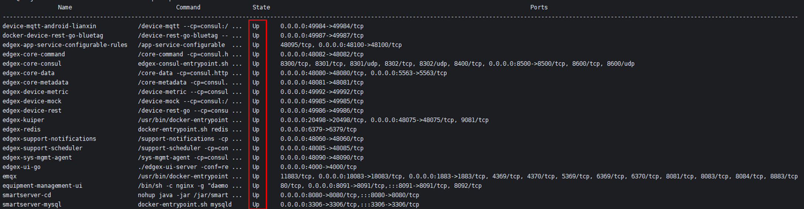 <br>

 - 如果存在状态为 exit 的容器，执行 docker start 命令尝试启动。<br>

   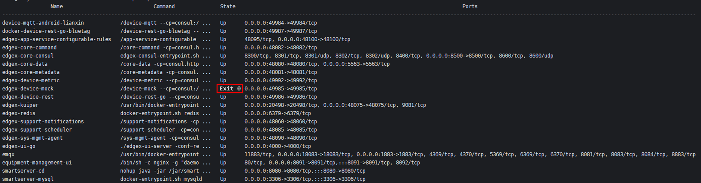 <br>
 - 打开浏览器，访问http://{EdgeX Foundry 服务器 IP 地址}:4000，如能正常访问则表示服务启动成功。<br>
   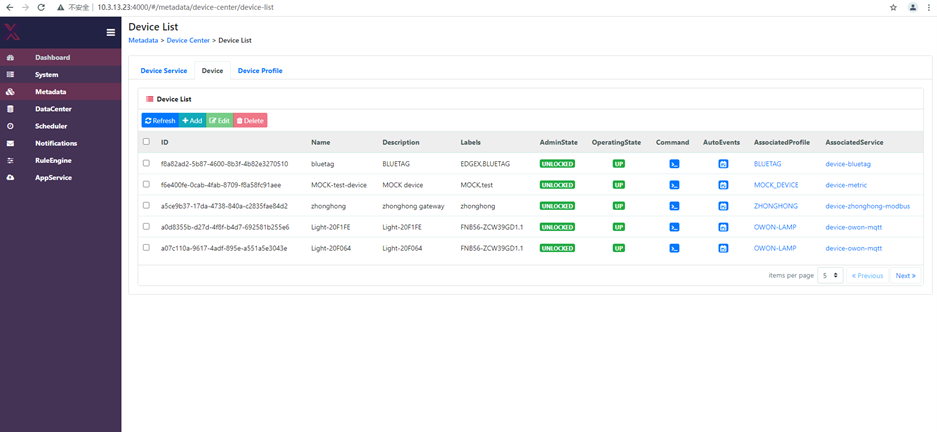 <br>

   若仍然无法启动，执行 docker logs 命令查看日志，并将日志发送给慧博云通技术支持进行分析定位。<br>

## 5. 安装agent到Windows和安卓设备上
1. 安装agent到Windows设备上<br>
   (1) 通过链接 https://gitee.com/PubDocumentation/iot-documents/tree/Chengyan_2.0/%E9%85%8D%E7%BD%AE%E6%96%87%E4%BB%B6/%E5%AE%89%E8%A3%85agent%E5%88%B0Windows%E8%AE%BE%E5%A4%87%E4%B8%8A%E6%89%80%E9%9C%80%E6%96%87%E4%BB%B6 下载如下内容：<br>
    | 文件名                   | 说明                |
    | ------------------------ | ------------------- |
    | system-monintor          | 文件夹              |
    | system-monitor.bat       | windows执行文件     |
    | system-monitor-edgex.xml | windows任务计划程序 |

   (2) 在Windows设备上安装JDK，版本至少为1.8<br>
   (3) 在有Maven的环境中运行以下命令编译jar包：<br>
      `mvn clean install -DskipTests` <br>
编译完成后可在target文件夹下看到名为system-monitor-0.0.1-SNAPSHOT.jar的jar包。<br>
   (4)将编译好的jar包放入D:\system-monitor文件夹中。<br>
  Note: 

    > 如果需要修改system-monitor文件夹的名称和路径，请在system-monitor.bat文件中修改相应的配置：<br>
    >  <br>

   (5) 在Windows开始菜单中搜索“任务计划程序”，点击右侧“导入任务”，选择system-monitor-edgex.xml文件，选择正确账户，配置选项选择与当前Windows系统版本对应的选项，点击确定。<br>
     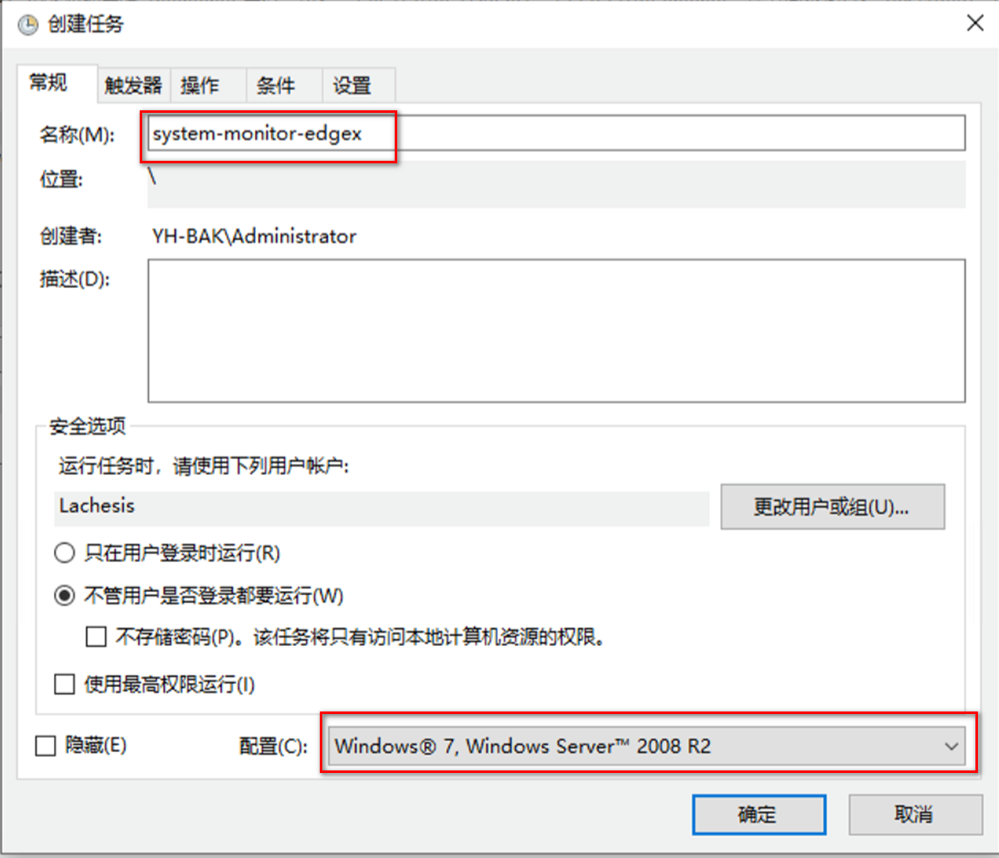 <br>

     新导入的任务会出现在列表中。<br>
   (6) 选择刚刚导入的新任务，点击右侧栏中的“运行”。查看system-monitor文件夹中是否有System-monitor-Log.log的日志文件，打开确认无错误即为成功。<br>

      <br>

   (7) 获取当前Windows设备的IP地址并记录。<br>

2. 安装agent到安卓设备上<br>
   (1) 通过链接https://gitee.com/PubDocumentation/iot-documents/tree/Chengyan/%E9%85%8D%E7%BD%AE%E6%96%87%E4%BB%B6/%E5%AE%89%E8%A3%85agent%E5%88%B0%E5%AE%89%E5%8D%93%E8%AE%BE%E5%A4%87%E4%B8%8A%E6%89%80%E9%9C%80%E6%96%87%E4%BB%B6 下载如下内容：<br>
      
    | 文件名                 | 说明                                                         |
    | ---------------------- | ------------------------------------------------------------ |
    | SmartDevice文件夹      | 安卓软件SmartDevice的源码文件，可使用Android Studio进行二次开发 |
    | SmartDevice_v2.0.0.apk | 用来监控安卓设备信息的软件                                   |

   (2) 在安卓设备上安装SmartDevice_v2.0.0.apk，并打开，填写连接Edgex Foundary的MQTT broker服务器配置信息：<br>

      <br>   

     其中：<br>
      - 设备Android ID：用来在Edgex端配置MQTT的topic，比如：订阅topic：reply/{androidId}/android/#；发布topic：api/{androidId}/android/deviceInfo_get<br>
      - MQTT URL: MQTT broker的IP地址和端口号<br>
      - MQTT 用户名：MQTT broker的用户名<br>
      - MQTT密码：MQTT broker的密码<br>
 

## 6. 安装device service到电池端     
1. 将Modbus协议的电池端与医疗推车上的多模态电脑的串口连接。<br>
2. 如果医疗推车的多模态电脑的操作系统是Windows系统，则需在应用商店安装Ubuntu子系统（操作步骤参见https://blog.csdn.net/daybreak222/article/details/87968078）；如果电脑操作系统是Linux系统则忽略此步骤。<br>     
3. 通过链接下载以下文件和文件夹并将其放在同一路径下：

    | 文件名          | 说明           | 下载地址                                                     |
    | --------------- | -------------- | ------------------------------------------------------------ |
    | device-electric-modbus | 电池的执行程序 | https://gitee.com/PubDocumentation/iot-documents/blob/Chengyan_2.0/%E9%85%8D%E7%BD%AE%E6%96%87%E4%BB%B6/%E5%AE%89%E8%A3%85device%20service%E5%88%B0%E7%94%B5%E6%B1%A0%E7%AB%AF%E6%89%80%E9%9C%80%E6%96%87%E4%BB%B6/device-electric-modbus.zip |
    | res             | 文件夹         | https://gitee.com/PubDocumentation/iot-documents/blob/Chengyan_2.0/%E9%85%8D%E7%BD%AE%E6%96%87%E4%BB%B6/%E5%AE%89%E8%A3%85device%20service%E5%88%B0%E7%94%B5%E6%B1%A0%E7%AB%AF%E6%89%80%E9%9C%80%E6%96%87%E4%BB%B6/res.zip |

4. 部署device-electric-modbus配置文件，运行命令：<br>
     `EDGEX_SECURITY_SECRET_STORE=false ./device-electric-modbus`

     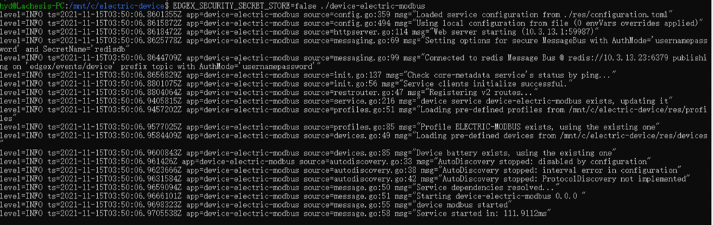 <br>   

## 7. 添加蓝牙定位系统 
1. 使用SQL工具或命令找到蓝牙定位服务器的用户名和密码： <br> 
    - 使用root用户登录蓝牙定位服务器，连接MySQL数据库 <br>
      `mysql -uroot -p`
     默认的数据库用户名为admin。<br>
    - 选择数据库： <br>
      `use blueiot;`
    - 查看admin用户的密码： <br>
      `select * from localsense_user;` <br> 
    - 记录LOGINPASSWORD字段下的密码，密码格式类似06e5b433d683ffb101e4b88438b6bcd6。<br> 
2. 访问http://{EdgeX Foundry 服务器 IP 地址}:4000。在 MetaData -> DeviceService 区域，点击 device-bluetag 容器对应的蓝色 Associated Devices 按钮。<br> 

     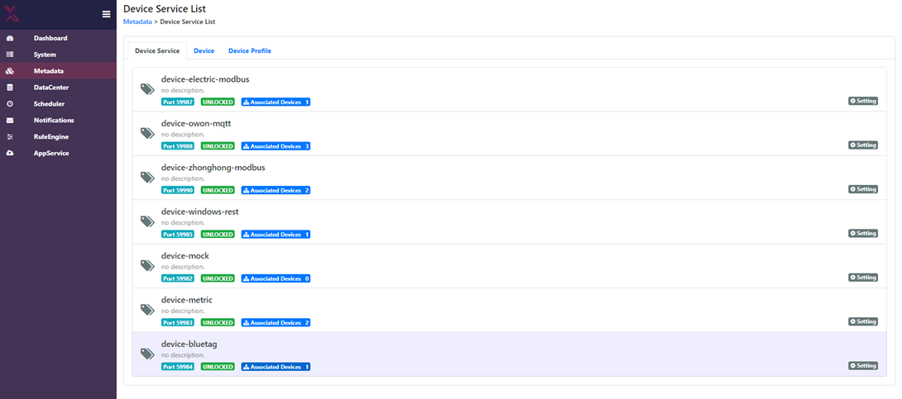 <br>  

3. 在Device页签下，点击设备添加按钮“＋Add”。<br> 

     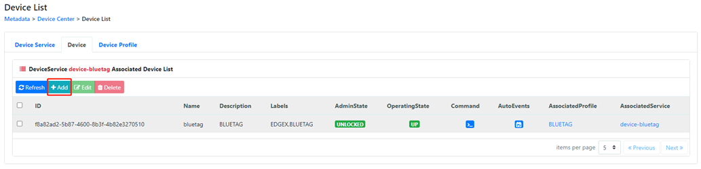 <br> 

4. 选择DeviceService，这里选择device-bluetag，点击“next”，进行下一步。<br>

     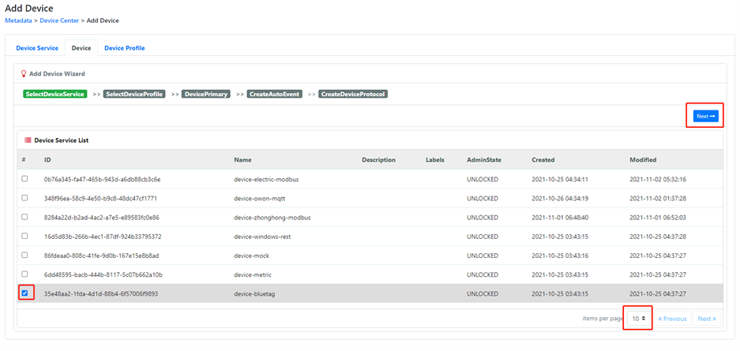 <br> 

5. 选择DeviceProfile，这里选择BLUETAG，点击“next”，进行下一步。<br>

     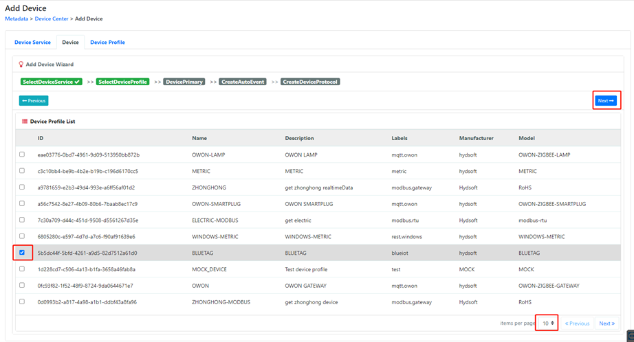 <br> 

6. 在接下来的DevicePrimary界面中，填写设备信息。<br>

     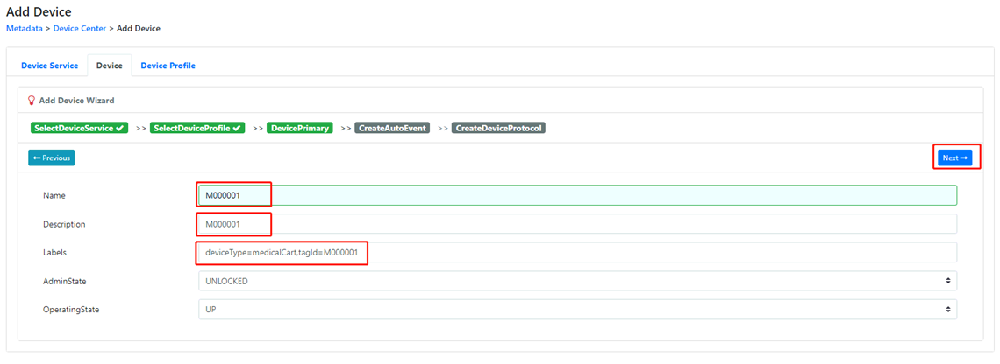 <br> 

   其中： <br> 

   - Name 和 Description 字段为自定义的设备名称和描述
   - Address：蓝牙定位服务器的IP地址
   - Labels字段为固定格式，须填写deviceType=medicalCart,tagId=M000001。其中deviceType代表设备的类型，指定为medicalCart，表示医疗推车，tagId是要绑定蓝牙标签的编号。
   填写完成设备信息后，点击“next”，进行下一步。<br>

7. 接下来的CreateAutoEvent界面为配置自动event，点击“Skip”暂时跳过，后续可按需配置。

     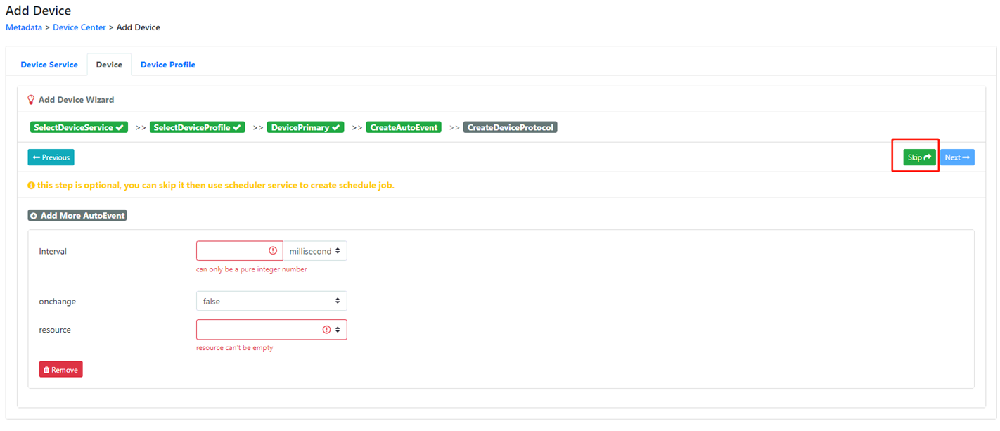 <br> 

8. 在接下来的CreateDeviceProtocol界面中，选择“Custom Protocol Teamplates”自定义协议模板, 填写协议名称HTTP，点击Add Protocol Property为协议增加如下图字段:<br>

      <br> 

其中： <br> 

    - Address: 	蓝牙定位服务器的IP地址。
    - Port:		蓝牙定位服务器的端口号。
    - UserName:	蓝牙定位服务器的用户名。
    - Password:	蓝牙定位服务器的密码。
    - TagID:		蓝牙标签的tagID。


9. 点击"Submit"提交配置信息<br>

## 8. 添加Windows设备
1. 访问http://{EdgeX Foundry 服务器 IP 地址}:4000。在 MetaData -> DeviceService 区域，点击 device-windows-rest 容器对应的蓝色 Associated Devices 按钮。<br> 。

     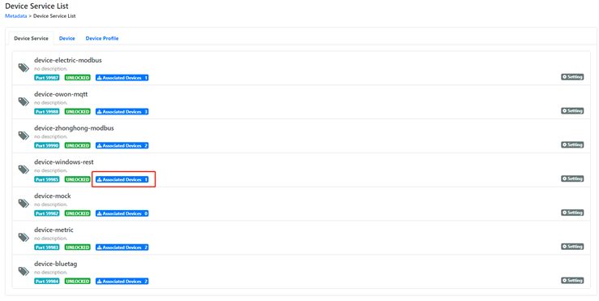 <br>  

2. 在Device页签下，点击设备添加按钮“＋Add”。<br> 

     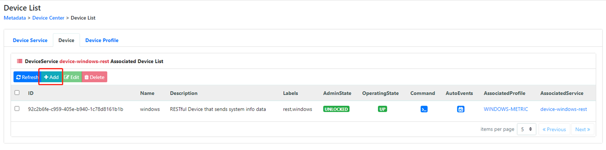 <br> 

3. 选择DeviceService，这里选择device-windows-rest，点击“next”，进行下一步。<br>

     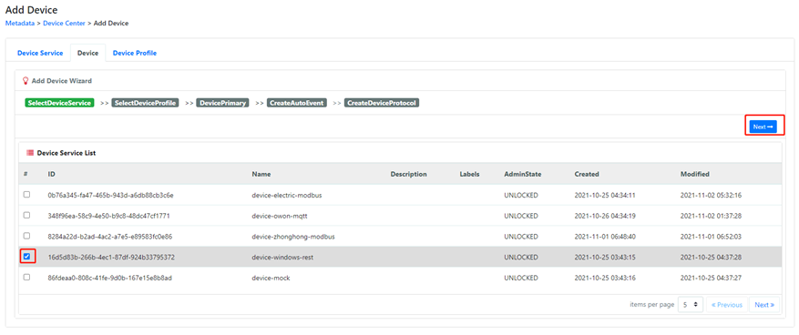 <br> 

4. 选择DeviceProfile，这里选择WINDOWS-METRIC，点击“next”，进行下一步。<br>

     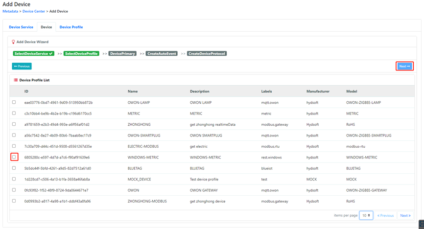 <br> 

5. 在接下来的DevicePrimary界面中，填写设备信息。<br>

     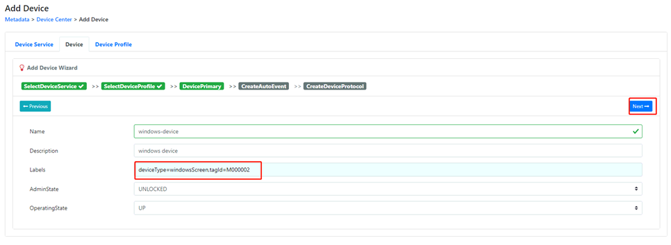 <br> 

   其中： <br> 

   - Name 和 Description 字段为自定义的设备名称和描述
   - Labels字段为固定格式，须填写deviceType=windowsScreen,tagId=M000002。其中deviceType代表设备的类型，指定为windowsScreen，表示Windows设备，tagId是要绑定医疗推车的编号。
   填写完成设备信息后，点击“next”，进行下一步。<br>

6. 接下来的CreateAutoEvent界面为配置自动event，点击“Skip”暂时跳过，后续可按需配置。

      <br> 

7. 在接下来的CreateDeviceProtocol界面中，选择“Custom Protocol Teamplates”自定义协议模板, 填写协议名称HTTP，点击Add Protocol Property为协议增加如下图字段:<br>

      <br> 

其中： <br> 

    - Address: 	Windows设备的IP地址。
    - Port:		Windows设备的端口号。


9. 点击"Submit"提交配置信息<br>

## 9. 添加安卓设备
1. 访问http://{EdgeX Foundry 服务器 IP 地址}:8500/ui/dc1/kv/edgex/devices/2.0/device-android-mqtt/MQTTBrokerInfo/ResponseTopic/edit
2. 在ResponseTopic区域，填写：reply/{androidId}/android/#<br>
   其中，androidId在前述步骤中取得。<br>
     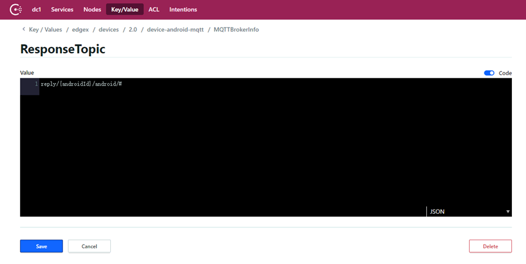 <br> 
3.  访问http://{EdgeX Foundry 服务器 IP 地址}:4000。在 MetaData -> DeviceService 区域，点击device-android-mqtt容器对应的蓝色 Associated Devices 按钮 。<br> 
     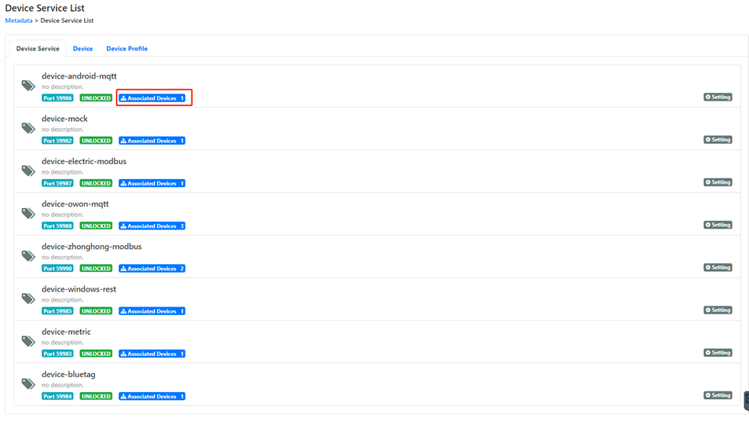 <br> 

4. 在Device页签下，点击设备添加按钮“＋Add”。<br> 

     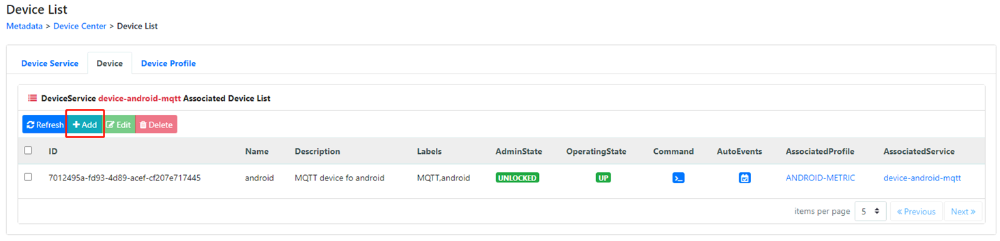 <br> 

5. 选择DeviceService，这里选择device-android-mqtt，点击“next”，进行下一步。<br>

     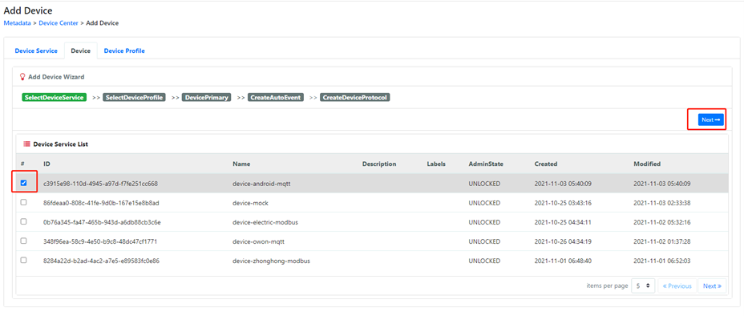 <br> 

6. 选择DeviceProfile，这里选择ANDRIOD-METRIC，点击“next”，进行下一步。<br>

     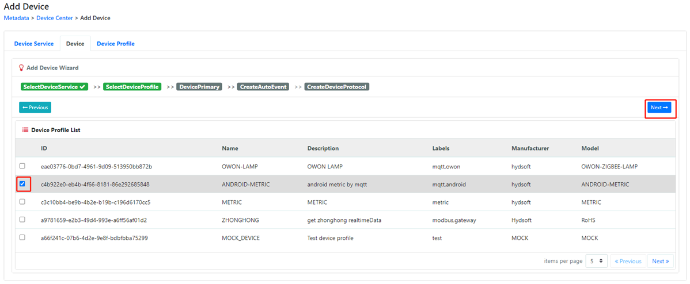 <br> 

7. 在接下来的DevicePrimary界面中，填写设备信息。<br>

     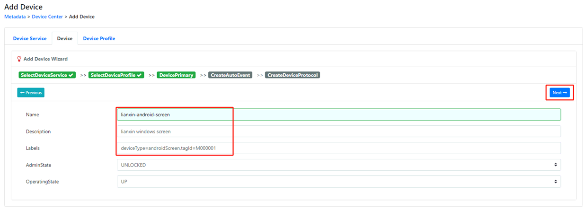 <br> 

   其中： <br> 

   - Name 和 Description 字段为自定义的设备名称和描述
   - Labels字段为固定格式，须填写deviceType=androidScreen,tagId=M000001。其中deviceType代表设备的类型，指定为androidScreen，表示安卓设备，tagId是要绑定蓝牙标签的编号。
   填写完成设备信息后，点击“next”，进行下一步。<br>

8. 接下来的CreateAutoEvent界面为配置自动event，点击“Skip”暂时跳过，后续可按需配置。

      <br> 

9. 在接下来的CreateDeviceProtocol界面中，选择“Custom Protocol Teamplates”自定义协议模板, 填写协议名称为mqtt，点击Add Protocol Property为协议增加如下图字段:<br>

      <br> 

   其中： <br> 

    - Host：主机地址或域名。
    - Port：主机端口。
    - Schema：协议类型。
    - ClientId：客户端ID。
    - CommandTopic：订阅的主题。

10. 重启服务 <br> 
   `docker-compose restart device-android-mqtt`

## 10. 添加电池设备
1.  访问http://{EdgeX Foundry 服务器 IP 地址}:4000。在 MetaData -> DeviceService 区域，点击device-electric-modbus容器对应的蓝色 Associated Devices 按钮 。<br> 
     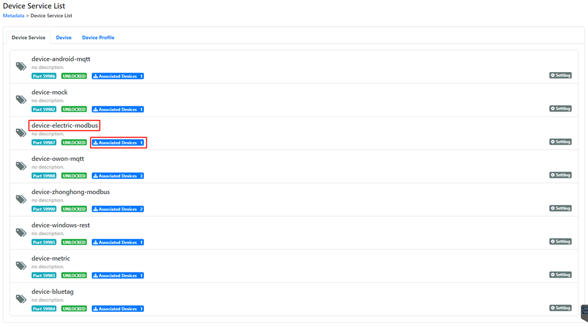 <br> 

2. 在Device页签下，勾选现有电池设备，点击设备编辑按钮“Edit”。<br> 

     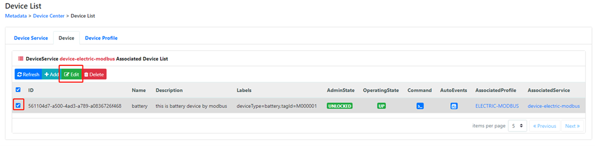 <br> 

3. 在接下来的Edit Device界面中，设备信息。<br>

      <br> 

   其中： <br> 

    在Device Primary区域: <br> 

   >- DeviceName 和 Description 字段为自定义的设备名称和描述。
   >- Labels字段为固定格式，须填写deviceType=battery,tagId=M000001

    在Device Protocol区域:  <br> 

   >- Protocol Name选择modbus-rtu。
   >- Address: 电池设备的串口dev地址。
修改完成设备信息后，点击“Save”，保存配置。<br>

## 11. 访问成研医疗设备管理平台
打开浏览器访问http://{EdgeX Foundry 服务器 IP 地址}/#/index <br>
如能正常访问则部署完成，如访问失败请联系慧博云通技术人员解决。<br>
            <br> 
          
 

注意：<br>
定位管理栏目下的所有页面目前仅支持火狐浏览器访问。       
 


  


