<h1>EdgeX Foundry软件部署</h1>

[1. 硬件设备](#1-硬件设备)<br>
[2. 前提条件](#2-前提条件)<br>
[3. 部署 EdgeX Foundry](#3-部署-edgex-foundry)<br>
[4. 安装agent到windows和安卓设备上](#4-安装agent到windows和安卓设备上)<br>
[5. 安装device service到电池端](#5-安装device-service到电池端)<br>
[6. 添加蓝牙定位系统](#6-添加蓝牙定位系统)<br>
[7. 添加Windows设备](#7-添加windows设备)<br>
[8. 添加安卓设备](#8-添加安卓设备)<br>
[9. 添加电池设备](#9-添加电池设备)<br>
[10. 访问成研医疗设备管理平台UI](#10-访问成研医疗设备管理平台ui)<br>
[11. 离线部署](#11-离线部署)
<br>

在IoT项目的架构中，EdgeX Foundry 为边缘端智能设备提供了一种安全、高效的接入方式。本文档介绍了 EdgeX Foundry 软件的部署过程，包括所使用的硬件设备、部署前准备、具体操作步骤以及部署后的配置。

## 1. 硬件设备
1. EdgeX Foundry 服务器及UI部分：<br>
推荐16G Intel (R) Core (TM) i7-7700HQ CPU @ 2.80GHz <br> OS：Ubuntu 16.04<br>
2. Blueiot定位系统部分<br>
配置根据蓝牙标签负载数量和刷新率有关，如下表:<br>

    | 标签个数*刷新率 | <300  | 300-1000   | 1000-2000     | 2000-3500  | 3500-5000   |
    | -------------- | ----- | -----------| ------------ | ---------- | -------------|
    | CPU             | 主频2.8G及以上，4核4线程 | 主频2.8G及以上，4核8线程<br/>或主频3.6G以上4核4线程<br/>或主频2.6G以上6核12线程 | 主频3G及以上，6核12线程<br/>或CPU3.6G以上4核8线程 | 主频3.2G及以上，8核16线程<br/>或者主频3.5G及以上6核12线程 | 主频3G及以上，12核24线程 |
    | 内存            | ≥8G                      | ≥8G                                                          | ≥16G                                              | ≥16G                                                      | ≥32G                     |
    | 磁盘            | ≥256G                    | ≥256G                                                        | ≥512G                                             | ≥1T                                                       | ≥1T                      |
    | 网卡            | ≥100M                    | ≥100M                                                        | ≥100M                                             | ≥1000M                                                    | ≥1000M                   |
## 2. 前提条件
开始部署前，请确认满足以下条件：<br>
- 已按照如下示意图安装好相关的硬件设备：<br>

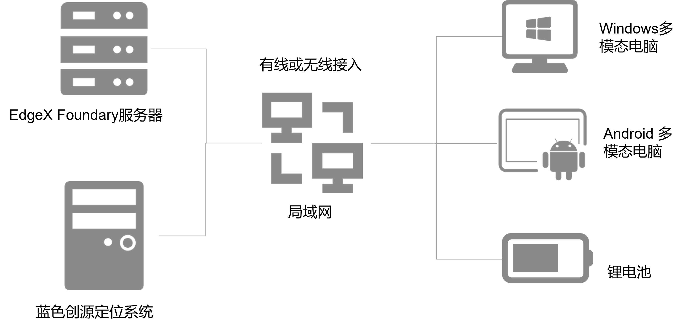<br>
- 已在 EdgeX Foundry 服务器上安装下表中的软件：<br>

    | 软件           | 版本         |
    | ------------------ | ---------------- |
    | docker         | 18.09.7 或以上   |
    | docker-compose | 1.29.1或以上   |
    | OS             | Ubuntu 16.04 |
- 已获取以下配置文件：

    | 文件名                 | 说明            | 下载地址                                                     |
    | ---------------------- | --------------- | ------------------------------------------------------------ |
    | docker-compose-cyy.yml | Docker 配置文件 | https://hydsoftiot.coding.net/p/equipment-management/d/equipment-management/git/tree/master/docker-compose-file/docker-compose-cyy.yml |
    | nginx.default.conf     | nginx配置文件   | https://hydsoftiot.coding.net/p/equipment-management/d/equipment-management/git/tree/master/ui/nginx.default.conf |


下载Docker 配置文件后，找到以下部分并将其修改为EdgeX Foundry 服务器 IP 地址：
```html
  smartserver:
    image: hydsoftiot/smartserver-cd:latest
    container_name: smartserver-cd
    hostname: smartserver
    networks:
      - smartserver-net
    environment:
      CREATE_CONFIG_CLASS: HTTP_CLASS
      EDGEX_URL_IP: {EdgeX Foundry 服务器 IP 地址}
      EDGEX_URL_PORT: 48082
      #MQTT_TCP_URL: tcp://192.168.1.5:1883
    depends_on:
      - db
      #- emqx
    ports:
      - "8080:8080"
restart: always
```
下载nginx配置文件后，找到以下部分并将其修改为EdgeX Foundry 服务器 IP 地址：<br>
```html
# 前端代理
    location ^~ /smartserver {
        proxy_pass http://{EdgeX Foundry 服务器 IP 地址}:8080/smartserver/;
        add_header Access-Control-Allow-Origin *;
        add_header Access-Control-Allow-Credentials: true;
        add_header Access-Control-Allow-Methods GET,POST,OPTIONS,PUT,DELETE;

        proxy_http_version 1.1;
        # 连接延时
        proxy_connect_timeout 3600s;
        proxy_read_timeout 3600s;
        proxy_send_timeout 3600s;
        # IP 穿透
        proxy_set_header        Host $proxy_host;
        proxy_set_header        X-Real-IP $remote_addr;
        proxy_set_header        X-Forwarded-For $proxy_add_x_forwarded_for;
        # WebSocket 穿透
        proxy_set_header Origin "";
        proxy_set_header Upgrade $http_upgrade;
        proxy_set_header Connection "upgrade";
    }
```
修改后，将文件放到/var/nginx/目录下即可。如没有目录请自行创建。<br>

## 3. 部署 EdgeX Foundry
1. 使用 root 用户登录 EdgeX Foundry 服务器。
2. 进入 /root 目录：<br>
   `cd /root`<br>
3. 使用 WinSCP 将 docker-compose-cyy.yml 文件放入 root 目录。<br>
4. 启动 EdgeX Foundry 进程：<br>
   `$ docker-compose -f docker-compose-cyy.yml up -d`<br>
5. 查看 EdgeX Foundry 服务是否启动成功：<br>
   `$ docker-compose -f docker-compose-cyy.yml ps`<br>
 - 如果命令回显中所有容器的状态均为 up，则 EdgeX Foundry 服务启动成功。<br>

    <br>

 - 如果存在状态为 exit 的容器，执行 docker start 命令尝试启动。<br>

    <br>
 - 打开浏览器，访问http://{EdgeX Foundry 服务器 IP 地址}:4000，如能正常访问则表示服务启动成功。<br>
   若仍然无法启动，执行 docker logs 命令查看日志，并将日志发送给慧博云通技术支持进行分析定位。<br>

## 4. 安装agent到Windows和安卓设备上
1. 安装agent到Windows设备上<br>
   (1) 通过链接 https://hydsoftiot.coding.net/p/equipment-management/d/equipment-management/git/tree/master/device/device-windows-monitor 下载如下内容：<br>
    | 文件名                   | 说明                |
    | ------------------------ | ------------------- |
    | system-monintor          | 文件夹              |
    | system-monitor.bat       | windows执行文件     |
    | system-monitor-edgex.xml | windows任务计划程序 |

   (2) 在Windows设备上安装JDK，版本至少为1.8<br>
   (3) 将编译好的jar包放入D:\system-monitor文件夹中（文件夹名称和磁盘路径可以修改，如果修改需要将system-monitor.bat文件中相应的路径修改为正确路径）。如需编译jar包，可在任意有Maven的环境下运行命令：`mvn clean install -DskipTests`，可在target下看到名为system-monitor-0.0.1-SNAPSHOT.jar的jar包。<br>
   (4) 搜索“任务计划程序”，点击右侧“导入任务”，选择system-monitor-edgex.xml文件，选择正确账户，配置选项选择与当前Windows系统版本对应的选项，点击确定。<br>
      <br>

   (5) 然后我们可以看到任务列表中添加了新任务，选择该新任务，点击右侧栏中的“运行”。然后到system-monitor文件夹中查看是否有System-monitor-Log.log的日志文件，打开确认无错误即为成功。<br>

      <br>

   (6) 获取当前Windows设备的IP地址并记录。<br>

2. 安装agent到安卓设备上<br>
   (1) 通过链接 https://hydsoftiot.coding.net/p/equipment-management/d/equipment-management/git/tree/master/device/device-android-monitor 下载如下内容：<br>
      
    | 文件名                 | 说明                                                         |
    | ---------------------- | ------------------------------------------------------------ |
    | SmartDevice文件夹      | 安卓软件SmartDevice的源码文件，可使用Android Studio进行二次开发 |
    | SmartDevice_v2.0.0.apk | 用来监控安卓设备信息的软件                                   |

   (2) 将SmartDevice_v2.0.0.apk安装到安卓设备上，打开，填写连接Edgex端的MQTT broker服务器配置信息：<br>

      <br>   

     其中：<br>
      - MQTT URL: Edgex端MQTT服务器IP和端口（比如：192.168.31.115:1883）<br>
      - MQTT 用户名：Edgex端MQTT服务器用户名（比如：admin）<br>
      - MQTT密码：Edgex端MQTT服务器密码（比如：public）<br>
      - 设备Android ID：用来在Edgex端配置MQTT的topic，比如：订阅topic：reply/{androidId}/android/#；发布topic：api/{androidId}/android/deviceInfo_get<br>

## 5. 安装device service到电池端     
1. 将Modbus协议的电池端与医疗推车上的电脑串口连接。<br>
2. 如果医疗推车的电脑是Windows系统，则需安装Ubuntu子系统；如果是Linux系统则忽略此步骤。<br>     
3. 通过链接下载以下文件和文件夹并将其放在同一路径下：

    | 文件名          | 说明           | 下载地址                                                     |
    | --------------- | -------------- | ------------------------------------------------------------ |
    | device-electric | 电池的执行程序 | https://hydsoftiot.coding.net/p/equipment-management/d/equipment-management/git/tree/master/device/device-modbus-go-electric/cmd/device-electric |
    | res             | 文件夹         | https://hydsoftiot.coding.net/p/equipment-management/d/equipment-management/git/tree/master/device/device-modbus-go-electric/cmd/res |

4. 运行`$ ./device-electric`

     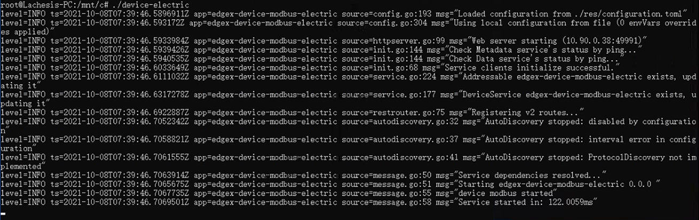 <br>   

## 6. 添加蓝牙定位系统 
1. 使用sql工具或命令找到蓝牙定位服务器的用户名和密码： <br> 
    - 进入蓝牙定位系统所在服务器，连接mysql数据库，输入密码 <br>
      `$ mysql -uroot -p`
    - 选择数据库 <br>
      `$ use blueiot;`
    - 查看当前admin用户的密码 （默认用户名为admin） <br>
      `$ select * from localsense_user;` <br> 
    - 记录LOGINPASSWORD字段下的密码，密码格式类似06e5b433d683ffb101e4b88438b6bcd6。<br> 
2. 访问http://{EdgeX Foundry 服务器 IP 地址}:4000。在 DeviceService 区域，点击 edgex-device-rest-go-bluetag容器对应的 Devices 列下面的图标。<br> 

     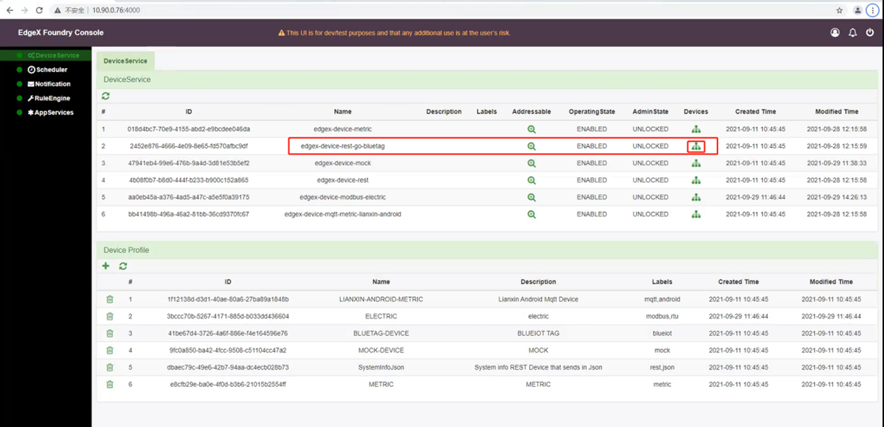 <br>  

3. 点击设备添加按钮“+”，按下图中提示填写蓝牙设备信息<br> 

     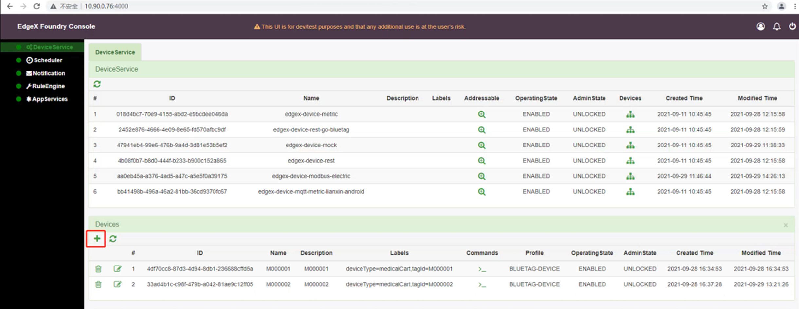 <br> 
     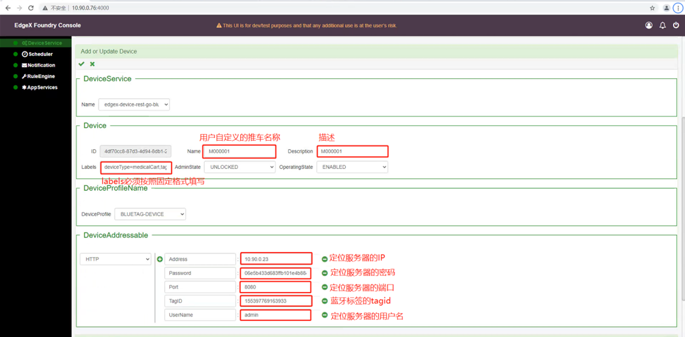 <br> 
   其中： <br> 
   - Labels字段填写deviceType=medicalCart,tagId=M000001（注意：labels必须按照固定格式填写。deviceType代表设备的类型，指定为medicalCart，表示医疗推车，tagId是要绑定蓝牙标签的编号）。
   - Name 和 Description 字段为自定义的设备名称和描述
   - Address：定位服务器IP
   - 在 DeviceProfileName 区域选择配置文件BLUETAG-DEVICE
   - Password：定位服务器的密码（即第1步中得到的密码）
   - Port：定位服务器的端口，填写8080
   - TagID：蓝牙标签的tagID
   - UserName：定位服务器的用户名（默认为admin）
4. 点击对勾保存设置<br>

## 7. 添加Windows设备
1. 同第6步，访问http://{EdgeX Foundry 服务器 IP 地址}:4000。在 DeviceService 区域，点击edgex-device-rest容器对应的 Devices 列下面的图标。<br> 
2. 如点击后已有设备信息，可以选择删除或者修改。 <br> 
3. 点击设备添加按钮“+”，填写Windows设备信息：<br>
     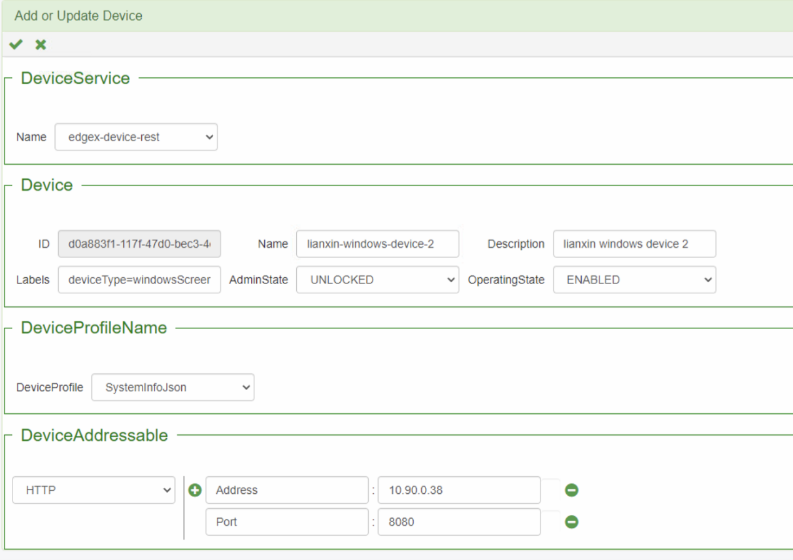 <br> 
     其中： <br>   
   - Name, Description 和Labels 字段为自定义的设备名称和描述
   - 在 DeviceProfileName 区域选择配置文件SystemInfo.json
   - 在DeviceAddressable区域选择HTTP协议
   - Address：填写先前第4步中获取的Windows设备的IP地址
   - Port：填写8080
4. 添加完成保存后可以看到如下界面，点击Commands图标，然后点击send，如返回结果正确则完成设置。<br> 
     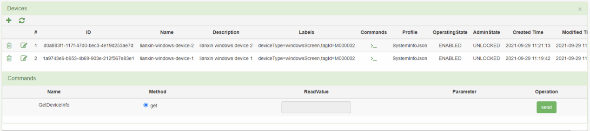 <br> 
     正确返回结果：<br>
     `{"device":"lianxin-windows-device-1","origin":1634262495915546400,"readings":[{"origin":1634262495364088800,"device":"lianxin-windows-device-1","name":"deviceInfo","value":"{\"meta\":{\"success\":true,\"message\":\"Success\"},\"data\":{\"deviceName\":\"H310MB PC:03000200-0400-0500-0006-000700080009\",\"deviceStatus\":\"online\",\"deviceBootedDate\":\"2021-10-13T09:33:16Z\",\"deviceUptime\":\"1 days, 16:15:04\",\"batteryRemainingCapacity\":1.0,\"batteryTemperature\":0.0,\"batteryStatus\":\"Discharging\",\"batteryUsageTime\":\"1 days, 16:15:04\",\"deviceUsageCount\":\"1\",\"deviceUsageRate\":\"0.63\",\"deviceFreeRate\":\"0.37\",\"deviceEnergyEfficiency\":\"0.0kwh\",\"currentRecordTime\":\"2021-10-15T01:48:17.429+00:00\"}}","valueType":"String"}],"EncodedEvent":null}`

## 8. 添加安卓设备
1. 访问http://{EdgeX Foundry 服务器 IP 地址}:8500/ui/dc1/kv/edgex/devices/1.0/edgex-device-mqtt-metric-lianxin-android/Driver/ResponseTopic/edit
2. 在打开的ResponseTopic区域，填写：reply/{androidId}/android/#<br>
   其中，androidId在4.2.(2)步骤中取得。<br>
     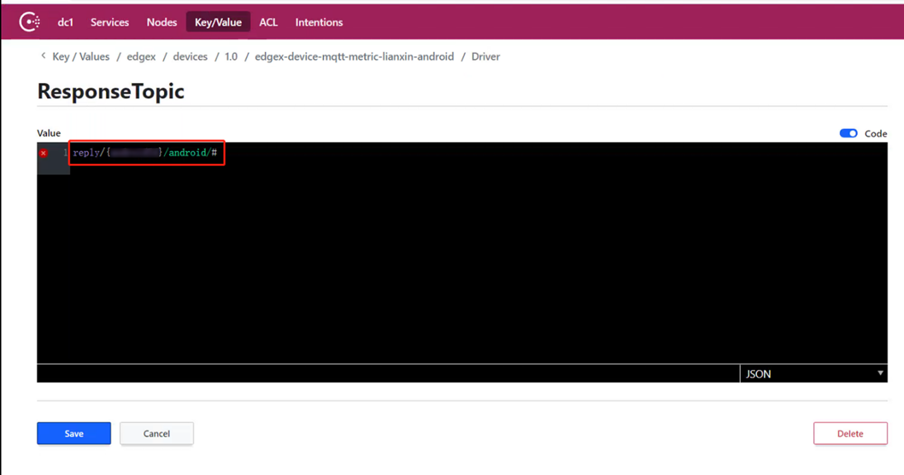 <br> 
3. 访问http://{EdgeX Foundry 服务器 IP 地址}:4000。在 DeviceService 区域，点击edgex-device-mqtt-metric-lianxin-android容器对应的 Devices 列下面的图标。<br> 
     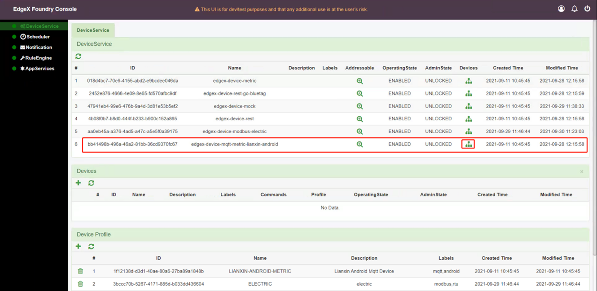 <br> 
4. 点击设备添加按钮“+”，填写安卓设备信息：<br>
     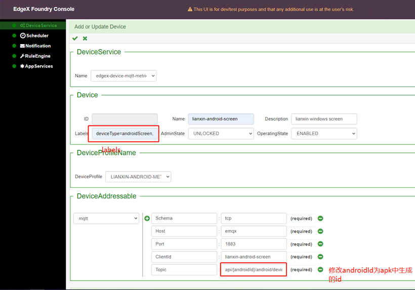 <br> 
     其中： <br>  
      - Labels字段填写deviceType=androidScreen,tagId=210854483264938（注意：labels必须按照固定格式填写。deviceType代表设备的类型，指定为androidScreen，表示安卓设备，tagId是要绑定蓝牙标签的编号）。
      - Name, Description 字段为自定义的设备名称和描述
      - 在 DeviceProfileName 区域选择配置文件LIANXIN-ANDROID-METRIC
      - 在 DeviceAddressable 区域选择MQTT协议
      - Topic：填写api/device/{deviceId}/{appclientId} （androidId在4.2.(2)步骤中取得）
      - 其他字段保存默认值即可
5. 点击对勾保存设置<br>
6. 使用 root 用户登录 EdgeX Foundry 服务器，并执行以下命令重启容器使配置生效： <br>
    `$ docker-compose restart device-mqtt-android-lianxin`  <br>

## 9. 添加电池设备
1. 访问http://{EdgeX Foundry 服务器 IP 地址}:4000。在 DeviceService 区域，点击edgex-device-modbus-electric容器对应的 Devices 列下面的图标。<br>
     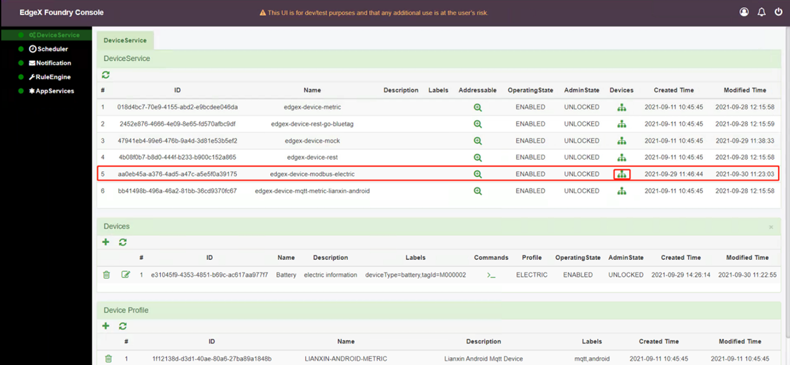 <br>   
2. 点击设备添加按钮“+”，填写电池设备信息：<br>
     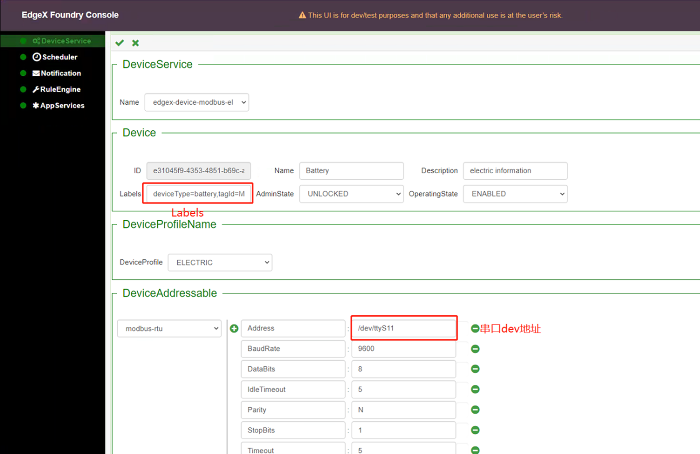 <br> 
     其中： <br>  
      - Labels字段填写deviceType=battery,tagId=210854483264938（注意：labels必须按照固定格式填写。deviceType代表设备的类型，指定为battery，表示电池设备，tagId是要绑定蓝牙标签的编号）。
      - Name, Description 字段为自定义的设备名称和描述
      - 在 DeviceProfileName 区域选择配置文件ELECTRIC
      - 在 DeviceAddressable 区域选择modbus-rtu
      - Address：填写电池的串口dev地址
      - 其他字段保存默认值即可<br>

    查找电池的串口dev地址：<br>
     - 在系统目录下输入命令：`ls /dev/ttyS*`即可查到当前所连接的所有电池设备串口dev地址：<br>
           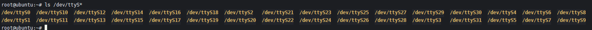 <br> 
           
3. 点击对勾保存设置<br>         

## 10. 访问成研医疗设备管理平台UI
打开浏览器访问http://{EdgeX Foundry 服务器 IP 地址}/#/index，如能正常访问则部署完成，如访问失败请联系慧博云通技术人员解决。<br>
           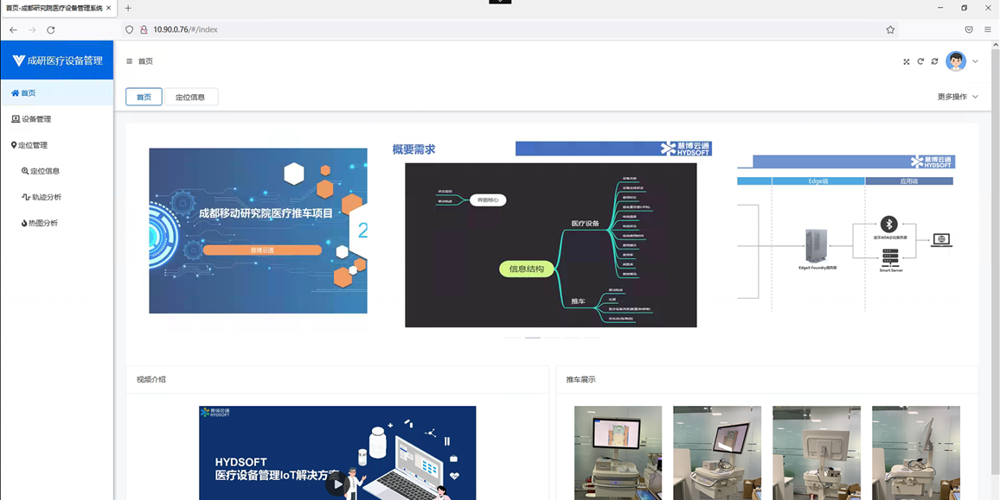 <br> 
          
## 11. 离线部署
除在线部署外，您也可以进行离线部署。<br> 
1. 下载离线安装包 edgex_cyy.tar，下载地址：https://hydsoftiot.coding.net/p/equipment-management/d/equipment-management/git/tree/master/docker-image/edgex_cyy.tar  <br>
2. 将安装包放在/root/目录下，执行命令导入image <br>
  `$ docker load -i edgex_cyy.tar`<br>
           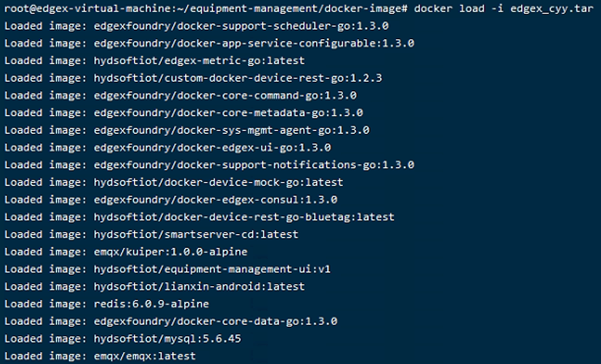 <br>   
3. 检查安装是否成功 <br>
  `$ docker images`<br>
           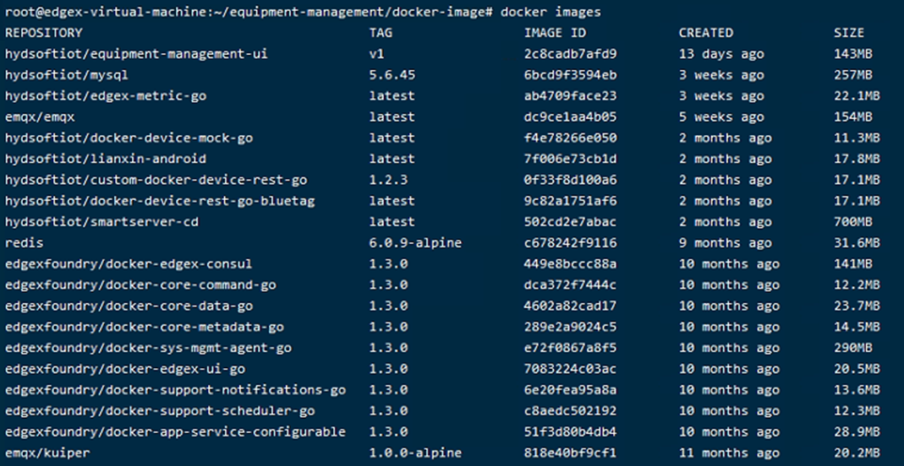 <br>       


如遇问题请联系慧博云通技术人员解决。       
 


  


