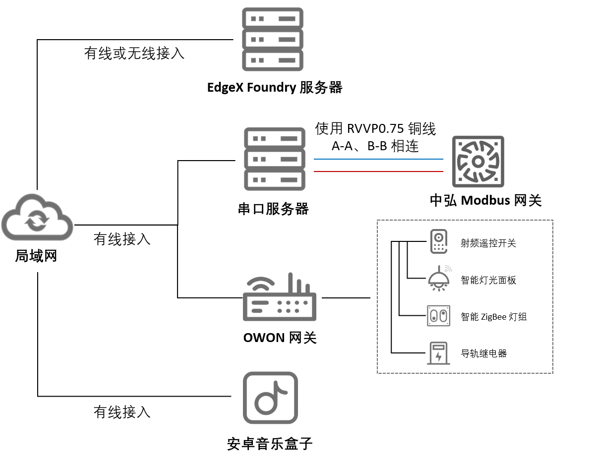
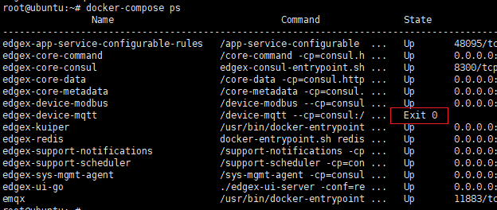
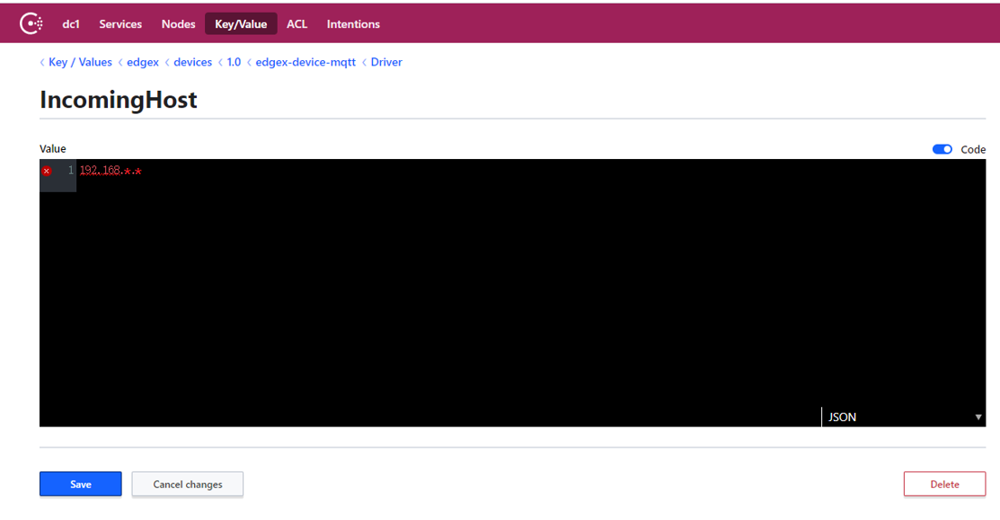
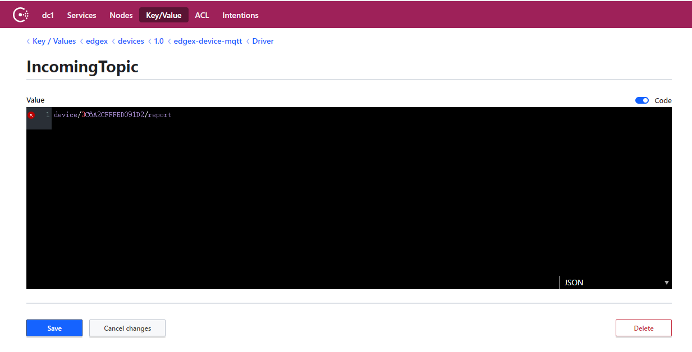
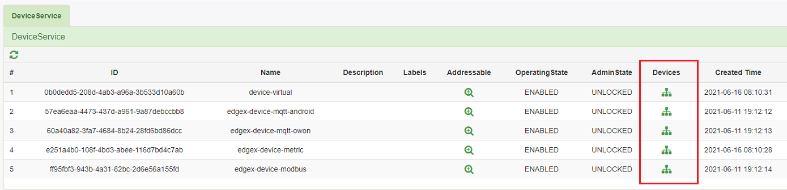
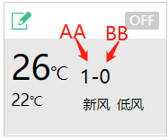
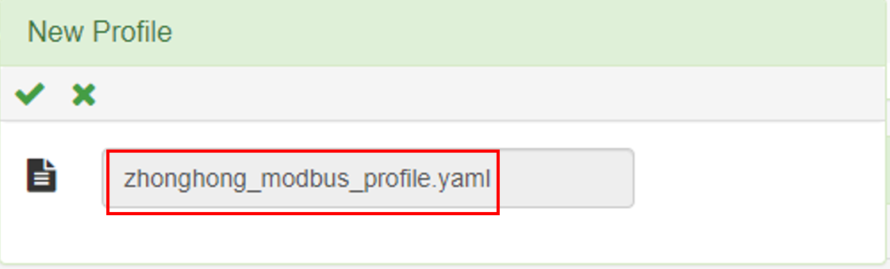
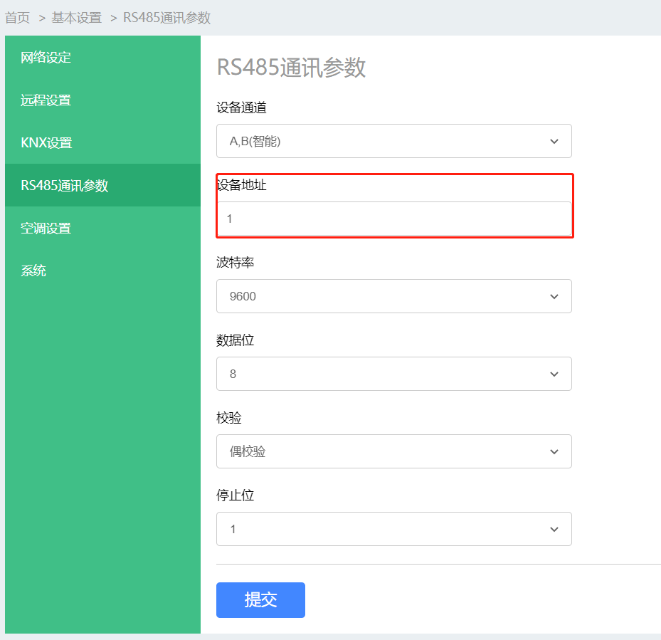
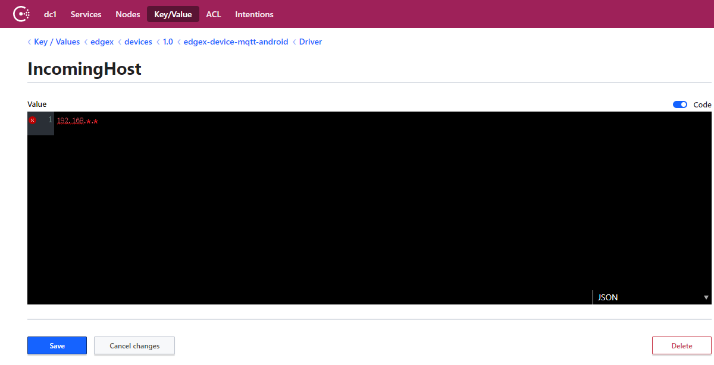
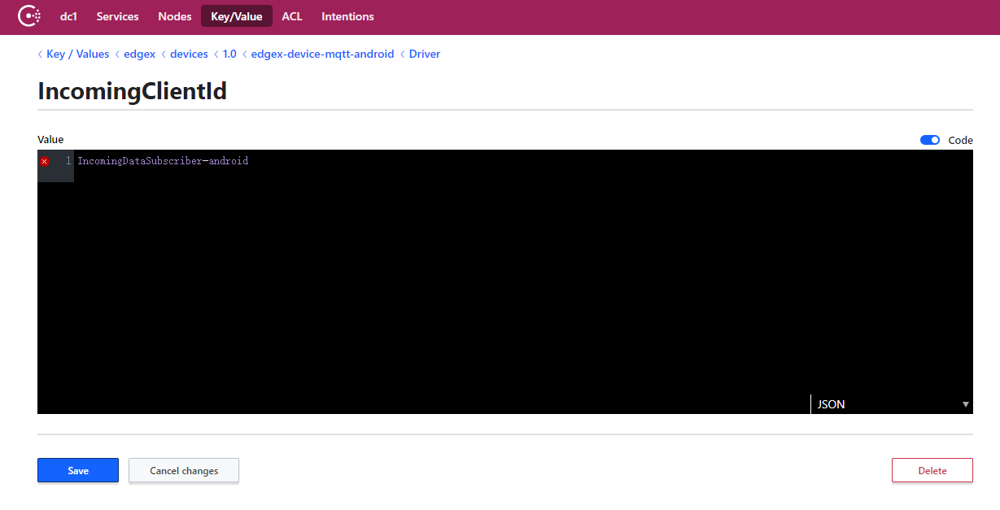

<h1>EdgeX Foundry软件部署</h1>

[1. 硬件设备](#1-硬件设备)<br>
[2. 前提条件](#2-前提条件)<br>
[3. 部署 EdgeX Foundry](#3-部署-edgex-foundry)<br>
[4. 配置串口服务器](#4-配置串口服务器)<br>
[5. 适配 OWON 网关](#5-适配owon网关)<br>
[6. 适配中弘 Modbus 网关](#6-适配中弘-modbus-网关)<br>
[7. 适配安卓音乐盒子](#7-适配安卓音乐盒子)<br>
[8. 故障诊断](#8-故障诊断)
<br>

在IoT项目的架构中，EdgeX Foundry 为边缘端智能设备提供了一种安全、高效的接入方式。本文档介绍了 EdgeX Foundry 软件的部署过程，包括所使用的硬件设备、部署前准备、具体操作步骤以及部署后的配置。

## 1. 硬件设备
| 设备 | 规格/型号 |
| --- | --- |
| EdgeX Foundry 服务器<br>（Intel 边缘设备） | 8G Intel (R) Core (TM) i7-7700HQ CPU @ 2.80GHz <br> OS：Ubuntu 16.04 |
| 中弘 Modbus 网关 | B17X2RT |
| RS485 串口服务器 | ZX-S508D (支持 Modbus TCP) |
| OWON 网关 | SEG-X1 |
| 智能 ZigBee 灯组 | FNB56-ZCW39GD1.1 |
| 射频遥控开关 | SLC600_R3 |
| 智能灯光面板 | SLC600-L3 |
| 导轨继电器 | CB432 | 
| 安卓音乐盒子 | audio_2021309_Rk3288 |

## 2. 前提条件
开始部署前，请确认满足以下条件：
- 已按照如下示意图安装好相关的硬件设备：<br>
  
  <br>
- 已在 EdgeX Foundry 服务器上安装下表中的软件：
    | 软件包名称 | 版本要求 |
    | --- | --- |
    | docker | 18.09.7 或以上 |
    | docker-compose | 1.29.1 或以上 |

- 已获取以下配置文件：<br>
   | 文件名 | 说明 |
   | --- | --- |
   | docker-compose.yml | Docker 配置文件 |
   | edgex_metric_profile.yaml | EdgeX Foundry 主机信息配置文件 |
   | owon_lamp_profile.yaml | 智能 ZigBee 灯组配置文件 |
   | owon_smartplug_1_profile | 导轨继电器配置文件 |
   | owon_smartplug_1_profile | 智能灯光面板配置文件 |
   | zhonghong_modbus_profile.yaml | 中弘 Modbus 网关配置文件|
   | suntop_android_mqtt_profile.yaml | 安卓音乐盒子配置文件 |
遇到问题请联系慧博云通技术支持。
## 3. 部署 EdgeX Foundry
1. 使用 root 用户登录 EdgeX Foundry 服务器。
2. 进入 /root 目录：<br>
   `cd /root`<br>
3. 使用 WinSCP 将 docker-compose.yml 文件放入 root 目录。<br>
4. 启动 EdgeX Foundry 进程：<br>
   `docker-compose up -d`<br>
5. 查看 EdgeX Foundry 服务是否启动成功：<br>
   `docker-compose ps`<br>
 - 如果命令回显中所有容器的状态均为 up，则 EdgeX Foundry 服务启动成功。<br>

    <br>

 - 如果存在状态为 exit 的容器，执行 docker start 命令尝试启动。<br>

    <br>

若仍然无法启动，执行 docker logs 命令查看日志，并将日志发送给慧博云通技术支持进行分析定位。

## 4. 配置串口服务器
1. 使用浏览器访问 http://{串口服务器 IP 地址}/cgi-bin/luci。
2. 输入用户名密码登录串口服务器 web 管理界面。

3. 根据下图，配置服务器端口信息，本示例中配置 PORT 8。<br>
   本地端口设置为 4008。<br>

   
## 5. 适配OWON网关
1. 使用浏览器进入 http://{EdgeX Foundry IP 地址}:8500/ui/dc1/kv/edgex/devices/1.0/edgex-device-mqtt/Driver。
2. 修改 IncomingHost 为 EdgeX Foundry 的 IP 地址。<br>
   
   <br>
3. 修改 ResponseHost 为 EdgeX Foundry 的 IP 地址。<br>
   
   <br>
4. 修改 IncomingTopic 为 device/+/report。<br>

   <br>
5. 修改 ResponseTopic 为 reply/device/+/+。<br>

   <br>
6. 添加 OWON 网关所连接的设备。<br>

   (1). 使用浏览器进入 http://{EdgeX Foundry IP 地址}:4000/ 并登录。<br>
   &emsp; 如果是首次登录，系统会要求您设置用于登录的用户名密码。本示例中用户名和密码均为 admin。<br>

   &emsp;  <br>

   (2). 点击 Device Profile 下面的 + 号，上传 OWON 网关所连接设备的配置文件，本操作以导轨继电器设备为例。<br>

      &emsp; <br>

   (3). 在 DeviceService 区域，点击 OWON 网关容器对应的 Devices 列下面的图标。<br>

      &emsp;<br>

   (4). 点击 Devices 下面的 + 号，添加 OWON 网关所连接的设备。<br>
        &emsp; Name 和 Description 字段为自定义的设备名称和描述。<br>
        &emsp; Labels 字段填写本次要添加设备的类型，取值如下：<br>
        &emsp; \- lamp：智能 ZigBee 灯组<br>
        &emsp; \- smartSwitch：智能灯光面板<br>
        &emsp; \- smartPlug：导轨继电器<br>
   (5). 在 DeviceProfileName 区域选择配置文件。详情请参考本文档<a href="#2-%E5%89%8D%E6%8F%90%E6%9D%A1%E4%BB%B6">前提条件</a>中的配置文件信息。

   (6). 在 DeviceAddressable 区域，点击加号图标添加字段，并填写要添加设备的信息。<br>
      &emsp; \- Clientid：clientid<br>
      &emsp; \- Host：EdgeX Foundry 服务器的 IP 地址<br>
      &emsp; \- ieee：要添加设备的 MAC 地址（请参考 <a href="https://gitee.com/PubDocumentation/iot-documents/blob/master/2.%20OWON%E6%99%BA%E8%83%BD%E7%BD%91%E5%85%B3%E9%85%8D%E7%BD%AE.md#23-%E8%8E%B7%E5%8F%96%E7%81%AF%E7%9A%84-mac-%E5%9C%B0%E5%9D%80" target="_blank">查询设备的 MAC 地址</a>）<br>
      &emsp; \- Schema：tcp<br>
      &emsp; \- Topic：api/device/{deviceId}/{appclientId}<br>
      &emsp; 其中 {deviceId} 是 OWON 网关的 MAC 地址，{appclientId} 是自定义的标识符。<br>
      &emsp; \- Port：MQTT 服务的端口号，此处为 1883<br>
      &emsp; 在下图的示例中，添加的设备为导轨继电器：<br>

      &emsp; <br>
      
7. 使用 root 用户登录 EdgeX Foundry 服务器，并执行以下命令重启容器使配置生效：<br>
   `docker restart edgex-device-mqtt-owon`

## 6. 适配中弘 Modbus 网关

1. 使用浏览器进入 http://{EdgeX Foundry IP 地址}:4000/。
<!-- 2. 编辑 zhonghong_modbus_profile.yaml 配置文件，将空调地址全部修改为当前环境的实际地址。<br>
   Get 命令的地址需要替换为空调状态寄存器的地址，Set 命令的地址需要替换为控制寄存器的地址。<br>
   例如，在 PowerGet_193，需要将 193 替换成实际的状态寄存器地址；在 TemperatureSet_4130 中，需要将 4130 替换成实际的控制寄存器地址。 
   - 状态寄存器计算方法：(AA × 32 + BB) × 6 + 1
   - 控制寄存器计算方法：(AA × 32 + BB) × 4 + 4001<br>
   其中 AA 和 BB 的值可从中弘空调的 web 管理界面获取，如下图所示。详情请参考中弘官方文档《室外机网关使用手册》。<br>

   <br> -->
2. 点击 Device Profile 下面的 + 号，上传中弘 Modbus 网关配置文件。<br>
   
   <br>
3. 点击 Devices 下面的 + 号，添加中弘 Modbus 网关设备的信息。<br>
   Name 和 Description 字段为自定义的设备名称和描述。<br>
   Labels 字段填写本次要添加设备的类型，此处设置为 air，表示空调设备。<br>

4. 在 DeviceProfileName 区域选择配置文件。详情请参考本文档<a href="#2-%E5%89%8D%E6%8F%90%E6%9D%A1%E4%BB%B6">前提条件</a>中的配置文件信息。
5. 在 DeviceAddressable 区域，点击加号图标添加字段，并填写要添加设备的信息。<br>

   <br>

   \- Address：串口服务器的 IP 地址<br>
   \- Timeout：读取数据超时时间（单位为秒），此处设置为 10<br>
   \- IdleTimeout：TCP 连接超时时间（单位为秒），此处设置为 10<br>
   \- Port：串口服务器的端口号，此处设置为 4008<br>
   此端口号需要与串口服务器中的配置保持一致，详情请参考 [4. 配置串口服务器](#4-配置串口服务器)中的步骤 3。<br>
   \- StartAddress：空调 Modbus 起始地址，该地址计算公式如下：(AA × 32 + BB) × 6<br>
   其中 AA 和 BB 的值可从中弘空调的 web 管理界面获取，如下图所示。详情请参考中弘官方文档《室外机网关使用手册》。<br>

   <br>

   \- UnitID：中弘 Modbus 网关管理页面中配置的设备地址，本示例中设置为 1<br>

   下图是中弘 Modbus 网关的管理页面，可从该页面获取设备地址，详情请参考中弘官方文档《室外机网关使用手册》。<br>

   <br>
## 7. 适配安卓音乐盒子
1. 将安卓音乐盒子连接到 EdgeX Foundry 服务器的 MQTT Broker 上。
2. 使用 root 用户登录 EdgeX Foundry 服务器。
3. 进入 /root 目录：<br>
    `cd /root`<br>

4. 启动安卓服务的容器：<br>
   `docker-compose up -d device-mqtt-android`<br>

5. 使用浏览器进入 http://{EdgeX Foundry IP 地址}:8500/ui/dc1/kv/edgex/devices/1.0/edgex-device-mqtt-android/Driver/。

6. 修改 IncomingHost 为 EdgeX Foundry 的 IP 地址。<br>
   
   
7. 修改 ResponseHost 为 EdgeX Foundry 的 IP 地址。<br>
   
   
8.  修改 IncomingTopic 和 ResponseTopic 为 api/android/+/+/+。<br>

9.  修改 IncomingClientId 为 IncomingDataSubscriber-android。<br>
    
    
10. 修改 ResponseClientId 为 CommandResponseSubscriber-android。
11. 上传安卓音乐盒子信息配置文件。<br>
    (1). 使用浏览器进入 http://{EdgeX Foundry IP 地址}:4000/。<br>
    (2). 点击 Device Profile 下面的 + 号，上传安卓音乐盒子的配置文件。<br>

       <br>
    (3). 点击 Devices 下面的 + 号，添加安卓音乐盒子信息。<br>
         Schema：tcp<br>
         Host：EdgeX Foundry 服务器的 IP 地址<br>
         Port：MQTT 服务的端口号，此处为 1883<br>
         Clientid：clientid<br>
         Topic：api/android/{type}/{brand_id}/{mac}<br>
         其中，brand_id 是品牌 ID，mac 是安卓音乐盒子的 MAC 地址，type 是设备类型<br>
         type 取值：<br>
         - VIDEO：广告屏<br>
         - SVIDEO：同步屏<br>
         - AI：互动屏<br>
         - AUDIO：音乐盒子<br>
12. 重启 edgex-device-mqtt-android 容器使配置生效：<br>
    `docker restart edgex-device-mqtt-android`

## 8. 故障诊断
**问题现象**<br>
在执行`docker-compose down`操作时，出现如下故障：
   ```html
   Stopping edgex-device-mqtt-android            ... error
   Stopping edgex-sys-mgmt-agent                 ... error
   Stopping edgex-app-service-configurable-rules ... error
   Stopping edgex-core-data                      ... error
   Stopping edgex-core-command                   ... error
   Stopping edgex-core-metadata                  ... error
   Stopping edgex-support-notifications          ... error
   Stopping edgex-support-scheduler              ... error
   Stopping edgex-mqtt-engine                    ... error
   Stopping edgex-core-consul                    ... error
   Stopping edgex-redis                          ... error
   Stopping emqx                                 ... error
   Stopping edgex-ui-go                          ... error

   ERROR: for edgex-sys-mgmt-agent  cannot stop container: 08cb64841d691a2ab666c8eb8b212b88c9a5bc55704674ecee53e52ac4d37f62: Cannot kill container 08cb64841d691a2ab666c8eb8b212b88c9a5bc55704674ecee53e52ac4d37f62: unknown error after kill: runc did not terminate sucessfully: container_linux.go:392: signaling init process caused "permission denied"
   : unknown

   ERROR: for edgex-mqtt-engine  cannot stop container: 5619502c02f2b4c736c8a649a97f5242bc6689205f39fb9cd4714ffcb47a92a0: Cannot kill container 5619502c02f2b4c736c8a649a97f5242bc6689205f39fb9cd4714ffcb47a92a0: unknown error after kill: runc did not terminate sucessfully: container_linux.go:392: signaling init process caused "permission denied"
   : unknown

   ERROR: for edgex-kuiper  cannot stop container: f397f103ca3fb119561fb49477350dc29dd033f5a5bbdc0f9f9b27b079bdef67: Cannot kill container f397f103ca3fb119561fb49477350dc29dd033f5a5bbdc0f9f9b27b079bdef67: unknown error after kill: runc did not terminate sucessfully: container_linux.go:392: signaling init process caused "permission denied"
   : unknown

   ERROR: for edgex-ui-go  cannot stop container: ae8196d481a298d989141bc9c92584575892b666a63380e606479dc4ce5c4f0e: Cannot kill container ae8196d481a298d989141bc9c92584575892b666a63380e606479dc4ce5c4f0e: unknown error after kill: runc did not terminate sucessfully: container_linux.go:392: signaling init process caused "permission denied"
   : unknown

   ERROR: for edgex-device-mqtt-owon  cannot stop container: 1dfdca4e8a3f15c43acf5721e473df0dde1bcaa63d15bed1fe50fd77de6c2e19: Cannot kill container 1dfdca4e8a3f15c43acf5721e473df0dde1bcaa63d15bed1fe50fd77de6c2e19: unknown error after kill: runc did not terminate sucessfully: container_linux.go:392: signaling init process caused "permission denied"
   : unknown

   ERROR: for emqx  cannot stop container: 0164a1d84f540f74a74cc0bfe2bc1713a0bd5ef0fb18c7bb4134ddec9f3c7c49: Cannot kill container 0164a1d84f540f74a74cc0bfe2bc1713a0bd5ef0fb18c7bb4134ddec9f3c7c49: unknown error after kill: runc did not terminate sucessfully: container_linux.go:392: signaling init process caused "permission denied"
   : unknown

   ERROR: for edgex-device-mqtt-android  cannot stop container: b2d588826482f6bebcb4c6dd8a8fb61f5d3951eaeacb092d125fe7f2679a3c1c: Cannot kill container b2d588826482f6bebcb4c6dd8a8fb61f5d3951eaeacb092d125fe7f2679a3c1c: unknown error after kill: runc did not terminate sucessfully: container_linux.go:392: signaling init process caused "permission denied"
   : unknown

   ERROR: for edgex-device-modbus  cannot stop container: 6eae161867de1b45754fced149a14adcef800df62d489f58e31645a72732950c: Cannot kill container 6eae161867de1b45754fced149a14adcef800df62d489f58e31645a72732950c: unknown error after kill: runc did not terminate sucessfully: container_linux.go:392: signaling init process caused "permission denied"
   : unknown
   Removing network edgex_edgex-network
   ERROR: error while removing network: network edgex_edgex-network id 53b3fd7024f282c33173094a1bfdb3231171d0b45506cd78c590c4aba2b4e63d has active endpoints

   ```
**解决方法**<br>
执行`aa-remove-unknown`命令之后再重试。