<h1>EdgeX Foundry软件部署</h1>

[1. 硬件设备](#1-硬件设备) 
[2. 前提条件](#2-前提条件) 
[3. 部署EdgeX Foundry](#3-部署edgex-foundry) 
[4. 配置串口服务器](#4-配置串口服务器) 
[5. 适配OWON网关](#5-适配owon网关) 
[6. 适配中弘Modbus网关](#6-适配中弘modbus网关) 
[7. 适配安卓盒子](#7-适配安卓盒子)
 

在IoT项目的架构中，EdgeX Foundry为边缘端智能设备提供了一种安全、高效的接入方式。本文档介绍了EdgeX Foundry软件的部署过程，包括所使用的硬件设备、部署前准备、具体操作步骤以及部署后的配置。

## 1. 硬件设备
| 设备 | 规格/型号 |
| --- | --- |
| EdgeX Foundry服务器 （Intel边缘设备） | 8G Intel (R) Core (TM) i7-7700HQ CPU @ 2.80GHz   OS：Ubuntu 16.04 |
| 中弘Modbus网关 | B17X2RT |
| RS485串口服务器 | ZX-S508D |
| OWON网关 | SEG-X1 |
| 智能ZigBee灯组 | FNB56-ZCW39GD1.1 |
| 安卓音乐盒子 | audio_2021309_Rk3288 |

## 2. 前提条件
开始部署前，请确认满足以下条件：
- 已按照如下示意图安装好相关的硬件设备： 
  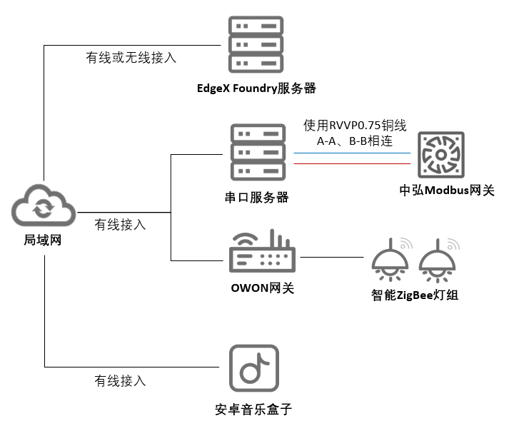
   
- 已在EdgeX Foundry服务器上安装下表中的软件：
    | 软件包名称 | 版本要求 |
    | --- | --- |
    | docker | 18.09.7或以上 |
    | docker-compose | 1.29.1或以上 |

- 已获取以下配置文件： 
    docker-compose.yml 
    owon_mqtt_profile.yaml 
    zhonghong_modbus_profile.yaml 
遇到问题请联系慧博云通技术支持。
## 3. 部署EdgeX Foundry
1. 使用root用户登录EdgeX Foundry服务器。
2. 进入/root目录： 
   `cd /root` 
3. 使用WinSCP将docker-compose.yml文件放入root目录。 
4. 启动EdgeX Foundry进程： 
   `docker-compose up -d` 
5. 查看EdgeX Foundry服务是否启动成功： 
   `docker-compose ps` 
 - 如果命令回显中所有容器的状态均为up，则EdgeX Foundry服务启动成功。 

   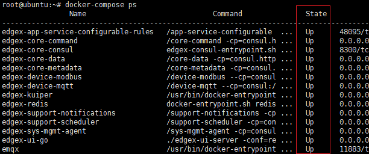  

 - 如果存在状态为exit的容器，执行docker start命令尝试启动。 

   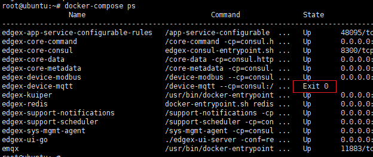  

若仍然无法启动，执行docker logs命令查看日志，并将日志发送给慧博云通技术支持进行分析定位。

## 4. 配置串口服务器
1. 使用浏览器访问http://{串口服务器IP地址}/cgi-bin/luci。
2. 输入用户名密码登录串口服务器web管理界面。

3. 根据下图，配置服务器端口信息，本示例中配置PORT 8。 
   本地端口设置为4008。 

   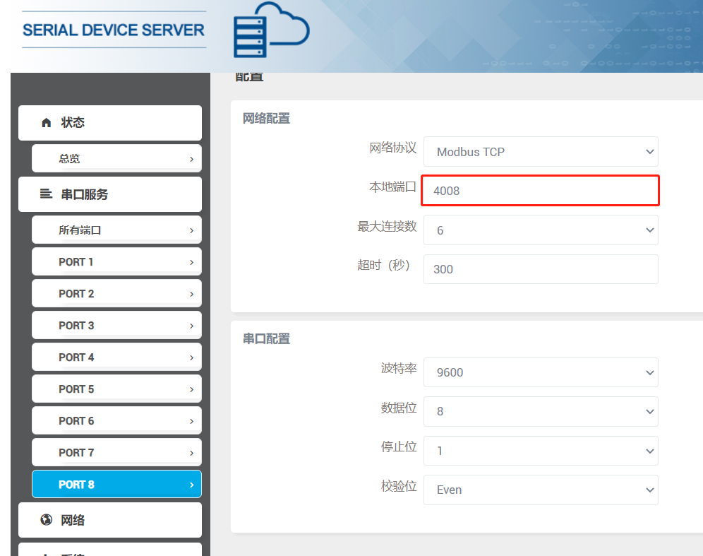
## 5. 适配OWON网关
1. 使用浏览器进入http://{EdgeX Foundry IP地址}:8500/ui/dc1/kv/edgex/devices/1.0/edgex-device-mqtt/Driver。
2. 修改IncomingHost为EdgeX Foundry的IP地址。 
   
   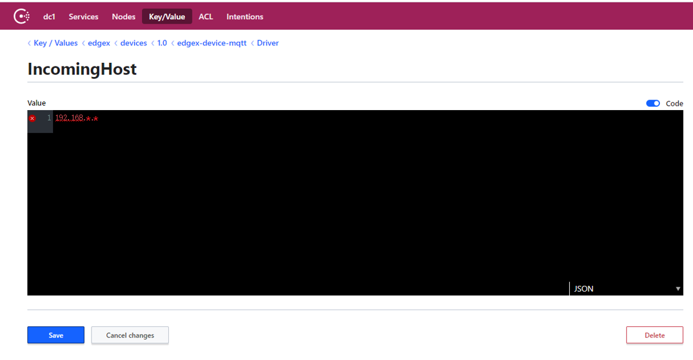 
3. 修改ResponseHost为EdgeX Foundry的IP地址。 
   
   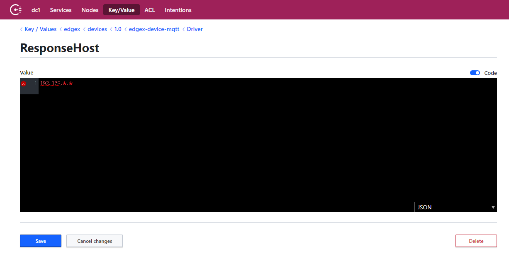 
4. 修改IncomingTopic为device/{deviceId}/report。 
   其中{deviceId}是OWON网关的MAC地址。 

   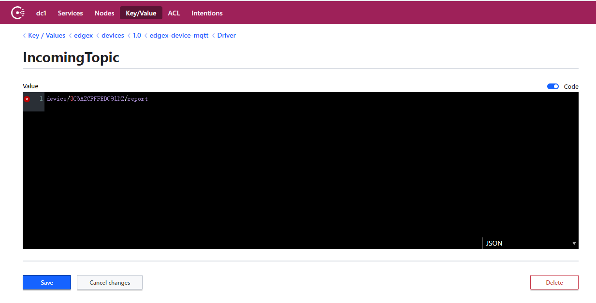 
5. 修改ResponseTopic为reply/device/{deviceId}/{appclientId}。 
   {deviceId}是OWON网关的MAC地址，{appclientId}是自定义的标识符。 

   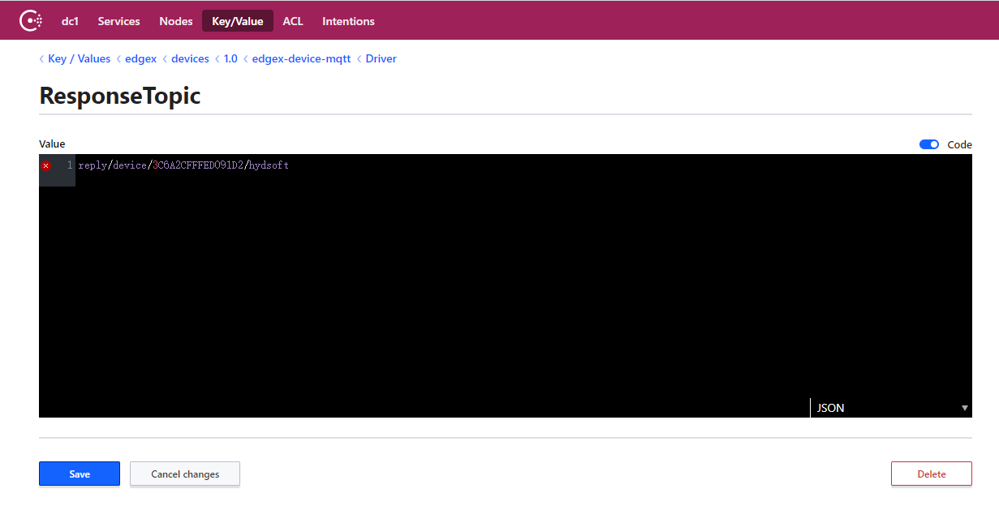 
6. 上传OWON网关信息配置文件。 
   (1). 使用浏览器进入http://{EdgeX Foundry IP地址}:4000/并登录。 
   >**注意：** 
   > 如果是首次登录，系统会要求您设置用于登录的用户名密码。本示例中用户名和密码均为admin。 

   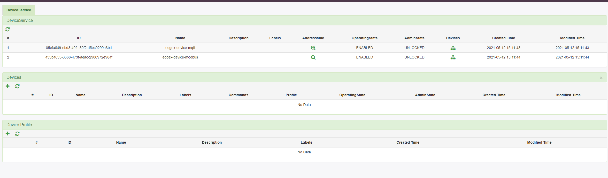  

   (2). 修改owon_mqtt_profile.yaml配置文件，把设备的MAC地址全部替换为当前环境灯的MAC地址。
         例如：switch_08F02004008D1500，需要将08F02004008D1500替换为实际的MAC地址。
         您可以从灯的设备信息中获取该MAC地址。 

   (3). 点击Device Profile下面的+号，上传OWON网关信息的配置文件。  

        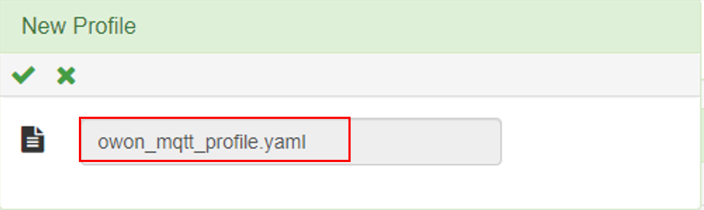 

   (4). 点击Devices下面的+号，添加OWON网关设备信息。 
        Schema：tcp 
        Host：EdgeX Foundry服务器的IP地址 
        Port：MQTT服务的端口号，此处为1883 
        Clientid：clientid 
        Topic：api/device/{deviceId}/{appclientId} 
        其中{deviceId}是OWON网关的MAC地址，{appclientId}是自定义的标识符。 

        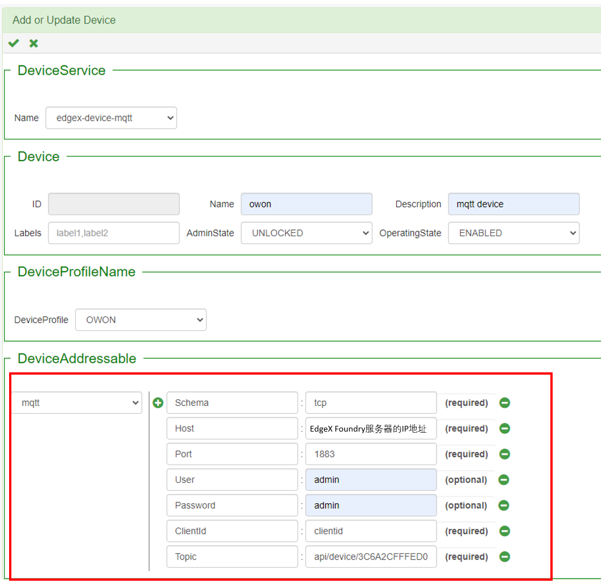 

    (5). 重启edgex-device-mqtt容器使配置生效： 
         `docker restart edgex-device-mqtt`
## 6. 适配中弘Modbus网关

1. 使用浏览器进入http://{EdgeX Foundry IP地址}:4000/。
2. 编辑zhonghong_modbus_profile.yaml配置文件，将空调地址全部修改为当前环境的实际地址。 
   Get命令的地址需要替换为空调状态寄存器的地址，Set命令的地址需要替换为控制寄存器的地址。 
   例如，在PowerGet_193，需要将193替换成实际的状态寄存器地址；在TemperatureSet_4130中，需要将4130替换成实际的控制寄存器地址。 
   - 状态寄存器计算方法：(AA × 32 + BB) × 6 + 1
   - 控制寄存器计算方法：(AA × 32 + BB) × 4 + 4001 
   其中AA和BB的值可从中弘空调的web管理界面获取，如下图所示。详情请参考中弘官方文档《室外机网关使用手册》。 

   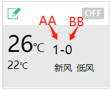 
3. 点击Device Profile下面的+号，上传中弘Modbus网关信息的配置文件。 
   
   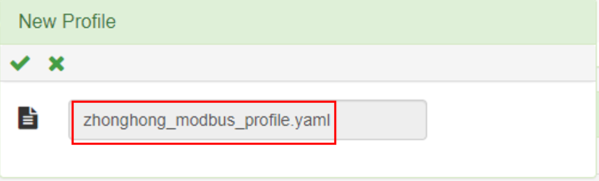 
4. 点击Devices下面的+号，添加中弘Modbus网关设备的信息。 
   Address：串口服务器的IP地址 
   Port：串口服务器的端口号，此处设置为4008 
   此端口号需要与串口服务器中的配置保持一致，详情请参考[4. 配置串口服务器](#4-配置串口服务器)中的步骤3。 
   UnitID：中弘Modbus网关管理页面中配置的设备地址，本示例中设置为1 

   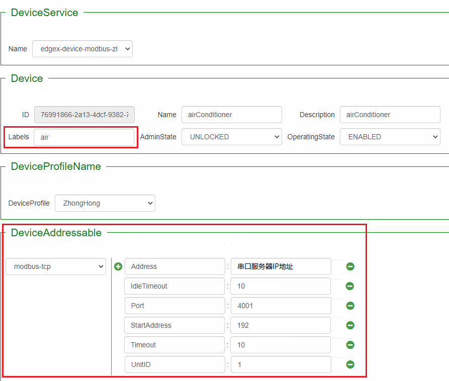 

   下图是中弘Modbus网关的管理页面，可从该页面获取设备地址，详情请参考中弘官方文档《室外机网关使用手册》。 

   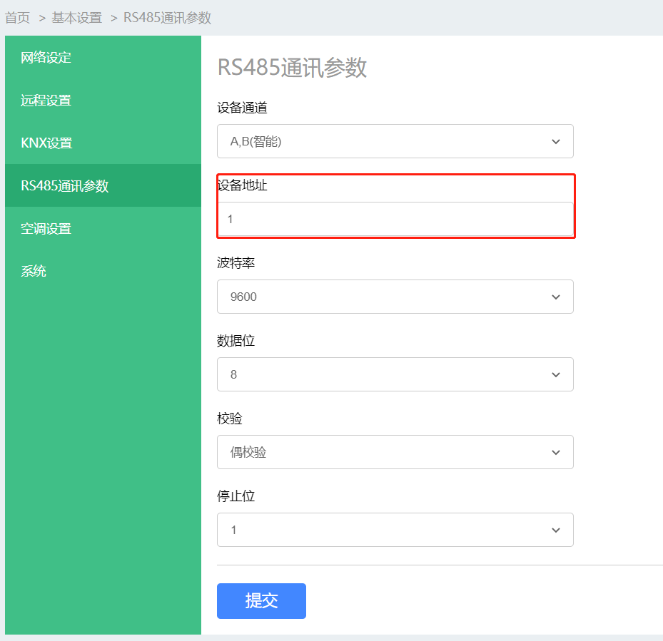
## 7. 适配安卓盒子
1. 将安卓盒子连接到EdgeX Foundry服务器的MQTT Broker上。
2. 使用root用户登录EdgeX Foundry服务器。
3. 进入/root目录： 
    `cd /root` 

4. 检查docker-compose.yml文件，确保文件包含安卓盒子的配置，如下图所示： 
   
   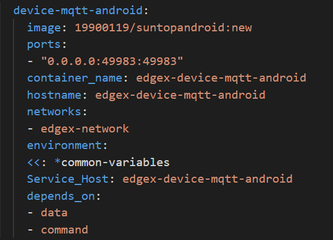
5. 启动安卓服务的容器： 
   `docker-compose up -d device-mqtt-android` 

6. 使用浏览器进入http://{EdgeX Foundry IP地址}:8500/ui/dc1/kv/edgex/devices/1.0/edgex-device-mqtt-android/Driver/。

7. 修改IncomingHost为EdgeX Foundry的IP地址。 
   
   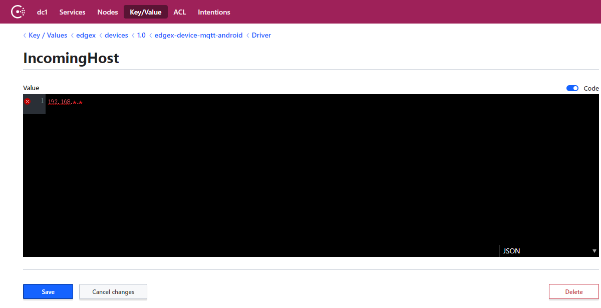
8. 修改ResponseHost为EdgeX Foundry的IP地址。 
   
   
9.  修改IncomingTopic和ResponseTopic为api/android/{type}/{brand_id}/{mac}。 
    其中，brand_id是品牌ID，mac是安卓音乐盒子的MAC地址，type是设备类型 
    type取值： 
    \- VIDEO：广告屏 
    \- SVIDEO：同步屏 
    \- AI：互动屏 
    \- AUDIO：音乐盒子
10. 修改IncomingClientId为IncomingDataSubscriber-android。 
    
    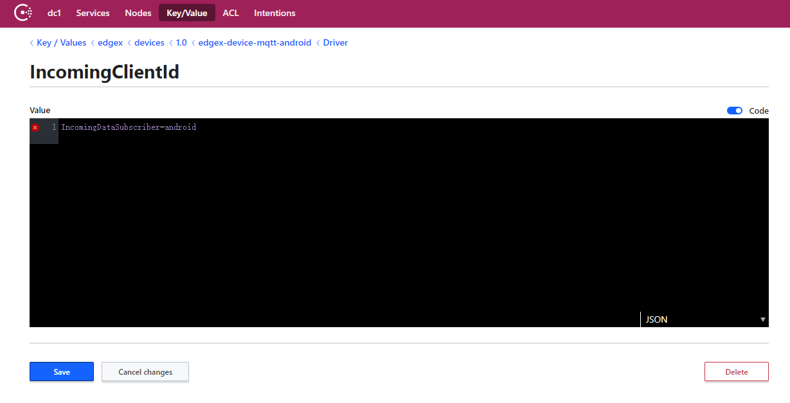
11. 修改ResponseClientId为CommandResponseSubscriber-android。
12. 上传安卓盒子信息配置文件。 
    (1). 使用浏览器进入http://{EdgeX Foundry IP地址}:4000/。 
    (2). 点击Device Profile下面的+号，上传安卓音乐盒子的配置文件。 

         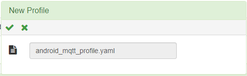 
    (3). 点击Devices下面的+号，添加安卓音乐盒子信息。 
         Schema：tcp 
         Host：EdgeX Foundry服务器的IP地址 
         Port：MQTT服务的端口号，此处为1883 
         Clientid：clientid 
         Topic：api/android/{type}/{brand_id}/{mac} 
         其中，brand_id是品牌ID，mac是安卓盒子的MAC地址，type是设备类型 
         type取值： 
         - VIDEO：广告屏 
         - SVIDEO：同步屏 
         - AI：互动屏 
         - AUDIO：音乐盒子 
13. 重启edgex-device-mqtt-android容器使配置生效： 
    `docker restart edgex-device-mqtt-android`