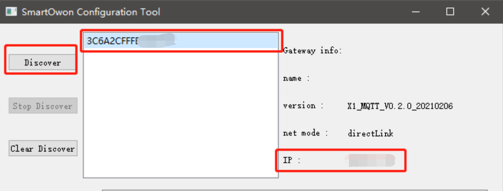

<h1>OWON智能网关配置</h1>

- [1. 前提条件](#1-前提条件)
- [2. 注册 OWON 网关](#2-注册-owon-网关)
- [3. 连接设备到 OWON 网关](#3-连接设备到-owon-网关)
	- [3.1 连接智能 ZigBee 灯组](#31-连接智能-zigbee-灯组)
	- [3.2 连接智能灯光面板](#32-连接智能灯光面板)
	- [3.3 连接导轨继电器](#33-连接导轨继电器)
	- [3.4 连接射频遥控开关并关联其他设备](#34-连接射频遥控开关并关联其他设备)
- [4. 查询设备的 MAC 地址](#4-查询设备的-mac-地址)


在 IoT 项目的架构中，OWON 网关是设备间的通讯中枢。本文档介绍了与 OWON 网关相关的配置流程，包括软件准备与具体配置步骤。

## 1. 前提条件

开始配置之前，请确保您已经在 PC 上安装了以下软件：<br>
- Socket Tool<br>
- Smart OWON Configuration Tool<br>

请确保在EdgX Foundry 服务器上安装了 mosquitto-clients 工具，安装命令：<br>
`apt install -y mosquitto-clients`<br>

可联系慧博云通技术支持获取软件安装包。<br>

## 2. 注册 OWON 网关

开始执行操作之前，需要先用网线连接 OWON 网关，并确保您执行操作的 PC 与 OWON 网关处于同一局域网内。<br>

**注意：**<br>
如果您之前配置过 OWON 网关，需要执行以下操作对其进行重置：<br>
在关机状态下同时按住蓝牙键与 ZigBee 键不放，开机成功后松开。<br>

1. 使用 Smart OWON Configuration Tool 查找 OWON 网关的 IP 地址。<br>
   <br>
2. 使用 Socket 工具，向 {OWON 网关 IP 地址}:11500 发送如下消息注册网关：<br>
   `{"type":"wizardConfig","command":"serverCfg","argument":{"host":"{EdgeX Foundry IP地址}","port":1883},"sequence":1}`<br>
   其中，1883 为 MQTT 服务的端口号。

3. 向 {OWON网关IP地址}:11500 发送如下消息，启动网关并注册到 MQTT 服务器：<br>
   `{"type":"wizardConfig", "command":"startRegister", "sequence":1 }`

## 3. 连接设备到 OWON 网关

### 3.1 连接智能 ZigBee 灯组

1. 将智能 ZigBee 灯组接通电源，保持灯亮，并确保其处于 OWON 网关的 Zigbee 网络信号范围内。

2. （可选）如果您之前配置过 ZigBee 灯组，需要执行以下操作对其进行重置：<br>
   反复开关灯组 10 次，灯泡闪烁表示重置完毕。
   
3. 使用 root 用户登录 EdgeX Foundry 服务器。
   
4. 查看 OWON 网关盒子背面的 MAC 地址。
   
5. 在 EdgeX Foundry 服务器上执行以下命令，将灯组连接到 ZigBee 网络：<br>
   `mosquitto_pub -t api/device/{OWON 网关的 MAC 地址}/test -m '{"type":"zigbeeConfig","command":"permitJoin", "sequence":1010, "argument": { "switchgear":"on", "second":60 } }'`

6. 执行以下命令验证连接是否成功：<br>
   `mosquitto_pub -t api/device/{OWON 网关的 MAC 地址}/test -m '{ "type":"zigbeeConfig", "command":"epList", "sequence":1009 }'`<br>

   如果命令返回灯组的 MAC 地址，说明连接成功。

### 3.2 连接智能灯光面板

1. 接通智能灯光面板的电源，并确保其处于 OWON 网关的 Zigbee 网络信号范围内。
   
2. 按智能灯光面板上的 ON/OFF 按键 4 次，第 4 次的时候按住 6 秒松开后指示灯闪烁。<br>
   此时智能灯光面板进入寻网状态。
   
3. 使用 root 用户登录 EdgeX Foundry 服务器。
   
4. 查看 OWON 网关盒子背面的 MAC 地址。
   
5. 在 EdgeX Foundry 服务器上执行以下命令，将智能灯光面板连接到 ZigBee 网络：<br>
   `mosquitto_pub -t api/device/{OWON 网关的 MAC 地址}/test -m '{"type":"zigbeeConfig","command":"permitJoin", "sequence":1010, "argument": { "switchgear":"on", "second":60 } }'`

6. 执行以下命令验证连接是否成功：<br>
   `mosquitto_pub -t api/device/{OWON 网关的 MAC 地址}/test -m '{ "type":"zigbeeConfig", "command":"epList", "sequence":1009 }'`<br>

   如果命令返回智能灯光面板的 MAC 地址，说明连接成功。


### 3.3 连接导轨继电器

1. 接导轨继电器的电源，并确保其处于 OWON 网关的 Zigbee 网络信号范围内。
2. 按住导轨继电器上的 ON/OFF 按键 10 秒，第 3 秒的时候指示灯闪烁 3 次，第 10 秒的时候闪烁 3 次。<br>
   此时导轨继电器进去寻网状态。

3. 使用 root 用户登录 EdgeX Foundry 服务器。
4. 查看 OWON 网关盒子背面的 MAC 地址。
5. 在 EdgeX Foundry 服务器上执行以下命令，将导轨继电器连接到 ZigBee 网络：<br>
   `mosquitto_pub -t api/device/{OWON 网关的 MAC 地址}/test -m '{"type":"zigbeeConfig","command":"permitJoin", "sequence":1010, "argument": { "switchgear":"on", "second":60 } }'`

6. 执行以下命令验证连接是否成功：<br>
   `mosquitto_pub -t api/device/{OWON 网关的 MAC 地址}/test -m '{ "type":"zigbeeConfig", "command":"epList", "sequence":1009 }'`<br>

   如果命令返回导轨继电器的 MAC 地址，说明连接成功。

### 3.4 连接射频遥控开关并关联其他设备

1. 接通射频遥控开关与要关联的设备（包括智能 ZigBee 灯组、智能灯光面板和导轨继电器）的电源，并确保其处于 OWON 网关的 Zigbee 网络信号范围内。<br>
2. 按射频遥控开关上的 ON/OFF 按键 4 次，第 4 次的时候按住 6 秒松开后指示灯闪烁<br>
   此时射频遥控开关进入寻网状态。

3. 使用 root 用户登录 EdgeX Foundry 服务器。
4. 查看 OWON 网关盒子背面的 MAC 地址。
5. 在 EdgeX Foundry 服务器上执行以下命令，将射频遥控开关连接到 ZigBee 网络：<br>
   `mosquitto_pub -t api/device/{OWON 网关的 MAC 地址}/test -m '{"type":"zigbeeConfig","command":"permitJoin", "sequence":1010, "argument": { "switchgear":"on", "second":60 } }'`<br>

6. 执行以下命令，查看 OWON 网关所连接设备的 MAC 地址：<br>
   `mosquitto_pub -t api/device/{OWON 网关的 MAC 地址}/test -m '{ "type":"zigbeeConfig", "command":"epList", "sequence":1009 }'`<br>

   返回结果中包含所有成功连接到 OWON 网关的设备信息，包括射频遥控、智能 ZigBee 灯组、智能灯光面板和导轨继电器。

7. 执行以下命令，使要与射频遥控连接的设备（智能 ZigBee 灯组，智能灯光面板或继电器）进入节点识别状态：<br>
   `mosquitto_pub -t api/device/{OWON 网关的 MAC 地址}/test -m '{ "type":"identify", "command":"identify", "sequence":1016, "argument": {"ieee":"{设备的MAC地址}", "ep":1, "time":100 } }'`<br>

   将 {设备的MAC地址} 替换为步骤 4 查询到的 MAC 地址。

8. 在射频遥控上按任意按键，连续按 4 次，第 4 次的时候按住不放，等待按键上的指示灯快速闪烁后松手。<br>
   此时设备与射频遥控连接成功。

## 4. 查询设备的 MAC 地址

1. 使用 root 用户登录 EdgeX Foundry 服务器。
2. 查看 OWON 网关盒子背面的 MAC 地址。
3. 执行以下两条命令查询 OWON 网关所连接的设备信息列表：<br>
   `mosquitto_sub -t reply/device/{OWON 网关的 MAC 地址}/test`   
   `mosquitto_pub -t api/device/{OWON 网关的 MAC 地址}/test -m '{ "type":"zigbeeConfig", "command":"epList", "sequence":1009 }'`<br>

   命令会返回 OWON 网关当前连接的所有设备的信息。其中，name 表示设备名称，ieee 表示设备的 MAC 地址，devModel 表示设备型号。<br>
   您可以根据 devModel 字段的值确定设备类型：<br>
   - FNB56-ZCW39GD1.1：智能 ZigBee 灯组
   - SLC600_R3：射频遥控开关
   - SLC600_L3：智能灯光面板
   - CB432：导轨继电器<br>

	返回结果样例：
	```html
	{
		"result":	true,
		"description":	"epList response success",
		"response":	{
			"total":	10,
			"start":	0,
			"count":	10,
			"epList":	[{
					"ieee":	"CA2B2004008D1500",
					"ep":	1,
					"netDeviceType":	1,
					"linkStatus":	false,
					"deviceType":	269,
					"IASZoneType":	65535,
					"ProfileId":	260,
					"name":	"Light-202BCA",
					"manuCode":	4478,
					"devModel":	"FNB56-ZCW39GD1.1",
					"clusterFlag":	3
				}, {
					"ieee":	"22F3D0FEFF2C6A3C",
					"ep":	1,
					"netDeviceType":	1,
					"linkStatus":	true,
					"deviceType":	33027,
					"IASZoneType":	65535,
					"ProfileId":	260,
					"name":	"Light-D0F322_01",
					"manuCode":	4412,
					"devModel":	"SLC600_R3    ",
					"clusterFlag":	0
				}, {
					"ieee":	"BEC6D0FEFF2C6A3C",
					"ep":	1,
					"netDeviceType":	1,
					"linkStatus":	true,
					"deviceType":	256,
					"IASZoneType":	65535,
					"ProfileId":	260,
					"name":	"Light-D0C6BE_01",
					"manuCode":	4412,
					"devModel":	"SLC600_L3    ",
					"clusterFlag":	3
				}, {
					"ieee":	"19CED0FEFF2C6A3C",
					"ep":	1,
					"netDeviceType":	1,
					"linkStatus":	true,
					"deviceType":	9,
					"IASZoneType":	65535,
					"ProfileId":	260,
					"name":	"Plug-D0CE19",
					"manuCode":	4412,
					"devModel":	"CB432",
					"clusterFlag":	3
				}]
		},
		"sequence":	1009
	}

	```