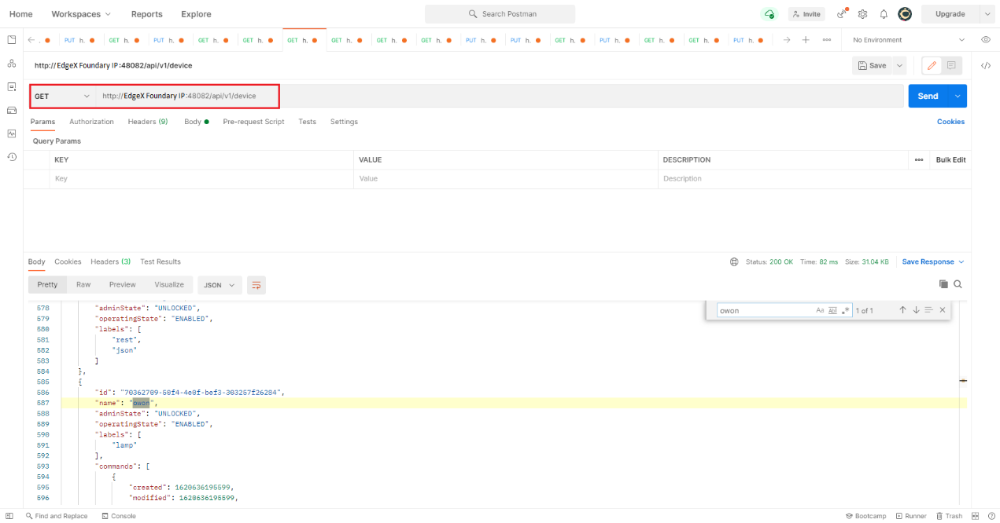

<h1>IoT设备API参考</h1>

- [1. 通用API](#1-通用api)
  - [1.1 查看所有可用的设备API](#11-查看所有可用的设备api)
- [2. 控制智能ZigBee灯组](#2-控制智能zigbee灯组)
  - [2.1 查看灯的开关状态](#21-查看灯的开关状态)
  - [2.2 设置灯的开关状态](#22-设置灯的开关状态)
  - [2.3 查看灯的亮度](#23-查看灯的亮度)
  - [2.4 设置灯的亮度](#24-设置灯的亮度)
  - [2.5 查找灯的位置](#25-查找灯的位置)
  - [2.6 查看OWON网关连接的所有设备](#26-查看owon网关连接的所有设备)
  - [2.7 查看灯的色温](#27-查看灯的色温)
  - [2.8 设置灯的色温](#28-设置灯的色温)
  - [2.9 查看灯的颜色](#29-查看灯的颜色)
  - [2.10 设置灯的颜色](#210-设置灯的颜色)
- [3. 通过中弘网关控制空调设备](#3-通过中弘网关控制空调设备)
  - [3.1 查询空调的状态](#31-查询空调的状态)
  - [3.2 设置空调的开关状态](#32-设置空调的开关状态)
  - [3.3 查询空调的温度](#33-查询空调的温度)
  - [3.4 设置空调的温度](#34-设置空调的温度)
  - [3.5 查询空调当前的模式](#35-查询空调当前的模式)
  - [3.6 设置空调的模式](#36-设置空调的模式)
  - [3.7 查询空调的风速](#37-查询空调的风速)
  - [3.8 设置空调的风速](#38-设置空调的风速)
  - [3.9 查询空调当前的回风温度](#39-查询空调当前的回风温度)
  - [3.10 查询空调的故障状态](#310-查询空调的故障状态)
- [4. 控制安卓音乐盒子](#4-控制安卓音乐盒子)
  - [4.1 控制音乐](#41-控制音乐)
  - [4.2 设备截屏并上传](#42-设备截屏并上传)
  - [4.3 控制设备](#43-控制设备)
  - [4.4 节目更新](#44-节目更新)
  - [4.5 节目计划更新](#45-节目计划更新)
- [5. 控制智能灯光面板](#5-控制智能灯光面板)
  - [5.1 查询开关状态](#51-查询开关状态)
  - [5.2 设置开关状态](#52-设置开关状态)
- [6. 控制导轨继电器](#6-控制导轨继电器)
  - [6.1 查询开关状态](#61-查询开关状态)
  - [6.2 设置开关状态](#62-设置开关状态)
  - [6.3 查询实时用电量信息](#63-查询实时用电量信息)
- [7. 查询EdgeX Foundry服务器信息](#7-查询edgex-foundry服务器信息)
  - [7.1 查询主机信息](#71-查询主机信息)
  - [7.2 查询CPU信息](#72-查询cpu信息)
  - [7.3 查询内存信息](#73-查询内存信息)
  - [7.4 查询磁盘信息](#74-查询磁盘信息)
- [8. 附录](#8-附录)
  - [8.1 响应公共参数](#81-响应公共参数)
  - [8.2 返回码](#82-返回码)
  - [8.3 颜色代码转换](#83-颜色代码转换)

  
<br>
EdgeX提供Restful API，您可以通过HTTP调用API管理智能设备。本文档指导您使用Postman来进行接口调用。


## 1. 通用API
### 1.1 查看所有可用的设备API
**URI**
```html
GET /api/v1/device
```

**请求**<br>
样例：
```html
GET http://{EdgeX Foundry IP地址}:48082/api/v1/device
```

**响应**<br>
响应结果会显示所有可用的设备API。<br>



## 2. 控制智能ZigBee灯组

### 2.1 查看灯的开关状态
**URI**

```html
GET /api/v1/device/name/{device_name}/command/switch
```

请将{device_name}替换为EdgeX Foundry中配置的灯设备名称（Name），详情请参考<a href="https://gitee.com/PubDocumentation/iot-documents/blob/master/1.%20EdgeX%20Foundry%E8%BD%AF%E4%BB%B6%E9%83%A8%E7%BD%B2.md#5-%E9%80%82%E9%85%8Dowon%E7%BD%91%E5%85%B3" target="_blank">适配OWON网关</a>中的步骤 6.(4)。<br>

**请求**<br>
样例：
```html
GET http://{EdgeX Foundry IP地址}:48082/api/v1/device/name/lamp/command/switch
```

**响应**<br>
响应参数：
| 名称  | 参数类型 | 说明                                                                         |
| ----- | -------- | ------ |
| value | String   | 开关状态信息<br>cache：缓存值<br>switchgear：开关的状态，off表示关机，on表示开机 |

其他参数请参考[8.1 响应公共参数](#81-响应公共参数)。<br>

样例：
```html
{
    "device": "lamp",
    "origin": 1620807421916211019,
    "readings": [
        {
            "origin": 1620807421916015171,
            "device": "lamp",
            "name": "switch",
            "value": "{\"cache\":0,\"switchgear\":\"off\"}",
            "valueType": "String"
        }
    ],
    "EncodedEvent": null
}
```
返回码：<br>
接口正常的返回码为2xx，例如200或者204。<br>
返回码含义以及更多返回码，请参考[8.2 返回码](#82-返回码)。

### 2.2 设置灯的开关状态
**URI**
```html
PUT /api/v1/device/name/{device_name}/command/switch
```

请将{device_name}替换为EdgeX Foundry中配置的灯设备名称（Name），详情请参考<a href="https://gitee.com/PubDocumentation/iot-documents/blob/master/1.%20EdgeX%20Foundry%E8%BD%AF%E4%BB%B6%E9%83%A8%E7%BD%B2.md#5-%E9%80%82%E9%85%8Dowon%E7%BD%91%E5%85%B3" target="_blank">适配OWON网关</a>中的步骤 6.(4)。<br>

**请求**<br>
请求参数：
| 名称                 | 是否必须 | 参数类型 | 说明                                  |
| -------------------- | -------- | -------- | ------------------------------------- |
| switch | 是       | String   | 灯的开关状态<br>on：开灯<br>off：关灯 |


样例：

```html
PUT http://{EdgeX Foundry IP地址}:48082/api/v1/device/name/lamp/command/switch
```
```html
{
    "switch": "off"
}
```

**响应**<br>
返回码：<br>
接口正常的返回码为2xx，例如200或者204。<br>
返回码含义以及更多返回码，请参考[8.2 返回码](#82-返回码)。
### 2.3 查看灯的亮度
**URI**
```html
GET /api/v1/device/name/{device_name}/command/level
```

请将{device_name}替换为EdgeX Foundry中配置的灯设备名称（Name），详情请参考<a href="https://gitee.com/PubDocumentation/iot-documents/blob/master/1.%20EdgeX%20Foundry%E8%BD%AF%E4%BB%B6%E9%83%A8%E7%BD%B2.md#5-%E9%80%82%E9%85%8Dowon%E7%BD%91%E5%85%B3" target="_blank">适配OWON网关</a>中的步骤 6.(4)。<br>

**请求**<br>
样例：
```html
GET http://{EdgeX Foundry IP地址}:48082/api/v1/device/name/lamp/command/level
```

**响应**<br>
响应参数：
| 名称  | 参数类型 | 说明                                                         |
| ----- | -------- | ------------------------------------------------------------ |
| value | String   | 灯的亮度<br>level字段取值范围：0-255<br>值越大，表示亮度越大 |

其他参数请参考[8.1 响应公共参数](#81-响应公共参数)。<br>

样例：
```html
{
    "device": "lamp",
    "origin": 1620807714963694663,
    "readings": [
        {
            "origin": 1620807714963246695,
            "device": "lamp",
            "name": "level",
            "value": "{\"level\":200}",
            "valueType": "String"
        }
    ],
    "EncodedEvent": null
}
```

返回码：<br>
接口正常的返回码为2xx，例如200或者204。<br>
返回码含义以及更多返回码，请参考[8.2 返回码](#82-返回码)。<br>

### 2.4 设置灯的亮度
**URI**

```html
PUT /api/v1/device/name/{device_name}/command/level
```

请将{device_name}替换为EdgeX Foundry中配置的灯设备名称（Name），详情请参考<a href="https://gitee.com/PubDocumentation/iot-documents/blob/master/1.%20EdgeX%20Foundry%E8%BD%AF%E4%BB%B6%E9%83%A8%E7%BD%B2.md#5-%E9%80%82%E9%85%8Dowon%E7%BD%91%E5%85%B3" target="_blank">适配OWON网关</a>中的步骤 6.(4)。<br>

**请求**<br>
请求参数：
| 名称                | 是否必须 | 参数类型 | 说明                                                |
| ------------------- | -------- | -------- | --------------------------------------------------- |
| level | 是       | String   | 灯的亮度<br>取值范围：0-255<br>值越大，表示亮度越大 |

样例：

```html
PUT http://{EdgeX Foundry IP地址}:48082/api/v1/device/name/lamp/command/level
```
```html
{
   "level":"30"
}
```

**响应**<br>
返回码：<br>
接口正常的返回码为2xx，例如200或者204。<br>
返回码含义以及更多返回码，请参考[8.2 返回码](#82-返回码)。

### 2.5 查找灯的位置
**URI**

```html
PUT /api/v1/device/name/{device_name}/command/findNode
```

请将{device_name}替换为EdgeX Foundry中配置的灯设备名称（Name），详情请参考<a href="https://gitee.com/PubDocumentation/iot-documents/blob/master/1.%20EdgeX%20Foundry%E8%BD%AF%E4%BB%B6%E9%83%A8%E7%BD%B2.md#5-%E9%80%82%E9%85%8Dowon%E7%BD%91%E5%85%B3" target="_blank">适配OWON网关</a>中的步骤 6.(4)。<br>

**请求**<br>
请求参数：
| 名称                   | 是否必须 | 参数类型 | 说明                                                                           |
| ---------------------- | -------- | -------- | ------------------------------------------------------------------------------ |
| findNode | 是       | String   | 灯闪烁的时间<br>取值范围：1-60（单位为秒）<br>您可以通过闪烁确定灯所在的位置。 |

样例：
```html
PUT http://{EdgeX Foundry IP地址}:48082/api/v1/device/name/lamp/command/findNode
```
```html
{
   "findNode":"10"
}
```

**响应**<br>
返回码：<br>
接口正常的返回码为2xx，例如200或者204。<br>
返回码含义以及更多返回码，请参考[8.2 返回码](#82-返回码)。

### 2.6 查看OWON网关连接的所有设备
**URI**<br>
```html
GET /api/v1/device/name/{device_name}/command/listAllDev
```

请将{device_name}替换为EdgeX Foundry中配置的灯设备名称（Name），详情请参考<a href="https://gitee.com/PubDocumentation/iot-documents/blob/master/1.%20EdgeX%20Foundry%E8%BD%AF%E4%BB%B6%E9%83%A8%E7%BD%B2.md#5-%E9%80%82%E9%85%8Dowon%E7%BD%91%E5%85%B3" target="_blank">适配OWON网关</a>中的步骤 6.(4)。<br> 

**请求**<br>
样例：

```html
GET http://{EdgeX Foundry IP地址}:48082/api/v1/device/name/lamp/command/listAllDev
```
**响应**<br>
响应参数：
| 名称  | 参数类型 | 说明                   |
| ----- | -------- | ---------------------- |
| value | String   | OWON网关连接的设备信息 |

其他参数请参考[8.1 响应公共参数](#81-响应公共参数)。<br>

样例：
```html
{
    "device": "lamp",
    "origin": 1620894127944722947,
    "readings": [
        {
            "origin": 1620894127944241478,
            "device": "lamp",
            "name": "listAllDev",
            "value": "{\"count\":2,\"epList\":[{\"IASZoneType\":65535,\"ProfileId\":260,
						\"clusterFlag\":3,\"devModel\":\"FNB56-ZCW39GD1.1\",\"deviceType\":269,
						\"ep\":1,\"ieee\":\"08F02004008D1500\",\"linkStatus\":true,\"manuCode\":4478,
						\"name\":\"Light-20F008\",\"netDeviceType\":1},{\"IASZoneType\":65535,
						\"ProfileId\":260,\"clusterFlag\":3,\"devModel\":\"FNB56-ZCW39GD1.1\",
						\"deviceType\":269,\"ep\":1,\"ieee\":\"CA2B2004008D1500\",\"linkStatus\":true,
						\"manuCode\":4478,\"name\":\"Light-202BCA\",\"netDeviceType\":1}],\"start\":0,\"total\":2}",
            "valueType": "String"
        }
    ],
    "EncodedEvent": null
}
```

返回码：<br>
接口正常的返回码为2xx，例如200或者204。<br>
返回码含义以及更多返回码，请参考[8.2 返回码](#82-返回码)。

### 2.7 查看灯的色温
**URI**

```html
GET /api/v1/device/name/{device_name}/command/color
```

请将{device_name}替换为EdgeX Foundry中配置的灯设备名称（Name），详情请参考<a href="https://gitee.com/PubDocumentation/iot-documents/blob/master/1.%20EdgeX%20Foundry%E8%BD%AF%E4%BB%B6%E9%83%A8%E7%BD%B2.md#5-%E9%80%82%E9%85%8Dowon%E7%BD%91%E5%85%B3" target="_blank">适配OWON网关</a>中的步骤 6.(4)。<br>

**请求**<br>
样例：

```html
GET http://{EdgeX Foundry IP地址}:48082/api/v1/device/name/lamp/command/color
```

**响应**<br>
响应参数：
| 名称  | 参数类型 | 说明                                                       |
| ----- | -------- | ---------------------------------------------------------- |
| value | String   | 灯的色温<br>colorTemp取值范围：1-370<br>值越大，色温越偏暖 |

其他参数请参考[8.1 响应公共参数](#81-响应公共参数)。<br>

样例：
```html
{
    "device": "lamp",
    "origin": 1620811610720158318,
    "readings": [
        {
            "origin": 1620811610719719006,
            "device": "lamp",
            "name": "color",
            "value": "{\"colorTemp\":250,\"status\":0}",
            "valueType": "String"
        }
    ],
    "EncodedEvent": null
}
```

返回码：<br>
接口正常的返回码为2xx，例如200或者204。<br>
返回码含义以及更多返回码，请参考[8.2 返回码](#82-返回码)。

### 2.8 设置灯的色温
**URI**
```html
PUT /api/v1/device/name/{device_name}/command/color
```

请将{device_name}替换为EdgeX Foundry中配置的灯设备名称（Name），详情请参考<a href="https://gitee.com/PubDocumentation/iot-documents/blob/master/1.%20EdgeX%20Foundry%E8%BD%AF%E4%BB%B6%E9%83%A8%E7%BD%B2.md#5-%E9%80%82%E9%85%8Dowon%E7%BD%91%E5%85%B3" target="_blank">适配OWON网关</a>中的步骤 6.(4)。<br>

**请求**<br>
请求参数：
| 名称                | 是否必须 | 参数类型 | 说明                                                  |
| ------------------- | -------- | -------- | ----------------------------------------------------- |
| color | 是       | String   | 要设置的色温<br>取值范围：1-370<br>值越大，色温越偏暖 |

样例：
```html
PUT http://{EdgeX Foundry IP地址}:48082/api/v1/device/name/lamp/command/color
```
```html
{
   "color":"320"
}
```

**响应**<br>
返回码：<br>
接口正常的返回码为2xx，例如200或者204。<br>
返回码含义以及更多返回码，请参考[8.2 返回码](#82-返回码)。

### 2.9 查看灯的颜色

**URI**
```bash
GET /api/v1/device/name/{device_name}/command/colorXY
```

请将{device_name}替换为EdgeX Foundry中配置的灯设备名称（Name），详情请参考<a href="https://gitee.com/PubDocumentation/iot-documents/blob/master/1.%20EdgeX%20Foundry%E8%BD%AF%E4%BB%B6%E9%83%A8%E7%BD%B2.md#5-%E9%80%82%E9%85%8Dowon%E7%BD%91%E5%85%B3" target="_blank">适配OWON网关</a>中的步骤 6.(4)。<br>

**请求**<br>
样例：

```bash
GET http://{EdgeX Foundry IP地址}:48082/api/v1/device/name/lamp/command/colorXY
```

**响应**<br>
响应参数：
| 名称  | 参数类型 | 说明                                                                                                     |
| ----- | -------- | -------------------------------------------------------------------------------------------------------- |
| value | String   | 灯的颜色<br>其中colorX和colorY是灯的颜色代码。<br>关于此处颜色代码与RGB颜色代码的转换，请参考[8.3 颜色代码转换](#83-颜色代码转换)。 |

其他参数请参考[8.1 响应公共参数](#81-响应公共参数)。<br>

样例：
```html
{
    "device": "lamp",
    "origin": 1620811749967455185,
    "readings": [
        {
            "origin": 1620811749967060736,
            "device": "lamp",
            "name": "colorXY",
            "value": "{\"colorX\":20545,\"colorY\":21207}",
            "valueType": "String"
        }
    ],
    "EncodedEvent": null
}
```

返回码：<br>
接口正常的返回码为2xx，例如200或者204。<br>
返回码含义以及更多返回码，请参考[8.2 返回码](#82-返回码)。<br>

### 2.10 设置灯的颜色
**URI**
```html
PUT /api/v1/device/name/{device_name}/command/colorXY
```

请将{device_name}替换为EdgeX Foundry中配置的灯设备名称（Name），详情请参考<a href="https://gitee.com/PubDocumentation/iot-documents/blob/master/1.%20EdgeX%20Foundry%E8%BD%AF%E4%BB%B6%E9%83%A8%E7%BD%B2.md#5-%E9%80%82%E9%85%8Dowon%E7%BD%91%E5%85%B3" target="_blank">适配OWON网关</a>中的步骤 6.(4)。<br>

**请求**<br>
请求参数：
| 名称                  | 是否必须 | 参数类型 | 说明                                                                                                     |
| --------------------- | -------- | -------- | -------------------------------------------------------------------------------------------------------- |
| colorXY | 是       | String   | 灯的颜色<br>其中colorX和colorY是灯的颜色代码。<br>关于此处颜色代码与RGB颜色代码的转换，请参考“[8.3 颜色代码转换](#83-颜色代码转换)”。 |


样例：
```html
PUT http://{EdgeX Foundry IP地址}:48082/api/v1/device/name/lamp/command/colorXY
```
```html
{
    "colorXY": 
    "{\"colorX\":20494, \"colorY\":21561}"
}
```

**响应**<br>
返回码：<br>
接口正常的返回码为2xx，例如200或者204。<br>
返回码含义以及更多返回码，请参考[8.2 返回码](#82-返回码)。


## 3. 通过中弘网关控制空调设备

### 3.1 查询空调的状态
**URI**
```html
GET /api/v1/device/name/{device_name}/command/PowerGet
```

请将{device_name}替换为EdgeX Foundry中配置的空调设备名称（Name），详情请参考<a href="https://gitee.com/PubDocumentation/iot-documents/blob/master/1.%20EdgeX%20Foundry%E8%BD%AF%E4%BB%B6%E9%83%A8%E7%BD%B2.md#6-%E9%80%82%E9%85%8D%E4%B8%AD%E5%BC%98-modbus-%E7%BD%91%E5%85%B3" target="_blank">适配中弘 Modbus 网关</a>中的步骤 3。<br>

**请求**<br>
请求样例：

```html
GET http://{EdgeX Foundry IP地址}:48082/api/v1/device/name/airConditioner/command/PowerGet
```

**响应**<br>
响应参数：
| 名称  | 参数类型 | 说明                             |
| ----- | -------- | -------------------------------- |
| value | String   | 空调的状态<br>1：开机<br>0：关机 |

其他参数请参考[8.1 响应公共参数](#81-响应公共参数)。<br>

样例：

```html
{
    "device": "airConditioner",
    "origin": 1620811978117765294,
    "readings": [
        {
            "origin": 1620811978117663735,
            "device": "airConditioner",
            "name": "PowerGet",
            "value": "1",
            "valueType": "Uint16"
        }
    ],
    "EncodedEvent": null
}
```

返回码：<br>
接口正常的返回码为2xx，例如200或者204。<br>
返回码含义以及更多返回码，请参考[8.2 返回码](#82-返回码)。

### 3.2 设置空调的开关状态
**URI**

```html
PUT /api/v1/device/name/{device_name}/command/PowerSet
```

请将{device_name}替换为EdgeX Foundry中配置的空调设备名称（Name），详情请参考<a href="https://gitee.com/PubDocumentation/iot-documents/blob/master/1.%20EdgeX%20Foundry%E8%BD%AF%E4%BB%B6%E9%83%A8%E7%BD%B2.md#6-%E9%80%82%E9%85%8D%E4%B8%AD%E5%BC%98-modbus-%E7%BD%91%E5%85%B3" target="_blank">适配中弘 Modbus 网关</a>中的步骤 3。<br>

**请求**<br>
请求参数：
| 名称                            | 是否必须 | 参数类型 | 说明                                     |
| ------------------------------- | -------- | -------- | ---------------------------------------- |
| PowerSet | 是       | String   | 空调的开关状态<br>0：关机<br>1：开机 |

样例：

```html
PUT http://{EdgeX Foundry IP地址}:48082/api/v1/device/name/airConditioner/command/PowerSet
```
```html
{
   "PowerSet":"0"
}
```

**响应**<br>
返回码：<br>
接口正常的返回码为2xx，例如200或者204。<br>
返回码含义以及更多返回码，请参考[8.2 返回码](#82-返回码)。

### 3.3 查询空调的温度
**URI**

```html
GET /api/v1/device/name/{device_name}/command/TemperatureGet
```

请将{device_name}替换为EdgeX Foundry中配置的空调设备名称（Name），详情请参考<a href="https://gitee.com/PubDocumentation/iot-documents/blob/master/1.%20EdgeX%20Foundry%E8%BD%AF%E4%BB%B6%E9%83%A8%E7%BD%B2.md#6-%E9%80%82%E9%85%8D%E4%B8%AD%E5%BC%98-modbus-%E7%BD%91%E5%85%B3" target="_blank">适配中弘 Modbus 网关</a>中的步骤 3。<br>

**请求**<br>
样例：

```html
GET http://{EdgeX Foundry IP地址}:48082/api/v1/device/name/airConditioner/command/TemperatureGet
```

**响应**<br>
响应参数：
| 名称  | 参数类型 | 说明                             |
| ----- | -------- | -------------------------------- |
| value | String   | 空调的温度<br>取值范围：16-32 |

其他参数请参考[8.1 响应公共参数](#81-响应公共参数)。<br>

样例：
```html
{
    "device": "airConditioner",
    "origin": 1620812218515922238,
    "readings": [
        {
            "origin": 1620812218515628510,
            "device": "airConditioner",
            "name": "TemperatureGet",
            "value": "27",
            "valueType": "Uint16"
        }
    ],
    "EncodedEvent": null
}
```

返回码：<br>
接口正常的返回码为2xx，例如200或者204。<br>
返回码含义以及更多返回码，请参考[8.2 返回码](#82-返回码)。

### 3.4 设置空调的温度
**URI**

```html
PUT /api/v1/device/name/{device_name}/command/TemperatureSet
```

请将{device_name}替换为EdgeX Foundry中配置的空调设备名称（Name），详情请参考<a href="https://gitee.com/PubDocumentation/iot-documents/blob/master/1.%20EdgeX%20Foundry%E8%BD%AF%E4%BB%B6%E9%83%A8%E7%BD%B2.md#6-%E9%80%82%E9%85%8D%E4%B8%AD%E5%BC%98-modbus-%E7%BD%91%E5%85%B3" target="_blank">适配中弘 Modbus 网关</a>中的步骤 3。<br>

**请求**<br>
请求参数：
| 名称                            | 是否必须 | 参数类型 | 说明                                     |
| ------------------------------- | -------- | -------- | ---------------------------------------- |
| TemperatureSet | 是       | String   | 空调的温度<br>取值范围：16-32 |

样例：

```html
PUT http://{EdgeX Foundry IP地址}:48082/api/v1/device/name/airConditioner/command/TemperatureSet
```
```html
{
   " TemperatureSet_4130":"30"
}
```

**响应**<br>
返回码：<br>
接口正常的返回码为2xx，例如200或者204。<br>
返回码含义以及更多返回码，请参考[8.2 返回码](#82-返回码)。

### 3.5 查询空调当前的模式

**URI**
```html
GET /api/v1/device/name/{device_name}/command/ModelGet
```

请将{device_name}替换为EdgeX Foundry中配置的空调设备名称（Name），详情请参考<a href="https://gitee.com/PubDocumentation/iot-documents/blob/master/1.%20EdgeX%20Foundry%E8%BD%AF%E4%BB%B6%E9%83%A8%E7%BD%B2.md#6-%E9%80%82%E9%85%8D%E4%B8%AD%E5%BC%98-modbus-%E7%BD%91%E5%85%B3" target="_blank">适配中弘 Modbus 网关</a>中的步骤 3。<br>

**请求**<br>
样例：

```html
GET http://{EdgeX Foundry IP地址}:48082/api/v1/device/name/airConditioner/command/ModelGet
```

**响应**<br>
响应参数：
| 名称  | 参数类型 | 说明                             |
| ----- | -------- | -------------------------------- |
| value | String   | 空调的模式<br>1：制冷<br>2：除湿<br>4：送风<br>8：制热 |

其他参数请参考[8.1 响应公共参数](#81-响应公共参数)。<br>

样例：
```html
{
    "device": "airConditioner",
    "origin": 1620812462282224482,
    "readings": [
        {
            "origin": 1620812462282026541,
            "device": "airConditioner",
            "name": "ModelGet",
            "value": "1",
            "valueType": "Uint16"
        }
    ],
    "EncodedEvent": null
}
```

返回码：<br>
接口正常的返回码为2xx，例如200或者204。<br>
返回码含义以及更多返回码，请参考[8.2 返回码](#82-返回码)。

### 3.6 设置空调的模式
**URI**
```html
PUT /api/v1/device/name/{device_name}/command/ModelSet
```

请将{device_name}替换为EdgeX Foundry中配置的空调设备名称（Name），详情请参考<a href="https://gitee.com/PubDocumentation/iot-documents/blob/master/1.%20EdgeX%20Foundry%E8%BD%AF%E4%BB%B6%E9%83%A8%E7%BD%B2.md#6-%E9%80%82%E9%85%8D%E4%B8%AD%E5%BC%98-modbus-%E7%BD%91%E5%85%B3" target="_blank">适配中弘 Modbus 网关</a>中的步骤 3。<br>

**请求**<br>
请求参数：
| 名称                            | 是否必须 | 参数类型 | 说明                                     |
| ------------------------------- | -------- | -------- | ---------------------------------------- |
| ModelSet | 是       | String   | 空调的模式<br>1：制冷<br>2：除湿<br>4：送风<br>8：制热 |

样例：
```html
PUT http://{EdgeX Foundry IP地址}:48082/api/v1/device/name/airConditioner/command/ModelSet
```
```html
{
   " ModelSet":"2"
}
```

**响应**<br>
返回码：<br>
接口正常的返回码为2xx，例如200或者204。<br>
返回码含义以及更多返回码，请参考[8.2 返回码](#82-返回码)。

### 3.7 查询空调的风速
**URI**

```html
GET /api/v1/device/name/{device_name}/command/WindSpeedGet
```

请将{device_name}替换为EdgeX Foundry中配置的空调设备名称（Name），详情请参考<a href="https://gitee.com/PubDocumentation/iot-documents/blob/master/1.%20EdgeX%20Foundry%E8%BD%AF%E4%BB%B6%E9%83%A8%E7%BD%B2.md#6-%E9%80%82%E9%85%8D%E4%B8%AD%E5%BC%98-modbus-%E7%BD%91%E5%85%B3" target="_blank">适配中弘 Modbus 网关</a>中的步骤 3。<br>

**请求**<br>
样例：

```html
GET http://{EdgeX Foundry IP地址}:48082/api/v1/device/name/airConditioner/command/WindSpeedGet
```

**响应**<br>
响应参数：
| 名称  | 参数类型 | 说明                             |
| ----- | -------- | -------------------------------- |
| value | String   | 空调的风速<br>1：高速<br>2：中速<br>4：低速 |

其他参数请参考[8.1 响应公共参数](#81-响应公共参数)。<br>

样例：
```html
{
    "device": "airConditioner",
    "origin": 1620812636112808729,
    "readings": [
        {
            "origin": 1620812636112576765,
            "device": "airConditioner",
            "name": "WindSpeedGet",
            "value": "1",
            "valueType": "Uint16"
        }
    ],
    "EncodedEvent": null
}
```

返回码：<br>
接口正常的返回码为2xx，例如200或者204。<br>
返回码含义以及更多返回码，请参考[8.2 返回码](#82-返回码)。

### 3.8 设置空调的风速
**URI**

```html
PUT /api/v1/device/name/{device_name}/command/WindSpeedSet
```

请将{device_name}替换为EdgeX Foundry中配置的空调设备名称（Name），详情请参考<a href="https://gitee.com/PubDocumentation/iot-documents/blob/master/1.%20EdgeX%20Foundry%E8%BD%AF%E4%BB%B6%E9%83%A8%E7%BD%B2.md#6-%E9%80%82%E9%85%8D%E4%B8%AD%E5%BC%98-modbus-%E7%BD%91%E5%85%B3" target="_blank">适配中弘 Modbus 网关</a>中的步骤 3。<br>

**请求**<br>
请求参数：
| 名称                            | 是否必须 | 参数类型 | 说明                                     |
| ------------------------------- | -------- | -------- | ---------------------------------------- |
| WindSpeedSet | 是       | String   | 空调的模式<br>1：高速<br>2：中速<br>4：低速 |

样例：

```html
PUT http://{EdgeX Foundry IP地址}:48082/api/v1/device/name/airConditioner/command/WindSpeedSet
```
```html
{
   "WindSpeedSet":"2"
}
```

**响应**<br>
返回码：<br>
接口正常的返回码为2xx，例如200或者204。<br>
返回码含义以及更多返回码，请参考[8.2 返回码](#82-返回码)。

### 3.9 查询空调当前的回风温度
**URI**

```html
GET /api/v1/device/name/{device_name}/command/CurrentTemperatureGet
```

请将{device_name}替换为EdgeX Foundry中配置的空调设备名称（Name），详情请参考<a href="https://gitee.com/PubDocumentation/iot-documents/blob/master/1.%20EdgeX%20Foundry%E8%BD%AF%E4%BB%B6%E9%83%A8%E7%BD%B2.md#6-%E9%80%82%E9%85%8D%E4%B8%AD%E5%BC%98-modbus-%E7%BD%91%E5%85%B3" target="_blank">适配中弘 Modbus 网关</a>中的步骤 3。<br>

**请求**<br>
样例：

```html
GET http://EdgeX Foundry IP地址:48082/api/v1/device/name/airConditioner/command/CurrentTemperatureGet
```

**响应**<br>
响应参数：
| 名称  | 参数类型 | 说明                             |
| ----- | -------- | -------------------------------- |
| value | String   | 空调的回风温度 |

其他参数请参考[8.1 响应公共参数](#81-响应公共参数)。<br>

样例：

```html
{
    "device": "airConditioner",
    "origin": 1620812735018473870,
    "readings": [
        {
            "origin": 1620812735018239469,
            "device": "airConditioner",
            "name": "CurrentTemperatureGet",
            "value": "23",
            "valueType": "Uint16"
        }
    ],
    "EncodedEvent": null
}
```

返回码：<br>
接口正常的返回码为2xx，例如200或者204。<br>
返回码含义以及更多返回码，请参考[8.2 返回码](#82-返回码)。

### 3.10 查询空调的故障状态
**URI**

```html
GET /api/v1/device/name/{device_name}/command/ErrorGet
```

请将{device_name}替换为EdgeX Foundry中配置的空调设备名称（Name），详情请参考<a href="https://gitee.com/PubDocumentation/iot-documents/blob/master/1.%20EdgeX%20Foundry%E8%BD%AF%E4%BB%B6%E9%83%A8%E7%BD%B2.md#6-%E9%80%82%E9%85%8D%E4%B8%AD%E5%BC%98-modbus-%E7%BD%91%E5%85%B3" target="_blank">适配中弘 Modbus 网关</a>中的步骤 3。<br>

**请求**<br>
样例：

```html
GET http://{EdgeX Foundry IP地址}:48082/api/v1/device/name/airConditioner/command/ErrorGet
```

**响应**<br>
响应参数：
| 名称  | 参数类型 | 说明                             |
| ----- | -------- | -------------------------------- |
| value | String   | 空调的状态码<br>0：无故障。<br>其他值：设备故障，请联系中弘的技术支持。 |

其他参数请参考[8.1 响应公共参数](#81-响应公共参数)。<br>

样例：
```html
{
    "device": "airConditioner",
    "origin": 1620812804819501364,
    "readings": [
        {
            "origin": 1620812804819315955,
            "device": "airConditioner",
            "name": "ErrorGet",
            "value": "0",
            "valueType": "Uint16"
        }
    ],
    "EncodedEvent": null
}
```

返回码：<br>
接口正常的返回码为2xx，例如200或者204。<br>
返回码含义以及更多返回码，请参考[8.2 返回码](#82-返回码)。<br>

## 4. 控制安卓音乐盒子

### 4.1 控制音乐

**URI**

```html
PUT /api/v1/device/name/android/command/music_control
```

**请求**<br>
请求参数：   

| 名称                 | 是否必须 | 参数类型 | 说明                                  |
| -------------------- | -------- | -------- | ------------------------------------- |
| switch_{​​​​​​灯的MAC地址}​​​​​​ | 是       | String   | 音乐控制操作<br>mac：安卓音乐盒子的MAC地址<br>action：音乐控制命令，取值范围：<br>- play：播放<br>- pre：上一首<br>- next：下一首<br>- pause：暂停<br>- prelist- 上一个歌单<br>- nextlist：下一个歌单<br>- jump：切换歌曲<br>audio_id：音乐文件ID<br>当action为jump时audio_id设置为所要跳转的音乐文件ID，当action为其他取值时该参数置0。<br>program_id：节目单ID<br>当action为jump时program_id设置为所要跳转的节目单ID，当action为其他取值时该参数置0。<br> |


样例：

```html
PUT http://{EdgeX Foundry IP地址}:48082/api/v1/device/name/android/command/music_control
```
```html
{"music_control":
                "{\"mac\":\"38CA73126BCB\",\"action\":\"pause\",\"audio_id\":0,\"program_id\":0}"
}
```

**响应**<br>
返回码：<br>
接口正常的返回码为2xx，例如200或者204。<br>
返回码含义以及更多返回码，请参考[8.2 返回码](#82-返回码)。

### 4.2 设备截屏并上传

**URI**

```html
PUT /api/v1/device/name/android/command/screenshot
```

**请求**<br>
请求参数：

| 名称                 | 是否必须 | 参数类型 | 说明                                  |
| -------------------- | -------- | -------- | ------------------------------------- |
| screenshot​​​​​​ | 是       | String   | 设备截屏并上传的频率<br>mac：安卓音乐盒子的MAC地址<br>delay：截屏间隔秒数<br>num：截屏上传次数|

样例：

```html
PUT http://{EdgeX Foundry IP地址}:48082/api/v1/device/name/android/command/screenshot
```
```html
{"screenshot":
            "{\"mac\":\"38CA73126BCB\",\"delay\":1,\"num\":1}"
}
```

**响应**<br>
返回码：<br>
接口正常的返回码为2xx，例如200或者204。<br>
返回码含义以及更多返回码，请参考[8.2 返回码](#82-返回码)。

### 4.3 控制设备

**URI**

```html
PUT /api/v1/device/name/android/command/device_control
```

**请求**<br>
请求参数：

| 名称                 | 是否必须 | 参数类型 | 说明                                  |
| -------------------- | -------- | -------- | ------------------------------------- |
| device_control | 是       | String   | 设备截屏并上传的频率<br>mac：安卓音乐盒子的MAC地址<br>switch：设备开关；1表示开，0表示关<br>backlight：屏幕亮度；取值范围为0-100<br>volume：音量；取值范围为0-100<br>rotation：屏幕旋转角度；取值为0，90，180或270 |

样例：

```html
PUT http://{EdgeX Foundry IP地址}:48082/api/v1/device/name/android/command/device_control
```
```html
{"device_control":
                "{\"mac\":\"38CA73126BCB\",\"switch\": 0, \"backlight\":100, \"volume\": 1020,\"rotation\": 0 } "
}
```

**响应**<br>
返回码：<br>
接口正常的返回码为2xx，例如200或者204。<br>
返回码含义以及更多返回码，请参考[8.2 返回码](#82-返回码)。

### 4.4 节目更新

**URI**

```html
PUT /api/v1/device/name/android/command/program
```

**请求**<br>
请求参数：

| 名称                 | 是否必须 | 参数类型 | 说明                                  |
| -------------------- | -------- | -------- | ------------------------------------- |
| program | 是       | String   | 更新节目<br>mac：安卓音乐盒子的MAC地址 |

样例：

```html
PUT http://{EdgeX Foundry IP地址}:48082/api/v1/device/name/android/command/program
```
```html
{"program": 
         "{\"mac\":\"38CA73126BCB\"} "
}
```

**响应**<br>
返回码：<br>
接口正常的返回码为2xx，例如200或者204。<br>
返回码含义以及更多返回码，请参考[8.2 返回码](#82-返回码)。

### 4.5 节目计划更新

**URI**

```html
PUT /api/v1/device/name/android/command/schedule
```

**请求**<br>
请求参数：

| 名称                 | 是否必须 | 参数类型 | 说明                                  |
| -------------------- | -------- | -------- | ------------------------------------- |
| schedule | 是       | String   | 更新节目计划<br>mac：安卓音乐盒子的MAC地址 |

样例：

```html
PUT http://{EdgeX Foundry IP地址}:48082/api/v1/device/name/android/command/schedule
```
```html
{"schedule": 
         "{\"mac\":\"38CA73126BCB\"} "
}
```

**响应**<br>
返回码：<br>
接口正常的返回码为2xx，例如200或者204。<br>
返回码含义以及更多返回码，请参考[8.2 返回码](#82-返回码)。

## 5. 控制智能灯光面板

### 5.1 查询开关状态
**URI**

```html
GET /api/v1/device/name/{device_name}/command/smartPlugSwitch_{EP功能节点ID}
```

请将{device_name}替换为EdgeX Foundry中配置的智能灯光面板设备名称（Name），详情请参考<a href="https://gitee.com/PubDocumentation/iot-documents/blob/master/1.%20EdgeX%20Foundry%E8%BD%AF%E4%BB%B6%E9%83%A8%E7%BD%B2.md#5-%E9%80%82%E9%85%8Dowon%E7%BD%91%E5%85%B3" target="_blank">适配OWON网关</a>中的步骤 6.(4)。<br>

请将{EP功能节点}替换为智能灯光面板上控制按键对应的EP功能节点ID。每个按键对应一个EP功能节点，其ID从左到右分别为1、2和3。<br>

**请求**<br>
样例：

```html
GET http://{EdgeX Foundry IP地址}:48082/api/v1/device/name/smartPlug-SLC600_L3/command/smartPlugSwitch_2
```

**响应**<br>
响应参数：
| 名称  | 参数类型 | 说明                                                                         |
| ----- | -------- | ------ |
| value | String   | 开关状态信息<br>cache：缓存值<br>switchgear：开关的状态，off表示关机，on表示开机 |

其他参数请参考[8.1 响应公共参数](#81-响应公共参数)。<br>

样例：
```html
{
    "device": "smartPlug-SLC600_L3",
    "origin": 1626933512576208192,
    "readings": [
        {
            "origin": 1626933512575752470,
            "device": "smartPlug-SLC600_L3",
            "name": "smartPlugSwitch_1",
            "value": "{\"cache\":0,\"switchgear\":\"on\"}",
            "valueType": "String"
        }
    ],
    "EncodedEvent": null
}
```

返回码：<br>
接口正常的返回码为2xx，例如200或者204。<br>
返回码含义以及更多返回码，请参考[8.2 返回码](#52-返回码)。<br>

### 5.2 设置开关状态

**URI**

```html
PUT /api/v1/device/name/{device_name}/command/smartPlugSwitch_{EP节点ID}
```

请将{device_name}替换为EdgeX Foundry中配置的智能灯光面板设备名称（Name），详情请参考<a href="https://gitee.com/PubDocumentation/iot-documents/blob/master/1.%20EdgeX%20Foundry%E8%BD%AF%E4%BB%B6%E9%83%A8%E7%BD%B2.md#5-%E9%80%82%E9%85%8Dowon%E7%BD%91%E5%85%B3" target="_blank">适配OWON网关</a>中的步骤 6.(4)。<br>

请将{EP功能节点ID}替换为智能灯光面板上控制按键对应的EP功能节点ID。每个按键对应一个EP功能节点，其ID从左到右分别为1、2和3。<br>

**请求**<br>
请求参数：

| 名称                 | 是否必须 | 参数类型 | 说明                                  |
| -------------------- | -------- | -------- | ------------------------------------- |
| smartPlugSwitch_{EP节点ID} | 是       | String   | 开关的状态<br>off表示关机，on表示开机 |

样例：

```html
PUT http://{EdgeX Foundry IP地址}:48082/api/v1/device/name/smartPlug-SLC600_L3/command/smartPlugSwitch_3
```
```html
{
    "smartPlugSwitch_3":"on"
}
```

**响应**<br>
返回码：<br>
接口正常的返回码为2xx，例如200或者204。<br>
返回码含义以及更多返回码，请参考[8.2 返回码](#82-返回码)。


## 6. 控制导轨继电器

### 6.1 查询开关状态
**URI**

```html
GET /api/v1/device/name/{device_name}/command/smartPlugSwitch_1
```

请将{device_name}替换为EdgeX Foundry中配置的导轨继电器设备名称（Name），详情请参考<a href="https://gitee.com/PubDocumentation/iot-documents/blob/master/1.%20EdgeX%20Foundry%E8%BD%AF%E4%BB%B6%E9%83%A8%E7%BD%B2.md#5-%E9%80%82%E9%85%8Dowon%E7%BD%91%E5%85%B3" target="_blank">适配OWON网关</a>中的步骤 6.(4)。<br>

**请求**<br>
样例：

```html
GET http://{EdgeX Foundry IP地址}:48082/api/v1/device/name/smartPlug-CB432-1/command/smartPlugSwitch_1
```

**响应**<br>
响应参数：
| 名称  | 参数类型 | 说明                                                                         |
| ----- | -------- | ------ |
| value | String   | 开关状态信息<br>cache：缓存值<br>switchgear：开关的状态，off表示关机，on表示开机 |

其他参数请参考[8.1 响应公共参数](#81-响应公共参数)。<br>

样例：
```html
{
    "device": "smartPlug-CB432-1",
    "origin": 1627465950217908435,
    "readings": [
        {
            "origin": 1627465950217530488,
            "device": "smartPlug-CB432-1",
            "name": "smartPlugSwitch_1",
            "value": "{\"cache\":0,\"switchgear\":\"on\"}",
            "valueType": "String"
        }
    ],
    "EncodedEvent": null
}
```

返回码：<br>
接口正常的返回码为2xx，例如200或者204。<br>
返回码含义以及更多返回码，请参考[8.2 返回码](#82-返回码)。<br>

### 6.2 设置开关状态

**URI**

```html
PUT /api/v1/device/name/{device_name}/command/smartPlugSwitch_1
```

请将{device_name}替换为EdgeX Foundry中配置的导轨继电器设备名称（Name），详情请参考<a href="https://gitee.com/PubDocumentation/iot-documents/blob/master/1.%20EdgeX%20Foundry%E8%BD%AF%E4%BB%B6%E9%83%A8%E7%BD%B2.md#5-%E9%80%82%E9%85%8Dowon%E7%BD%91%E5%85%B3" target="_blank">适配OWON网关</a>中的步骤 6.(4)。<br>

**请求**<br>
请求参数：

| 名称                 | 是否必须 | 参数类型 | 说明                                  |
| -------------------- | -------- | -------- | ------------------------------------- |
| smartPlugSwitch_1 | 是       | String   | 开关的状态<br>off表示关机，on表示开机 |

样例：

```html
PUT http://{EdgeX Foundry IP地址}:48082/api/v1/device/name/smartPlug-CB432-1/command/smartPlugSwitch_1
```
```html
{
    "smartPlugSwitch_1":"on"
}
```

**响应**<br>
返回码：<br>
接口正常的返回码为2xx，例如200或者204。<br>
返回码含义以及更多返回码，请参考[8.2 返回码](#82-返回码)。

### 6.3 查询实时用电量信息

**URI**

```html
GET /api/v1/device/name/{device_name}/command/energy_1
```

请将{device_name}替换为EdgeX Foundry中配置的导轨继电器设备名称（Name），详情请参考<a href="https://gitee.com/PubDocumentation/iot-documents/blob/master/1.%20EdgeX%20Foundry%E8%BD%AF%E4%BB%B6%E9%83%A8%E7%BD%B2.md#5-%E9%80%82%E9%85%8Dowon%E7%BD%91%E5%85%B3" target="_blank">适配OWON网关</a>中的步骤 6.(4)。<br>

**请求**<br>
样例：

```html
GET http://1.202.80.91:48082/api/v1/device/name/smartPlug-CB432-2/command/energy_1
```

**响应**<br>
响应参数：
| 名称  | 参数类型 | 说明                                                                         |
| ----- | -------- | ------ |
| value | String   | 设备用电量信息 |
| activePower | Float | 瞬时功率 |
| summation | Float | 累计功耗 |
| divisor | Int | 显示格式的除数，具体请参考 ZigBee 文档 |
| multiplier | Int | 显示格式的乘数，具体请参考 ZigBee 文档 |
| meteringDeviceStatus | Int | 设备状态 | 
| unitOfMeasure | Int | 0 代表xxx，0x00 代表 kWh, 0x01 代表 m3，具体请参考 ZigBee 文档 | 
| summationFormatting | Int | 需要转换到 16 进制,来控制保留小数点前后 |
| demandFormatting | Int | xxx |

其他参数请参考[8.1 响应公共参数](#81-响应公共参数)。<br>

样例：
```html
{
    "device": "smartPlug-CB432-2",
    "origin": 1627469913968410797,
    "readings": [
        {
            "origin": 1627469913967822237,
            "device": "smartPlug-CB432-2",
            "name": "energy_1",
            "value": "{\"activePower\":0,\"demandFormatting\":0,\"divisor\":1000,\"meteringDeviceStatus\":0,\"mutiplier\":1,\"summation\":0,\"summationFormatting\":0,\"unitOfMeasure\":0}",
            "valueType": "String"
        }
    ],
    "EncodedEvent": null
}
```

返回码：<br>
接口正常的返回码为2xx，例如200或者204。<br>
返回码含义以及更多返回码，请参考[8.2 返回码](#82-返回码)。<br>

## 7. 查询EdgeX Foundry服务器信息

### 7.1 查询主机信息
**URI**

```html
GET /api/v1/device/name/metric/command/hostInfo
```

**请求**<br>
样例：

```html
GET http://{EdgeX Foundry IP地址}:48082/api/v1/device/name/metric/command/hostInfo
```

**响应**<br>
响应参数：
| 名称  | 参数类型 | 说明                                                                         |
| ----- | -------- | ------ |
| hostname | String   | 主机名称 |
| uptime | Int | 自启动后经历的时间（秒） |
| bootTime | Int | 启动时间（秒） |
| os | String | 操作系统 |
| platform | String | 平台名称 |
| platformFamily | String | 平台系列 | 
| platformVersion | String | 平台版本 | 
| kernelVersion | String | 内核版本 |
| kernelArch | String | 内核架构 |  

其他参数请参考[8.1 响应公共参数](#81-响应公共参数)。<br>

样例：
```html
{
    "device": "metric",
    "origin": 1627518188046147237,
    "readings": [
        {
            "origin": 1627518188045622998,
            "device": "metric",
            "name": "hostInfo",
            "value": "{\"hostname\":\"edgex-device-metric\",\"uptime\":2666489,\"bootTime\":1624851700,\"os\":\"linux\",\"platform\":\"\",\"platformFamily\":\"\",\"platformVersion\":\"\",\"kernelVersion\":\"5.4.0-73-generic\",\"kernelArch\":\"x86_64\"}",
            "valueType": "String"
        }
    ],
    "EncodedEvent": null
}
```

返回码：<br>
接口正常的返回码为2xx，例如200或者204。<br>
返回码含义以及更多返回码，请参考[8.2 返回码](#82-返回码)。

### 7.2 查询CPU信息
**URI**

```html
GET /api/v1/device/name/metric/command/cpuInfo
```

**请求**<br>
样例：

```html
GET http://{EdgeX Foundry IP地址}:48082/api/v1/device/name/metric/command/cpuInfo
```

**响应**<br>
响应参数：
| 名称  | 参数类型 | 说明                                                                         |
| ----- | -------- | ------ |
| value | String | CPU信息 |
| cores | Int   | 核心数量 |
| modelName | String | CPU型号 |
| mhz | Int | CPU频率（Mhz） |
| percent | Float | CPU占用率 |

其他参数请参考[8.1 响应公共参数](#81-响应公共参数)。<br>

样例：
```html
{
    "device": "metric",
    "origin": 1627518693022409986,
    "readings": [
        {
            "origin": 1627518692003682754,
            "device": "metric",
            "name": "cpuInfo",
            "value": "{\"cores\":1,\"modelName\":\"Intel(R) Core(TM) i7-7700HQ CPU @ 2.80GHz\",\"mhz\":3800,\"percent\":0.2525252527034211}",
            "valueType": "String"
        }
    ],
    "EncodedEvent": null
}
```

返回码：<br>
接口正常的返回码为2xx，例如200或者204。<br>
返回码含义以及更多返回码，请参考[8.2 返回码](#82-返回码)。

### 7.3 查询内存信息
**URI**

```html
GET /api/v1/device/name/metric/command/memInfo
```

**请求**<br>
样例：

```html
GET http://{EdgeX Foundry IP地址}:48082/api/v1/device/name/metric/command/memInfo
```

**响应**<br>
响应参数：
| 名称  | 参数类型 | 说明                                                                         |
| ----- | -------- | ------ |
| value | String | 内存信息 |
| total | Int   | 总内存（Byte） |
| available | Int | 可用内存（Byte） |
| used | Int | 已使用内存（Byte） |
| usedPercent | Float | 内存使用率（%） |
| free | Int | 空闲内存（Byte） |

其他参数请参考[8.1 响应公共参数](#81-响应公共参数)。<br>

样例：
```html
{
    "device": "metric",
    "origin": 1627521337170695096,
    "readings": [
        {
            "origin": 1627521337170291433,
            "device": "metric",
            "name": "memInfo",
            "value": "{\"total\":8260464640,\"available\":1463730176,\"used\":6461976576,\"usedPercent\":78.22776148340247,\"free\":181256192}",
            "valueType": "String"
        }
    ],
    "EncodedEvent": null
}
```

返回码：<br>
接口正常的返回码为2xx，例如200或者204。<br>
返回码含义以及更多返回码，请参考[8.2 返回码](#82-返回码)。

### 7.4 查询磁盘信息

**URI**

```html
GET /api/v1/device/name/metric/command/diskInfo
```

**请求**<br>
样例：

```html
GET http://{EdgeX Foundry IP地址}:48082/api/v1/device/name/metric/command/diskInfo
```

**响应**<br>
响应参数：
| 名称  | 参数类型 | 说明                                                                         |
| ----- | -------- | ------ |
| value | String | 磁盘信息 |
| path | String   | 磁盘路径 |
| total | Int | 磁盘总容量（Byte） |
| free | Int | 空闲磁盘容量（Byte） |
| used | Int | 已使用容量（Byte） |
| usedPercent | Float | 磁盘使用率（%） |

其他参数请参考[8.1 响应公共参数](#81-响应公共参数)。<br>

样例：
```html
{
    "device": "metric",
    "origin": 1627521747535307507,
    "readings": [
        {
            "origin": 1627521747535271066,
            "device": "metric",
            "name": "diskInfo",
            "value": "{\"path\":\"/\",\"total\":124959473664,\"free\":94598303744,\"used\":23969525760,\"usedPercent\":20.215876313390186}",
            "valueType": "String"
        }
    ],
    "EncodedEvent": null
}
```

返回码：<br>
接口正常的返回码为2xx，例如200或者204。<br>
返回码含义以及更多返回码，请参考[8.2 返回码](#82-返回码)。

## 8. 附录
### 8.1 响应公共参数
下表列出了接口响应中readings字段下的公共参数：
| 名称 | 参数类型 | 说明 |
| --- | --- | --- |
| origin | Int	| 请求编号 |
| device | String | 设备名称|
| name	| String | 操作命令| 
| valueType	| String | value字段的类型| 

### 8.2 返回码
**正常时的返回码**
| 返回码 | 说明 |
| --- | --- |
| 200	| 请求成功。|
| 204	| 请求成功，但无返回信息。|

**异常时的返回码**
| **返回码** | **说明** |
| 404	| 无法找到所请求的对象。| 
| 500	| 请求未完成，服务器异常。| 
| 503	| 请求失败，服务不可用。| 

###  8.3 颜色代码转换
colorX：int类型，CIE XYZ颜色空间中的x值。<br>
colorY：int类型，CIE XYZ颜色空间中的y值。<br>

colorX与colorY转换成RGB值的公式如下：

```html
//X, Y and Z input refer to a D65/2° standard illuminant.
//sR, sG and sB (standard RGB) output range = 0 ÷ 255

x=colorX / 65536（colorX：范围为0-65279）
y=colorY / 65536（colorY：范围为0-65279）
Y = b*100/255.0 （b为亮度值）
X = x * ( Y / y )
Z = ( 1 - x - y ) * ( Y / y )
var_X = X / 100
var_Y = Y / 100
var_Z = Z / 100
var_R = var_X * 3.2406 + var_Y * -1.5372 + var_Z * -0.4986
var_G = var_X * -0.9689 + var_Y * 1.8758 + var_Z * 0.0415
var_B = var_X * 0.0557 + var_Y * -0.2040 + var_Z * 1.0570
if ( var_R > 0.0031308 )
    var_R = 1.055 * ( var_R ^ ( 1 / 2.4 ) ) - 0.055
else
    var_R = 12.92 * var_R
if ( var_G > 0.0031308 )
    var_G = 1.055 * ( var_G ^ ( 1 / 2.4 ) ) - 0.055
else
    var_G = 12.92 * var_G
if ( var_B > 0.0031308 )
    var_B = 1.055 * ( var_B ^ ( 1 / 2.4 ) ) - 0.055
else
    var_B = 12.92 * var_B
sR = var_R * 255
sG = var_G * 255
sB = var_B * 255
```


