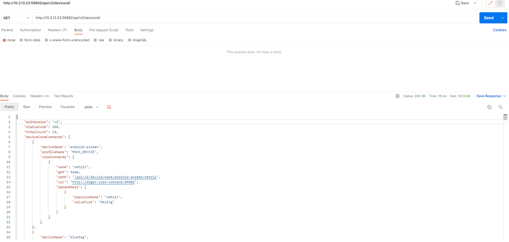

<h1>IoT设备API参考</h1>

- [1. 通用API](#1-通用api)
  - [1.1 查看所有可用的设备API](#11-查看所有可用的设备api)
- [2. 控制智能ZigBee灯组](#2-控制智能zigbee灯组)
  - [2.1 查看灯的开关状态](#21-查看灯的开关状态)
  - [2.2 设置灯的开关状态](#22-设置灯的开关状态)
  - [2.3 查看灯的亮度](#23-查看灯的亮度)
  - [2.4 设置灯的亮度](#24-设置灯的亮度)
  - [2.5 查找灯的位置](#25-查找灯的位置)
  - [2.6 查看OWON网关连接的所有设备](#26-查看owon网关连接的所有设备)
  - [2.7 查看灯的色温](#27-查看灯的色温)
  - [2.8 设置灯的色温](#28-设置灯的色温)
  - [2.9 查看灯的颜色](#29-查看灯的颜色)
  - [2.10 设置灯的颜色](#210-设置灯的颜色)
- [3. 通过中弘网关控制空调设备](#3-通过中弘网关控制空调设备)
  - [3.1 查询空调的状态](#31-查询空调的状态)
  - [3.2 设置空调的开关状态](#32-设置空调的开关状态)
  - [3.3 查询空调的温度](#33-查询空调的温度)
  - [3.4 设置空调的温度](#34-设置空调的温度)
  - [3.5 查询空调当前的模式](#35-查询空调当前的模式)
  - [3.6 设置空调的模式](#36-设置空调的模式)
  - [3.7 查询空调的风速](#37-查询空调的风速)
  - [3.8 设置空调的风速](#38-设置空调的风速)
  - [3.9 查询空调当前的回风温度](#39-查询空调当前的回风温度)
  - [3.10 查询空调的故障状态](#310-查询空调的故障状态)
- [4. 控制安卓音乐盒子](#4-控制安卓音乐盒子)
  - [4.1 控制音乐](#41-控制音乐)
  - [4.2 设备截屏并上传](#42-设备截屏并上传)
  - [4.3 控制设备](#43-控制设备)
  - [4.4 节目更新](#44-节目更新)
  - [4.5 节目计划更新](#45-节目计划更新)
- [5. 控制智能灯光面板](#5-控制智能灯光面板)
  - [5.1 查询开关状态](#51-查询开关状态)
  - [5.2 设置开关状态](#52-设置开关状态)
- [6. 控制导轨继电器](#6-控制导轨继电器)
  - [6.1 查询开关状态](#61-查询开关状态)
  - [6.2 设置开关状态](#62-设置开关状态)
  - [6.3 查询实时用电量信息](#63-查询实时用电量信息)
- [7. 查询EdgeX Foundry服务器信息](#7-查询edgex-foundry服务器信息)
  - [7.1 查询主机信息](#71-查询主机信息)
  - [7.2 查询CPU信息](#72-查询cpu信息)
  - [7.3 查询内存信息](#73-查询内存信息)
  - [7.4 查询磁盘信息](#74-查询磁盘信息)
- [8. 附录](#8-附录)
  - [8.1 响应公共参数](#81-响应公共参数)
  - [8.2 返回码](#82-返回码)
  - [8.3 颜色代码转换](#83-颜色代码转换)

  
<br>
EdgeX提供Restful API，您可以通过HTTP调用API管理智能设备。本文档指导您使用Postman来进行接口调用。


## 1. 通用API
### 1.1 查看所有可用的设备API
**URI**
```html
GET /api/v2/device/all
```

**请求**<br>
样例：
```html
GET http://{EdgeX Foundry IP地址}:59882/api/v2/device/all
```

**响应**<br>
响应结果会显示所有可用的设备API。<br>



## 2. 控制智能ZigBee灯组

### 2.1 查看灯的开关状态
**URI**

```html
GET /api/v2/device/name/{device_name}/switch
```


请将{device_name}替换为EdgeX Foundry中配置的灯设备名称（Name），详情请参考<a href="https://gitee.com/PubDocumentation/iot-documents/blob/master/1.%20EdgeX%20Foundry%E8%BD%AF%E4%BB%B6%E9%83%A8%E7%BD%B2.md#5-%E9%80%82%E9%85%8Dowon%E7%BD%91%E5%85%B3" target="_blank">适配OWON网关</a>中的步骤 6.(4)。<br>

**请求**<br>
样例：
```html
GET http://{EdgeX Foundry IP地址}:59882/api/v2/device/name/Light-20F1FE/switch
```

**响应**<br>
响应参数：
| 名称  | 参数类型 | 说明                                                                         |
| ----- | -------- | ------ |
| value | String | 返回信息   |
|connectionInfo| String  | 连接信息 |
| response | String | 开关状态信息<br>cache：缓存值<br>switchgear：开关的状态，off表示关机，on表示开机  |

其他参数请参考[8.1 响应公共参数](#81-响应公共参数)。<br>

样例：
```html
{
    "apiVersion": "v2",
    "statusCode": 200,
    "event": {
        "apiVersion": "v2",
        "id": "87ef51cd-3bf1-47ab-9010-e5a7ff461eb2",
        "deviceName": "Light-20F1FE",
        "profileName": "OWON-LAMP",
        "sourceName": "switch",
        "origin": 1636610037393035760,
        "readings": [
            {
                "id": "fbea1a8c-6151-4aec-8078-c9576a02a2fd",
                "origin": 1636610037393010408,
                "deviceName": "Light-20F1FE",
                "resourceName": "switch",
                "profileName": "OWON-LAMP",
                "valueType": "String",
                "value": "{\"connectionInfo\":{\"ClientId\":\"Light-20F1FE11\",\"Ep\":\"1\",\"Host\":\"10.3.13.23\",\"Ieee\":\"FEF12004008D1500\",\"Password\":\"\",\"Port\":\"1883\",\"Schema\":\"tcp\",\"Topic\":\"api/device/3C6A2CFFFED0C559/hydsoft\",\"User\":\"\"},\"response\":{\"cache\":0,\"switchgear\":\"off\"}}"
            }
        ]
    }
}
```
返回码：<br>
接口正常的返回码为2xx，例如200或者204。<br>
返回码含义以及更多返回码，请参考[8.2 返回码](#82-返回码)。

### 2.2 设置灯的开关状态
**URI**
```html
PUT /api/v2/device/name/{device_name}/switch
```

请将{device_name}替换为EdgeX Foundry中配置的灯设备名称（Name），详情请参考<a href="https://gitee.com/PubDocumentation/iot-documents/blob/master/1.%20EdgeX%20Foundry%E8%BD%AF%E4%BB%B6%E9%83%A8%E7%BD%B2.md#5-%E9%80%82%E9%85%8Dowon%E7%BD%91%E5%85%B3" target="_blank">适配OWON网关</a>中的步骤 6.(4)。<br>

**请求**<br>
请求参数：
| 名称                 | 是否必须 | 参数类型 | 说明                                  |
| -------------------- | -------- | -------- | ------------------------------------- |
| switch | 是       | String   | 灯的开关状态<br>on：开灯<br>off：关灯 |


样例：

```html
PUT http://{EdgeX Foundry IP地址}:/api/v2/device/name/Light-20F1FE/switch
```
```html
{
    "switch": "off"
}
```

**响应**<br>
返回码：<br>
接口正常的返回码为2xx，例如200或者204。<br>
返回码含义以及更多返回码，请参考[8.2 返回码](#82-返回码)。
### 2.3 查看灯的亮度
**URI**
```html
GET /api/v2/device/name/{device_name}/level
```

请将{device_name}替换为EdgeX Foundry中配置的灯设备名称（Name），详情请参考<a href="https://gitee.com/PubDocumentation/iot-documents/blob/master/1.%20EdgeX%20Foundry%E8%BD%AF%E4%BB%B6%E9%83%A8%E7%BD%B2.md#5-%E9%80%82%E9%85%8Dowon%E7%BD%91%E5%85%B3" target="_blank">适配OWON网关</a>中的步骤 6.(4)。<br>

**请求**<br>
样例：
```html
GET http://{EdgeX Foundry IP地址}:59882/api/v2/device/name/Light-20F1FE/level
```

**响应**<br>
响应参数：
| 名称  | 参数类型 | 说明                                                         |
| ----- | -------- | ------------------------------------------------------------ |
| value | String | 返回信息   |
|connectionInfo| String  | 连接信息 |
| response | String | 灯的亮度<br>level字段取值范围：0-255<br>值越大，表示亮度越大  |

其他参数请参考[8.1 响应公共参数](#81-响应公共参数)。<br>

样例：
```html
{
    "apiVersion": "v2",
    "statusCode": 200,
    "event": {
        "apiVersion": "v2",
        "id": "3f1c90e1-7a6f-44be-8112-f7d669e6feaf",
        "deviceName": "Light-20F1FE",
        "profileName": "OWON-LAMP",
        "sourceName": "level",
        "origin": 1636619147140895006,
        "readings": [
            {
                "id": "b8c5b361-a424-4bfd-a49d-cdc61bec8ae3",
                "origin": 1636619147140860049,
                "deviceName": "Light-20F1FE",
                "resourceName": "level",
                "profileName": "OWON-LAMP",
                "valueType": "String",
                "value": "{\"connectionInfo\":{\"ClientId\":\"Light-20F1FE11\",\"Ep\":\"1\",\"Host\":\"10.3.13.23\",\"Ieee\":\"FEF12004008D1500\",\"Password\":\"\",\"Port\":\"1883\",\"Schema\":\"tcp\",\"Topic\":\"api/device/3C6A2CFFFED0C559/hydsoft\",\"User\":\"\"},\"response\":{\"level\":10}}"
            }
        ]
    }
}
```

返回码：<br>
接口正常的返回码为2xx，例如200或者204。<br>
返回码含义以及更多返回码，请参考[8.2 返回码](#82-返回码)。<br>

### 2.4 设置灯的亮度
**URI**

```html
PUT /api/v2/device/name/{device_name}/level
```

请将{device_name}替换为EdgeX Foundry中配置的灯设备名称（Name），详情请参考<a href="https://gitee.com/PubDocumentation/iot-documents/blob/master/1.%20EdgeX%20Foundry%E8%BD%AF%E4%BB%B6%E9%83%A8%E7%BD%B2.md#5-%E9%80%82%E9%85%8Dowon%E7%BD%91%E5%85%B3" target="_blank">适配OWON网关</a>中的步骤 6.(4)。<br>

**请求**<br>
请求参数：
| 名称                | 是否必须 | 参数类型 | 说明                                                |
| ------------------- | -------- | -------- | --------------------------------------------------- |
| level | 是       | String   | 灯的亮度<br>取值范围：0-255<br>值越大，表示亮度越大 |

样例：

```html
PUT http://{EdgeX Foundry IP地址}:59882/api/v2/device/name/Light-20F1FE/level
```
```html
{
   "level":"30"
}
```

**响应**<br>
返回码：<br>
接口正常的返回码为2xx，例如200或者204。<br>
返回码含义以及更多返回码，请参考[8.2 返回码](#82-返回码)。

### 2.5 查找灯的位置
**URI**

```html
PUT /api/v2/device/name/{device_name}/findNode
```

请将{device_name}替换为EdgeX Foundry中配置的灯设备名称（Name），详情请参考<a href="https://gitee.com/PubDocumentation/iot-documents/blob/master/1.%20EdgeX%20Foundry%E8%BD%AF%E4%BB%B6%E9%83%A8%E7%BD%B2.md#5-%E9%80%82%E9%85%8Dowon%E7%BD%91%E5%85%B3" target="_blank">适配OWON网关</a>中的步骤 6.(4)。<br>

**请求**<br>
请求参数：
| 名称                   | 是否必须 | 参数类型 | 说明                                                                           |
| ---------------------- | -------- | -------- | ------------------------------------------------------------------------------ |
| findNode | 是       | String   | 灯闪烁的时间<br>取值范围：1-60（单位为秒）<br>您可以通过闪烁确定灯所在的位置。 |

样例：
```html
PUT http://{EdgeX Foundry IP地址}:59882/api/v2/device/name/Light-20F1FE/findNode
```
```html
{
   "findNode":"10"
}
```

**响应**<br>
返回码：<br>
接口正常的返回码为2xx，例如200或者204。<br>
返回码含义以及更多返回码，请参考[8.2 返回码](#82-返回码)。

### 2.6 查看OWON网关连接的所有设备
**URI**<br>
```html
GET /api/v2/device/name/owon/listAllDev
```

请将{device_name}替换为EdgeX Foundry中配置的灯设备名称（Name），详情请参考<a href="https://gitee.com/PubDocumentation/iot-documents/blob/master/1.%20EdgeX%20Foundry%E8%BD%AF%E4%BB%B6%E9%83%A8%E7%BD%B2.md#5-%E9%80%82%E9%85%8Dowon%E7%BD%91%E5%85%B3" target="_blank">适配OWON网关</a>中的步骤 6.(4)。<br> 

**请求**<br>
样例：

```html
GET http://{EdgeX Foundry IP地址}:59882/api/v2/device/name/owon/listAllDev
```
**响应**<br>
响应参数：
| 名称 | 参数类型 | 说明                   |
| ----- | -------- | ---------------------- |
| value | String | 返回信息   |
|connectionInfo| String  | 连接信息 |
| response | String | OWON网关连接的设备信息 |

其他参数请参考[8.1 响应公共参数](#81-响应公共参数)。<br>

样例：
```html
[
   {
      "id": "cef797f1-dd63-48b7-b24a-6c545fb434d6",
      "origin": 1636619837570361300,
      "deviceName": "owon",
      "resourceName": "listAllDev",
      "profileName": "OWON",
      "valueType": "String",
      "value": "{\"connectionInfo\":{\"ClientId\":\"owon\",\"Ep\":\"\",\"Host\":\"10.3.13.25\",\"Ieee\":\"\",\"Password\":\"\",\"Port\":\"1883\",\"Schema\":\"tcp\",\"Topic\":\"api/device/3C6A2CFFFED0C559/hydsoft\",\"User\":\"\"},\"response\":{\"count\":11,\"epList\":[{\"IASZoneType\":65535,\"ProfileId\":260,\"clusterFlag\":0,\"devModel\":\"SLC600_R3    \",\"deviceType\":33027,\"ep\":1,\"ieee\":\"22F3D0FEFF2C6A3C\",\"linkStatus\":true,\"manuCode\":4412,\"name\":\"Light-D0F322_01\",\"netDeviceType\":1},{\"IASZoneType\":65535,\"ProfileId\":260,\"clusterFlag\":0,\"devModel\":\"SLC600_R3    \",\"deviceType\":33027,\"ep\":2,\"ieee\":\"22F3D0FEFF2C6A3C\",\"linkStatus\":true,\"manuCode\":4412,\"name\":\"Light-D0F322_02\",\"netDeviceType\":1},{\"IASZoneType\":65535,\"ProfileId\":260,\"clusterFlag\":0,\"devModel\":\"SLC600_R3    \",\"deviceType\":33027,\"ep\":3,\"ieee\":\"22F3D0FEFF2C6A3C\",\"linkStatus\":true,\"manuCode\":4412,\"name\":\"Light-D0F322_03\",\"netDeviceType\":1},{\"IASZoneType\":65535,\"ProfileId\":260,\"clusterFlag\":3,\"devModel\":\"SLC600_L3    \",\"deviceType\":256,\"ep\":1,\"ieee\":\"BEC6D0FEFF2C6A3C\",\"linkStatus\":true,\"manuCode\":4412,\"name\":\"Light-D0C6BE_01\",\"netDeviceType\":1},{\"IASZoneType\":65535,\"ProfileId\":260,\"clusterFlag\":3,\"devModel\":\"SLC600_L3    \",\"deviceType\":256,\"ep\":2,\"ieee\":\"BEC6D0FEFF2C6A3C\",\"linkStatus\":true,\"manuCode\":4412,\"name\":\"Light-D0C6BE_02\",\"netDeviceType\":1},{\"IASZoneType\":65535,\"ProfileId\":260,\"clusterFlag\":3,\"devModel\":\"SLC600_L3    \",\"deviceType\":256,\"ep\":3,\"ieee\":\"BEC6D0FEFF2C6A3C\",\"linkStatus\":true,\"manuCode\":4412,\"name\":\"Light-D0C6BE_03\",\"netDeviceType\":1},{\"IASZoneType\":65535,\"ProfileId\":260,\"clusterFlag\":3,\"devModel\":\"CB432\",\"deviceType\":9,\"ep\":1,\"ieee\":\"E9CDD0FEFF2C6A3C\",\"linkStatus\":true,\"manuCode\":4412,\"name\":\"Plug-D0CDE9\",\"netDeviceType\":1},{\"IASZoneType\":65535,\"ProfileId\":260,\"clusterFlag\":3,\"devModel\":\"CB432\",\"deviceType\":9,\"ep\":1,\"ieee\":\"19CED0FEFF2C6A3C\",\"linkStatus\":true,\"manuCode\":4412,\"name\":\"Plug-D0CE19\",\"netDeviceType\":1},{\"IASZoneType\":65535,\"ProfileId\":260,\"clusterFlag\":3,\"devModel\":\"FNB56-ZCW39GD1.1\",\"deviceType\":269,\"ep\":1,\"ieee\":\"FEF12004008D1500\",\"linkStatus\":true,\"manuCode\":4478,\"name\":\"Light-20F1FE\",\"netDeviceType\":1},{\"IASZoneType\":65535,\"ProfileId\":260,\"clusterFlag\":3,\"devModel\":\"FNB56-ZCW39GD1.1\",\"deviceType\":269,\"ep\":1,\"ieee\":\"232B2004008D1500\",\"linkStatus\":false,\"manuCode\":4478,\"name\":\"Light-202B23\",\"netDeviceType\":1},{\"IASZoneType\":65535,\"ProfileId\":260,\"clusterFlag\":3,\"devModel\":\"FNB56-ZCW39GD1.1\",\"deviceType\":269,\"ep\":1,\"ieee\":\"64F02004008D1500\",\"linkStatus\":true,\"manuCode\":4478,\"name\":\"Light-20F064\",\"netDeviceType\":1}],\"start\":0,\"total\":11}}"
   }
]
```

返回码：<br>
接口正常的返回码为2xx，例如200或者204。<br>
返回码含义以及更多返回码，请参考[8.2 返回码](#82-返回码)。

### 2.7 查看灯的色温
**URI**

```html
GET /api/v2/device/name/{device_name}/color
```

请将{device_name}替换为EdgeX Foundry中配置的灯设备名称（Name），详情请参考<a href="https://gitee.com/PubDocumentation/iot-documents/blob/master/1.%20EdgeX%20Foundry%E8%BD%AF%E4%BB%B6%E9%83%A8%E7%BD%B2.md#5-%E9%80%82%E9%85%8Dowon%E7%BD%91%E5%85%B3" target="_blank">适配OWON网关</a>中的步骤 6.(4)。<br>

**请求**<br>
样例：

```html
GET http://{EdgeX Foundry IP地址}:59882/api/v2/device/name/Light-20F1FE/color
```

**响应**<br>
响应参数：
| 名称  | 参数类型 | 说明                                                       |
| ----- | -------- | ---------------------------------------------------------- |
| value | String | 返回信息 |
|connectionInfo| String  | 连接信息 |
| response | String | 灯的色温<br>colorTemp取值范围：1-370<br>值越大，色温越偏暖 |

其他参数请参考[8.1 响应公共参数](#81-响应公共参数)。<br>

样例：
```html
{
    "apiVersion": "v2",
    "statusCode": 200,
    "event": {
        "apiVersion": "v2",
        "id": "9f361409-25b4-4b14-8abc-3ebe92caacef",
        "deviceName": "Light-20F1FE",
        "profileName": "OWON-LAMP",
        "sourceName": "color",
        "origin": 1636620094629273496,
        "readings": [
            {
                "id": "ae2a32fb-41c1-4e6c-b9d7-df554933a8be",
                "origin": 1636620094629235329,
                "deviceName": "Light-20F1FE",
                "resourceName": "color",
                "profileName": "OWON-LAMP",
                "valueType": "String",
                "value": "{\"connectionInfo\":{\"ClientId\":\"Light-20F1FE11\",\"Ep\":\"1\",\"Host\":\"10.3.13.23\",\"Ieee\":\"FEF12004008D1500\",\"Password\":\"\",\"Port\":\"1883\",\"Schema\":\"tcp\",\"Topic\":\"api/device/3C6A2CFFFED0C559/hydsoft\",\"User\":\"\"},\"response\":{\"colorTemp\":153,\"status\":0}}"
            }
        ]
    }
}
```

返回码：<br>
接口正常的返回码为2xx，例如200或者204。<br>
返回码含义以及更多返回码，请参考[8.2 返回码](#82-返回码)。

### 2.8 设置灯的色温
**URI**
```html
PUT /api/v2/device/name/{device_name}/color
```

请将{device_name}替换为EdgeX Foundry中配置的灯设备名称（Name），详情请参考<a href="https://gitee.com/PubDocumentation/iot-documents/blob/master/1.%20EdgeX%20Foundry%E8%BD%AF%E4%BB%B6%E9%83%A8%E7%BD%B2.md#5-%E9%80%82%E9%85%8Dowon%E7%BD%91%E5%85%B3" target="_blank">适配OWON网关</a>中的步骤 6.(4)。<br>

**请求**<br>
请求参数：
| 名称                | 是否必须 | 参数类型 | 说明                                                  |
| ------------------- | -------- | -------- | ----------------------------------------------------- |
| color | 是       | String   | 要设置的色温<br>取值范围：1-370<br>值越大，色温越偏暖 |

样例：
```html
PUT http://{EdgeX Foundry IP地址}:59882/api/v2/device/name/Light-20F1FE/color
```
```html
{
   "color":"320"
}
```

**响应**<br>
返回码：<br>
接口正常的返回码为2xx，例如200或者204。<br>
返回码含义以及更多返回码，请参考[8.2 返回码](#82-返回码)。

### 2.9 查看灯的颜色

**URI**
```bash
GET /api/v2/device/name/{device_name}/colorXY
```

请将{device_name}替换为EdgeX Foundry中配置的灯设备名称（Name），详情请参考<a href="https://gitee.com/PubDocumentation/iot-documents/blob/master/1.%20EdgeX%20Foundry%E8%BD%AF%E4%BB%B6%E9%83%A8%E7%BD%B2.md#5-%E9%80%82%E9%85%8Dowon%E7%BD%91%E5%85%B3" target="_blank">适配OWON网关</a>中的步骤 6.(4)。<br>

**请求**<br>
样例：

```bash
GET http://{EdgeX Foundry IP地址}:59882/api/v2/device/name/Light-20F1FE/colorXY
```

**响应**<br>
响应参数：
| 名称  | 参数类型 | 说明                                                                                                     |
| ----- | -------- | -------------------------------------------------------------------------------------------------------- |
| value | String | 返回信息   |
|connectionInfo| String  | 连接信息 |
| response | String | 灯的颜色<br>其中colorX和colorY是灯的颜色代码。<br>关于此处颜色代码与RGB颜色代码的转换，请参考[8.3 颜色代码转换](#83-颜色代码转换)。 |

其他参数请参考[8.1 响应公共参数](#81-响应公共参数)。<br>

样例：
```html
{
    "apiVersion": "v2",
    "statusCode": 200,
    "event": {
        "apiVersion": "v2",
        "id": "034a5cd0-cc88-42ef-a2c9-ccac6ee5eedf",
        "deviceName": "Light-20F1FE",
        "profileName": "OWON-LAMP",
        "sourceName": "colorXY",
        "origin": 1636620229408511188,
        "readings": [
            {
                "id": "8a623da0-f6d7-465f-a2ce-672ec2885df7",
                "origin": 1636620229408468601,
                "deviceName": "Light-20F1FE",
                "resourceName": "colorXY",
                "profileName": "OWON-LAMP",
                "valueType": "String",
                "value": "{\"connectionInfo\":{\"ClientId\":\"Light-20F1FE11\",\"Ep\":\"1\",\"Host\":\"10.3.13.23\",\"Ieee\":\"FEF12004008D1500\",\"Password\":\"\",\"Port\":\"1883\",\"Schema\":\"tcp\",\"Topic\":\"api/device/3C6A2CFFFED0C559/hydsoft\",\"User\":\"\"},\"response\":{\"colorX\":20545,\"colorY\":21207}}"
            }
        ]
    }
}
```

返回码：<br>
接口正常的返回码为2xx，例如200或者204。<br>
返回码含义以及更多返回码，请参考[8.2 返回码](#82-返回码)。<br>

### 2.10 设置灯的颜色
**URI**
```html
PUT /api/v2/device/name/{device_name}/colorXY
```

请将{device_name}替换为EdgeX Foundry中配置的灯设备名称（Name），详情请参考<a href="https://gitee.com/PubDocumentation/iot-documents/blob/master/1.%20EdgeX%20Foundry%E8%BD%AF%E4%BB%B6%E9%83%A8%E7%BD%B2.md#5-%E9%80%82%E9%85%8Dowon%E7%BD%91%E5%85%B3" target="_blank">适配OWON网关</a>中的步骤 6.(4)。<br>

**请求**<br>
请求参数：
| 名称                  | 是否必须 | 参数类型 | 说明                                                                                                     |
| --------------------- | -------- | -------- | -------------------------------------------------------------------------------------------------------- |
| colorXY | 是       | String   | 灯的颜色<br>其中colorX和colorY是灯的颜色代码。<br>关于此处颜色代码与RGB颜色代码的转换，请参考“[8.3 颜色代码转换](#83-颜色代码转换)”。 |


样例：
```html
PUT http://{EdgeX Foundry IP地址}:59882/api/v2/device/name/Light-20F1FE/colorXY
```
```html
{
    "colorXY": 
    "{\"colorX\":20494, \"colorY\":21561}"
}
```

**响应**<br>
返回码：<br>
接口正常的返回码为2xx，例如200或者204。<br>
返回码含义以及更多返回码，请参考[8.2 返回码](#82-返回码)。


## 3. 通过中弘网关控制空调设备

### 3.1 查询空调的状态
**URI**
```html
GET /api/v2/device/name/{device_name}/PowerGet
```

请将{device_name}替换为EdgeX Foundry中配置的空调设备名称（Name），详情请参考<a href="https://gitee.com/PubDocumentation/iot-documents/blob/master/1.%20EdgeX%20Foundry%E8%BD%AF%E4%BB%B6%E9%83%A8%E7%BD%B2.md#6-%E9%80%82%E9%85%8D%E4%B8%AD%E5%BC%98-modbus-%E7%BD%91%E5%85%B3" target="_blank">适配中弘 Modbus 网关</a>中的步骤 3。<br>

**请求**<br>
请求样例：

```html
GET http://{EdgeX Foundry IP地址}:59882/api/v2/device/name/airConditioner/PowerGet
```

**响应**<br>
响应参数：
| 名称  | 参数类型 | 说明                             |
| ----- | -------- | -------------------------------- |
| value | String | 返回信息   |
|connectionInfo| String  | 连接信息 |
| response | String | 空调的状态<br>1：开机<br>0：关机 |

其他参数请参考[8.1 响应公共参数](#81-响应公共参数)。<br>

样例：

```html
{
    "apiVersion": "v2",
    "statusCode": 200,
    "event": {
        "apiVersion": "v2",
        "id": "ba010250-0347-4182-b888-ab0e4b2db300",
        "deviceName": "airConditioner",
        "profileName": "ZHONGHONG-MODBUS",
        "sourceName": "PowerGet",
        "origin": 1636620332817459023,
        "readings": [
            {
                "id": "e1c8f4ac-4964-4d0f-94b0-9e175769828d",
                "origin": 1636620332817379657,
                "deviceName": "airConditioner",
                "resourceName": "PowerGet",
                "profileName": "ZHONGHONG-MODBUS",
                "valueType": "Uint16",
                "value": "0"
            }
        ]
    }
}
```

返回码：<br>
接口正常的返回码为2xx，例如200或者204。<br>
返回码含义以及更多返回码，请参考[8.2 返回码](#82-返回码)。

### 3.2 设置空调的开关状态
**URI**

```html
PUT /api/v2/device/name/{device_name}/PowerSet
```

请将{device_name}替换为EdgeX Foundry中配置的空调设备名称（Name），详情请参考<a href="https://gitee.com/PubDocumentation/iot-documents/blob/master/1.%20EdgeX%20Foundry%E8%BD%AF%E4%BB%B6%E9%83%A8%E7%BD%B2.md#6-%E9%80%82%E9%85%8D%E4%B8%AD%E5%BC%98-modbus-%E7%BD%91%E5%85%B3" target="_blank">适配中弘 Modbus 网关</a>中的步骤 3。<br>

**请求**<br>
请求参数：
| 名称                            | 是否必须 | 参数类型 | 说明                                     |
| ------------------------------- | -------- | -------- | ---------------------------------------- |
| PowerSet | 是       | String   | 空调的开关状态<br>0：关机<br>1：开机 |

样例：

```html
PUT http://{EdgeX Foundry IP地址}:59882/api/v2/device/name/airConditioner/PowerSet
```
```html
{
   "PowerSet":"0"
}
```

**响应**<br>
返回码：<br>
接口正常的返回码为2xx，例如200或者204。<br>
返回码含义以及更多返回码，请参考[8.2 返回码](#82-返回码)。

### 3.3 查询空调的温度
**URI**

```html
GET /api/v2/device/name/{device_name}/TemperatureGet
```

请将{device_name}替换为EdgeX Foundry中配置的空调设备名称（Name），详情请参考<a href="https://gitee.com/PubDocumentation/iot-documents/blob/master/1.%20EdgeX%20Foundry%E8%BD%AF%E4%BB%B6%E9%83%A8%E7%BD%B2.md#6-%E9%80%82%E9%85%8D%E4%B8%AD%E5%BC%98-modbus-%E7%BD%91%E5%85%B3" target="_blank">适配中弘 Modbus 网关</a>中的步骤 3。<br>

**请求**<br>
样例：

```html
GET http://{EdgeX Foundry IP地址}:59882/api/v2/device/name/airConditioner/TemperatureGet
```

**响应**<br>
响应参数：
| 名称  | 参数类型 | 说明                             |
| ----- | -------- | -------------------------------- |
| readings  | String | 返回信息 |
| value | String | 空调的温度<br>取值范围：16-32 |

其他参数请参考[8.1 响应公共参数](#81-响应公共参数)。<br>

样例：
```html
{
    "apiVersion": "v2",
    "statusCode": 200,
    "event": {
        "apiVersion": "v2",
        "id": "38036684-48a9-42e3-82c8-baeede3acb78",
        "deviceName": "airConditioner",
        "profileName": "ZHONGHONG-MODBUS",
        "sourceName": "TemperatureGet",
        "origin": 1636620460084072713,
        "readings": [
            {
                "id": "8a6dc3dc-6991-45b2-a948-d2ab3f7c27cf",
                "origin": 1636620460083990805,
                "deviceName": "airConditioner",
                "resourceName": "TemperatureGet",
                "profileName": "ZHONGHONG-MODBUS",
                "valueType": "Uint16",
                "value": "26"
            }
        ]
    }
}
```

返回码：<br>
接口正常的返回码为2xx，例如200或者204。<br>
返回码含义以及更多返回码，请参考[8.2 返回码](#82-返回码)。

### 3.4 设置空调的温度
**URI**

```html
PUT /api/v2/device/name/{device_name}/TemperatureSet
```

请将{device_name}替换为EdgeX Foundry中配置的空调设备名称（Name），详情请参考<a href="https://gitee.com/PubDocumentation/iot-documents/blob/master/1.%20EdgeX%20Foundry%E8%BD%AF%E4%BB%B6%E9%83%A8%E7%BD%B2.md#6-%E9%80%82%E9%85%8D%E4%B8%AD%E5%BC%98-modbus-%E7%BD%91%E5%85%B3" target="_blank">适配中弘 Modbus 网关</a>中的步骤 3。<br>

**请求**<br>
请求参数：
| 名称                            | 是否必须 | 参数类型 | 说明                                     |
| ------------------------------- | -------- | -------- | ---------------------------------------- |
| TemperatureSet | 是       | String   | 空调的温度<br>取值范围：16-32 |

样例：

```html
PUT http://{EdgeX Foundry IP地址}:59882/api/v2/device/name/airConditioner/TemperatureSet
```
```html
{
   "TemperatureSet":"30"
}
```

**响应**<br>
返回码：<br>
接口正常的返回码为2xx，例如200或者204。<br>
返回码含义以及更多返回码，请参考[8.2 返回码](#82-返回码)。

### 3.5 查询空调当前的模式

**URI**
```html
GET /api/v2/device/name/{device_name}/ModelGet
```

请将{device_name}替换为EdgeX Foundry中配置的空调设备名称（Name），详情请参考<a href="https://gitee.com/PubDocumentation/iot-documents/blob/master/1.%20EdgeX%20Foundry%E8%BD%AF%E4%BB%B6%E9%83%A8%E7%BD%B2.md#6-%E9%80%82%E9%85%8D%E4%B8%AD%E5%BC%98-modbus-%E7%BD%91%E5%85%B3" target="_blank">适配中弘 Modbus 网关</a>中的步骤 3。<br>

**请求**<br>
样例：

```html
GET http://{EdgeX Foundry IP地址}:59882/api/v2/device/name/airConditioner/ModelGet
```

**响应**<br>
响应参数：
| 名称  | 参数类型 | 说明                             |
| ----- | -------- | -------------------------------- |
| readings | String | 返回信息 |
| value | String | 空调的模式<br>1：制冷<br>2：除湿<br>4：送风<br>8：制热 |

其他参数请参考[8.1 响应公共参数](#81-响应公共参数)。<br>

样例：
```html
{
    "apiVersion": "v2",
    "statusCode": 200,
    "event": {
        "apiVersion": "v2",
        "id": "82f21190-40c7-46f6-a10d-230b4c4dbbe0",
        "deviceName": "airConditioner",
        "profileName": "ZHONGHONG-MODBUS",
        "sourceName": "ModelGet",
        "origin": 1636621555659738473,
        "readings": [
            {
                "id": "acb136e9-db1a-43c9-b0e1-a23e9c9e8c65",
                "origin": 1636621555659661411,
                "deviceName": "airConditioner",
                "resourceName": "ModelGet",
                "profileName": "ZHONGHONG-MODBUS",
                "valueType": "Uint16",
                "value": "4"
            }
        ]
    }
}
```

返回码：<br>
接口正常的返回码为2xx，例如200或者204。<br>
返回码含义以及更多返回码，请参考[8.2 返回码](#82-返回码)。

### 3.6 设置空调的模式
**URI**
```html
PUT /api/v2/device/name/{device_name}/ModelSet
```

请将{device_name}替换为EdgeX Foundry中配置的空调设备名称（Name），详情请参考<a href="https://gitee.com/PubDocumentation/iot-documents/blob/master/1.%20EdgeX%20Foundry%E8%BD%AF%E4%BB%B6%E9%83%A8%E7%BD%B2.md#6-%E9%80%82%E9%85%8D%E4%B8%AD%E5%BC%98-modbus-%E7%BD%91%E5%85%B3" target="_blank">适配中弘 Modbus 网关</a>中的步骤 3。<br>

**请求**<br>
请求参数：
| 名称                            | 是否必须 | 参数类型 | 说明                                     |
| ------------------------------- | -------- | -------- | ---------------------------------------- |
| ModelSet | 是       | String   | 空调的模式<br>1：制冷<br>2：除湿<br>4：送风<br>8：制热 |

样例：
```html
PUT http://{EdgeX Foundry IP地址}:59882/api/v2/device/name/airConditioner/ModelSet
```
```html
{
   " ModelSet":"2"
}
```

**响应**<br>
返回码：<br>
接口正常的返回码为2xx，例如200或者204。<br>
返回码含义以及更多返回码，请参考[8.2 返回码](#82-返回码)。

### 3.7 查询空调的风速
**URI**

```html
GET /api/v2/device/name/{device_name}/WindSpeedGet
```

请将{device_name}替换为EdgeX Foundry中配置的空调设备名称（Name），详情请参考<a href="https://gitee.com/PubDocumentation/iot-documents/blob/master/1.%20EdgeX%20Foundry%E8%BD%AF%E4%BB%B6%E9%83%A8%E7%BD%B2.md#6-%E9%80%82%E9%85%8D%E4%B8%AD%E5%BC%98-modbus-%E7%BD%91%E5%85%B3" target="_blank">适配中弘 Modbus 网关</a>中的步骤 3。<br>

**请求**<br>
样例：

```html
GET http://{EdgeX Foundry IP地址}:59882/api/v2/device/name/airConditioner/WindSpeedGet
```

**响应**<br>
响应参数：
| 名称  | 参数类型 | 说明                             |
| ----- | -------- | -------------------------------- |
| readings | String | 返回信息 |
| value | String | 空调的风速<br>1：高速<br>2：中速<br>4：低速 |

其他参数请参考[8.1 响应公共参数](#81-响应公共参数)。<br>

样例：
```html
{
    "apiVersion": "v2",
    "statusCode": 200,
    "event": {
        "apiVersion": "v2",
        "id": "fb18646a-63dd-415f-98fd-0e103039bf06",
        "deviceName": "airConditioner",
        "profileName": "ZHONGHONG-MODBUS",
        "sourceName": "WindSpeedGet",
        "origin": 1636622055694134927,
        "readings": [
            {
                "id": "3dc293af-fe7d-4c53-83e9-6b9b6d582f70",
                "origin": 1636622055694039464,
                "deviceName": "airConditioner",
                "resourceName": "WindSpeedGet",
                "profileName": "ZHONGHONG-MODBUS",
                "valueType": "Uint16",
                "value": "4"
            }
        ]
    }
}
```

返回码：<br>
接口正常的返回码为2xx，例如200或者204。<br>
返回码含义以及更多返回码，请参考[8.2 返回码](#82-返回码)。

### 3.8 设置空调的风速
**URI**

```html
PUT /api/v2/device/name/{device_name}/WindSpeedSet
```

请将{device_name}替换为EdgeX Foundry中配置的空调设备名称（Name），详情请参考<a href="https://gitee.com/PubDocumentation/iot-documents/blob/master/1.%20EdgeX%20Foundry%E8%BD%AF%E4%BB%B6%E9%83%A8%E7%BD%B2.md#6-%E9%80%82%E9%85%8D%E4%B8%AD%E5%BC%98-modbus-%E7%BD%91%E5%85%B3" target="_blank">适配中弘 Modbus 网关</a>中的步骤 3。<br>

**请求**<br>
请求参数：
| 名称                            | 是否必须 | 参数类型 | 说明                                     |
| ------------------------------- | -------- | -------- | ---------------------------------------- |
| WindSpeedSet | 是       | String   | 空调的模式<br>1：高速<br>2：中速<br>4：低速 |

样例：

```html
PUT http://{EdgeX Foundry IP地址}:59882/api/v2/device/name/airConditioner/WindSpeedSet
```
```html
{
   "WindSpeedSet":"2"
}
```

**响应**<br>
返回码：<br>
接口正常的返回码为2xx，例如200或者204。<br>
返回码含义以及更多返回码，请参考[8.2 返回码](#82-返回码)。

### 3.9 查询空调当前的回风温度
**URI**

```html
GET /api/v2/device/name/{device_name}/CurrentTemperatureGet
```

请将{device_name}替换为EdgeX Foundry中配置的空调设备名称（Name），详情请参考<a href="https://gitee.com/PubDocumentation/iot-documents/blob/master/1.%20EdgeX%20Foundry%E8%BD%AF%E4%BB%B6%E9%83%A8%E7%BD%B2.md#6-%E9%80%82%E9%85%8D%E4%B8%AD%E5%BC%98-modbus-%E7%BD%91%E5%85%B3" target="_blank">适配中弘 Modbus 网关</a>中的步骤 3。<br>

**请求**<br>
样例：

```html
GET http://EdgeX Foundry IP地址:59882/api/v2/device/name/airConditioner/CurrentTemperatureGet
```

**响应**<br>
响应参数：
| 名称  | 参数类型 | 说明                             |
| ----- | -------- | -------------------------------- |
| readings | String | 返回信息 |
| value | String | 空调的回风温度 |

其他参数请参考[8.1 响应公共参数](#81-响应公共参数)。<br>

样例：

```html
{
    "apiVersion": "v2",
    "statusCode": 200,
    "event": {
        "apiVersion": "v2",
        "id": "e951b9f1-9127-4930-b901-c11eeee0e04b",
        "deviceName": "airConditioner",
        "profileName": "ZHONGHONG-MODBUS",
        "sourceName": "CurrentTemperatureGet",
        "origin": 1636622196325912253,
        "readings": [
            {
                "id": "8b80fd82-a9a7-43c0-b0b4-bc6a85fef674",
                "origin": 1636622196325823282,
                "deviceName": "airConditioner",
                "resourceName": "CurrentTemperatureGet",
                "profileName": "ZHONGHONG-MODBUS",
                "valueType": "Uint16",
                "value": "22"
            }
        ]
    }
}
```

返回码：<br>
接口正常的返回码为2xx，例如200或者204。<br>
返回码含义以及更多返回码，请参考[8.2 返回码](#82-返回码)。

### 3.10 查询空调的故障状态
**URI**

```html
GET /api/v2/device/name/{device_name}/ErrorGet
```

请将{device_name}替换为EdgeX Foundry中配置的空调设备名称（Name），详情请参考<a href="https://gitee.com/PubDocumentation/iot-documents/blob/master/1.%20EdgeX%20Foundry%E8%BD%AF%E4%BB%B6%E9%83%A8%E7%BD%B2.md#6-%E9%80%82%E9%85%8D%E4%B8%AD%E5%BC%98-modbus-%E7%BD%91%E5%85%B3" target="_blank">适配中弘 Modbus 网关</a>中的步骤 3。<br>

**请求**<br>
样例：

```html
GET http://{EdgeX Foundry IP地址}:59882/api/v2/device/name/airConditioner/ErrorGet
```

**响应**<br>
响应参数：
| 名称  | 参数类型 | 说明                             |
| ----- | -------- | -------------------------------- |
| readings | String | 返回信息 |
| value | String | 空调的状态码<br>0：无故障。<br>其他值：设备故障，请联系中弘的技术支持。 |

其他参数请参考[8.1 响应公共参数](#81-响应公共参数)。<br>

样例：
```html
{
    "apiVersion": "v2",
    "statusCode": 200,
    "event": {
        "apiVersion": "v2",
        "id": "ed5d7e38-b512-4098-b6fa-511d1919b263",
        "deviceName": "airConditioner",
        "profileName": "ZHONGHONG-MODBUS",
        "sourceName": "ErrorGet",
        "origin": 1636622396104707785,
        "readings": [
            {
                "id": "7bdff3a0-0053-4afb-8efd-c747c9356ead",
                "origin": 1636622396104647303,
                "deviceName": "airConditioner",
                "resourceName": "ErrorGet",
                "profileName": "ZHONGHONG-MODBUS",
                "valueType": "Uint16",
                "value": "0"
            }
        ]
    }
}
```

返回码：<br>
接口正常的返回码为2xx，例如200或者204。<br>
返回码含义以及更多返回码，请参考[8.2 返回码](#82-返回码)。<br>

## 4. 控制安卓音乐盒子

### 4.1 控制音乐

**URI**

```html
PUT /api/v2/device/name/android/music_control
```

**请求**<br>
请求参数：   

| 名称                 | 是否必须 | 参数类型 | 说明                                  |
| -------------------- | -------- | -------- | ------------------------------------- |
| music_control​​​​​​ | 是       | String   | 音乐控制操作<br>mac：安卓音乐盒子的MAC地址<br>action：音乐控制命令，取值范围：<br>- play：播放<br>- pre：上一首<br>- next：下一首<br>- pause：暂停<br>- prelist- 上一个歌单<br>- nextlist：下一个歌单<br>- jump：切换歌曲<br>audio_id：音乐文件ID<br>当action为jump时audio_id设置为所要跳转的音乐文件ID，当action为其他取值时该参数置0。<br>program_id：节目单ID<br>当action为jump时program_id设置为所要跳转的节目单ID，当action为其他取值时该参数置0。<br> |


样例：

```html
PUT http://{EdgeX Foundry IP地址}:59882/api/v2/device/name/android/music_control
```
```html
{"music_control":
                "{\"mac\":\"38CA73126BCB\",\"action\":\"pause\",\"audio_id\":0,\"program_id\":0}"
}
```

**响应**<br>
返回码：<br>
接口正常的返回码为2xx，例如200或者204。<br>
返回码含义以及更多返回码，请参考[8.2 返回码](#82-返回码)。

### 4.2 设备截屏并上传

**URI**

```html
PUT /api/v2/device/name/android/screenshot
```

**请求**<br>
请求参数：

| 名称                 | 是否必须 | 参数类型 | 说明                                  |
| -------------------- | -------- | -------- | ------------------------------------- |
| screenshot​​​​​​ | 是       | String   | 设备截屏并上传的频率<br>mac：安卓音乐盒子的MAC地址<br>delay：截屏间隔秒数<br>num：截屏上传次数|

样例：

```html
PUT http://{EdgeX Foundry IP地址}:59882/api/v2/device/name/android/screenshot
```
```html
{"screenshot":
            "{\"mac\":\"38CA73126BCB\",\"delay\":1,\"num\":1}"
}
```

**响应**<br>
返回码：<br>
接口正常的返回码为2xx，例如200或者204。<br>
返回码含义以及更多返回码，请参考[8.2 返回码](#82-返回码)。

### 4.3 控制设备

**URI**

```html
PUT /api/v2/device/name/android/device_control
```

**请求**<br>
请求参数：

| 名称                 | 是否必须 | 参数类型 | 说明                                  |
| -------------------- | -------- | -------- | ------------------------------------- |
| device_control | 是       | String   | 设备截屏并上传的频率<br>mac：安卓音乐盒子的MAC地址<br>switch：设备开关；1表示开，0表示关<br>backlight：屏幕亮度；取值范围为0-100<br>volume：音量；取值范围为0-100<br>rotation：屏幕旋转角度；取值为0，90，180或270 |

样例：

```html
PUT http://{EdgeX Foundry IP地址}:59882/api/v2/device/name/android/device_control
```
```html
{"device_control":
                "{\"mac\":\"38CA73126BCB\",\"switch\": 0, \"backlight\":100, \"volume\": 1020,\"rotation\": 0 } "
}
```

**响应**<br>
返回码：<br>
接口正常的返回码为2xx，例如200或者204。<br>
返回码含义以及更多返回码，请参考[8.2 返回码](#82-返回码)。

### 4.4 节目更新

**URI**

```html
PUT /api/v2/device/name/android/program
```

**请求**<br>
请求参数：

| 名称                 | 是否必须 | 参数类型 | 说明                                  |
| -------------------- | -------- | -------- | ------------------------------------- |
| program | 是       | String   | 更新节目<br>mac：安卓音乐盒子的MAC地址 |

样例：

```html
PUT http://{EdgeX Foundry IP地址}:59882/api/v2/device/name/android/program
```
```html
{"program": 
         "{\"mac\":\"38CA73126BCB\"} "
}
```

**响应**<br>
返回码：<br>
接口正常的返回码为2xx，例如200或者204。<br>
返回码含义以及更多返回码，请参考[8.2 返回码](#82-返回码)。

### 4.5 节目计划更新

**URI**

```html
PUT /api/v2/device/name/android/schedule
```

**请求**<br>
请求参数：

| 名称                 | 是否必须 | 参数类型 | 说明                                  |
| -------------------- | -------- | -------- | ------------------------------------- |
| schedule | 是       | String   | 更新节目计划<br>mac：安卓音乐盒子的MAC地址 |

样例：

```html
PUT http://{EdgeX Foundry IP地址}:59882/api/v2/device/name/android/schedule
```
```html
{"schedule": 
         "{\"mac\":\"38CA73126BCB\"} "
}
```

**响应**<br>
返回码：<br>
接口正常的返回码为2xx，例如200或者204。<br>
返回码含义以及更多返回码，请参考[8.2 返回码](#82-返回码)。

## 5. 控制智能灯光面板

### 5.1 查询开关状态
**URI**

```html
GET /api/v2/device/name/{device_name}/smartPlugSwitch
```

请将{device_name}替换为EdgeX Foundry中配置的智能灯光面板设备名称（Name），详情请参考<a href="https://gitee.com/PubDocumentation/iot-documents/blob/master/1.%20EdgeX%20Foundry%E8%BD%AF%E4%BB%B6%E9%83%A8%E7%BD%B2.md#5-%E9%80%82%E9%85%8Dowon%E7%BD%91%E5%85%B3" target="_blank">适配OWON网关</a>中的步骤 6.(4)。<br>

**请求**<br>
样例：

```html
GET http://{EdgeX Foundry IP地址}:59882/api/v2/device/name/SLC600_L3-3/smartPlugSwitch
```

**响应**<br>
响应参数：
| 名称  | 参数类型 | 说明                                                                         |
| ----- | -------- | ------ |
| value | String | 返回信息 |
|connectionInfo| String  | 连接信息 |
| response | String | 开关状态信息<br>cache：缓存值<br>switchgear：开关的状态，off表示关机，on表示开机 |

其他参数请参考[8.1 响应公共参数](#81-响应公共参数)。<br>

样例：
```html
{
    "device": "SLC600_L3-3",
    "origin": 1630033170843212273,
    "readings": [
        {
            "origin": 1630033170842928364,
            "device": "SLC600_L3-3",
            "name": "smartPlugSwitch",
            "value": "{\"connectionInfo\":{\"ClientId\":\"SLC600_L3-3\",\"Ep\":3,\"Host\":\"emqx\",\"Ieee\":\"BEC6D0FEFF2C6A3C\",\"Password\":\"\",\"Port\":\"1883\",\"Schema\":\"tcp\",\"Topic\":\"api/device/3C6A2CFFFED0C559/hydsoft\",\"User\":\"\"},\"response\":{\"cache\":0,\"switchgear\":\"off\"}}",
            "valueType": "String"
        }
    ],
    "EncodedEvent": null
}
```

返回码：<br>
接口正常的返回码为2xx，例如200或者204。<br>
返回码含义以及更多返回码，请参考[8.2 返回码](#52-返回码)。<br>

### 5.2 设置开关状态

**URI**

```html
PUT /api/v2/device/name/{device_name}/smartPlugSwitch
```

请将{device_name}替换为EdgeX Foundry中配置的智能灯光面板设备名称（Name），详情请参考<a href="https://gitee.com/PubDocumentation/iot-documents/blob/master/1.%20EdgeX%20Foundry%E8%BD%AF%E4%BB%B6%E9%83%A8%E7%BD%B2.md#5-%E9%80%82%E9%85%8Dowon%E7%BD%91%E5%85%B3" target="_blank">适配OWON网关</a>中的步骤 6.(4)。<br>


**请求**<br>
请求参数：

| 名称                 | 是否必须 | 参数类型 | 说明                                  |
| -------------------- | -------- | -------- | ------------------------------------- |
| smartPlugSwitch | 是       | String   | 开关的状态<br>off表示关机，on表示开机 |

样例：

```html
PUT http://{EdgeX Foundry IP地址}:59882/api/v2/device/name/SLC600_L3-3/smartPlugSwitch
```
```html
{
    "smartPlugSwitch":"on"
}
```

**响应**<br>
返回码：<br>
接口正常的返回码为2xx，例如200或者204。<br>
返回码含义以及更多返回码，请参考[8.2 返回码](#82-返回码)。


## 6. 控制导轨继电器

### 6.1 查询开关状态
**URI**

```html
GET /api/v2/device/name/{device_name}/smartPlugSwitch
```

请将{device_name}替换为EdgeX Foundry中配置的导轨继电器设备名称（Name），详情请参考<a href="https://gitee.com/PubDocumentation/iot-documents/blob/master/1.%20EdgeX%20Foundry%E8%BD%AF%E4%BB%B6%E9%83%A8%E7%BD%B2.md#5-%E9%80%82%E9%85%8Dowon%E7%BD%91%E5%85%B3" target="_blank">适配OWON网关</a>中的步骤 6.(4)。<br>

**请求**<br>
样例：

```html
GET http://{EdgeX Foundry IP地址}:59882/api/v2/device/name/Plug-D0CE19/smartPlugSwitch
```

**响应**<br>
响应参数：
| 名称  | 参数类型 | 说明                                                                         |
| ----- | -------- | ------ |
| value | String | 返回信息 |
|connectionInfo| String  | 连接信息 |
| response | String | 开关状态信息<br>cache：缓存值<br>switchgear：开关的状态，off表示关机，on表示开机 |

其他参数请参考[8.1 响应公共参数](#81-响应公共参数)。<br>

样例：
```html
{
    "apiVersion": "v2",
    "statusCode": 200,
    "event": {
        "apiVersion": "v2",
        "id": "6187913c-a74b-4c40-9c68-36519157ee15",
        "deviceName": "Plug-D0CE19",
        "profileName": "OWON-SMARTPLUG",
        "sourceName": "smartPlugSwitch",
        "origin": 1636687992584045301,
        "readings": [
            {
                "id": "59569385-2188-4fb9-8a01-daf330341b0f",
                "origin": 1636687992584013163,
                "deviceName": "Plug-D0CE19",
                "resourceName": "smartPlugSwitch",
                "profileName": "OWON-SMARTPLUG",
                "valueType": "String",
                "value": "{\"connectionInfo\":{\"ClientId\":\"Plug-D0CE19\",\"Ep\":\"1\",\"Host\":\"emqx\",\"Ieee\":\"19CED0FEFF2C6A3C\",\"Password\":\"\",\"Port\":\"1883\",\"Schema\":\"tcp\",\"Topic\":\"api/device/3C6A2CFFFED0C559/hydsoft\",\"User\":\"\"},\"response\":{\"cache\":0,\"switchgear\":\"on\"}}"
            }
        ]
    }
}
```

返回码：<br>
接口正常的返回码为2xx，例如200或者204。<br>
返回码含义以及更多返回码，请参考[8.2 返回码](#82-返回码)。<br>

### 6.2 设置开关状态

**URI**

```html
PUT /api/v2/device/name/{device_name}/smartPlugSwitch
```

请将{device_name}替换为EdgeX Foundry中配置的导轨继电器设备名称（Name），详情请参考<a href="https://gitee.com/PubDocumentation/iot-documents/blob/master/1.%20EdgeX%20Foundry%E8%BD%AF%E4%BB%B6%E9%83%A8%E7%BD%B2.md#5-%E9%80%82%E9%85%8Dowon%E7%BD%91%E5%85%B3" target="_blank">适配OWON网关</a>中的步骤 6.(4)。<br>

**请求**<br>
请求参数：

| 名称                 | 是否必须 | 参数类型 | 说明                                  |
| -------------------- | -------- | -------- | ------------------------------------- |
| smartPlugSwitch | 是       | String   | 开关的状态<br>off表示关机，on表示开机 |

样例：

```html
PUT http://{EdgeX Foundry IP地址}:59882/api/v2/device/name/Plug-D0CE19/smartPlugSwitch
```
```html
{
    "smartPlugSwitch":"on"
}
```

**响应**<br>
返回码：<br>
接口正常的返回码为2xx，例如200或者204。<br>
返回码含义以及更多返回码，请参考[8.2 返回码](#82-返回码)。

### 6.3 查询实时用电量信息

**URI**

```html
GET /api/v2/device/name/{device_name}/energy
```

请将{device_name}替换为EdgeX Foundry中配置的导轨继电器设备名称（Name），详情请参考<a href="https://gitee.com/PubDocumentation/iot-documents/blob/master/1.%20EdgeX%20Foundry%E8%BD%AF%E4%BB%B6%E9%83%A8%E7%BD%B2.md#5-%E9%80%82%E9%85%8Dowon%E7%BD%91%E5%85%B3" target="_blank">适配OWON网关</a>中的步骤 6.(4)。<br>

**请求**<br>
样例：

```html
GET http://{EdgeX Foundry IP地址}:59882/api/v2/device/name/Plug-D0CE19/energy
```

**响应**<br>
响应参数：
| 名称  | 参数类型 | 说明                                                                         |
| ----- | -------- | ------ |
| value | String | 返回信息 |
|connectionInfo| String  | 连接信息 |
| response | String | 设备用电量信息 |
| activePower | Float | 瞬时功率 |
| summation | Float | 累计功耗 |
| divisor | Int | 显示格式的除数 |
| multiplier | Int | 显示格式的乘数 |
| meteringDeviceStatus | Int | 设备状态，该参数当前未使用 | 
| unitOfMeasure | Int | 计量单位，0代表kWh | 
| summationFormatting | Int | 最终积累功耗summationToShow小数点前后保留的位数<br>转换到二进制后，第0-2位表示小数点右边要保留的位数，第3-6位表示小数点左边要保留的位数 |
| demandFormatting | Int | 最终瞬时功率activePowerToShow小数点前后保留的位数<br>转换到二进制后，第0-2位表示小数点右边要保留的位数，第3-6位 表示小数点左边要保留的位数 |

最终积累功耗summationToShow（单位kWh）计算公式：<br>
`summationToShow = summation x multiplier / divisor`<br>

在以下响应样例中，summationFormatting为251，转换为二进制为 1111 1011。<br>
第0-2位为 011（十进制3），则小数点右边最多保留三位；第3-6位为 1111 1（十进制15），则小数点左边最多保留15位。<br>

计算结果：<br>
`summationToShow = 1134.5 x 1 / 1000 = 1.134（kWh）`<br>

最终瞬时功率activePowerToShow（单位kW）计算公式：<br>
`activePowerToShow = activePower x multiplier / divisor`<br>
计算方式与summationToShow类似。<br>

其他参数请参考[8.1 响应公共参数](#81-响应公共参数)。<br>

样例：
```html
{
    "apiVersion": "v2",
    "statusCode": 200,
    "event": {
        "apiVersion": "v2",
        "id": "65b85173-362b-4bb4-9177-3ac05c2f4d1b",
        "deviceName": "Plug-D0CE19",
        "profileName": "OWON-SMARTPLUG",
        "sourceName": "energy",
        "origin": 1636688572530495770,
        "readings": [
            {
                "id": "951bb01d-f6c6-4865-a069-a0f84b2a6ab8",
                "origin": 1636688572530455875,
                "deviceName": "Plug-D0CE19",
                "resourceName": "energy",
                "profileName": "OWON-SMARTPLUG",
                "valueType": "String",
                "value": "{\"connectionInfo\":{\"ClientId\":\"Plug-D0CE19\",\"Ep\":\"1\",\"Host\":\"emqx\",\"Ieee\":\"19CED0FEFF2C6A3C\",\"Password\":\"\",\"Port\":\"1883\",\"Schema\":\"tcp\",\"Topic\":\"api/device/3C6A2CFFFED0C559/hydsoft\",\"User\":\"\"},\"response\":{\"activePower\":0,\"demandFormatting\":0,\"divisor\":1000,\"meteringDeviceStatus\":0,\"mutiplier\":1,\"summation\":0,\"summationFormatting\":0,\"unitOfMeasure\":0}}"
            }
        ]
    }
}
```


返回码：<br>
接口正常的返回码为2xx，例如200或者204。<br>
返回码含义以及更多返回码，请参考[8.2 返回码](#82-返回码)。<br>

## 7. 查询EdgeX Foundry服务器信息
### 7.1 查询主机信息
**URI**

```html
GET /api/v2/device/name/metrics/hostInfo
```

**请求**<br>
样例：

```html
GET http://{EdgeX Foundry IP地址}:59882/api/v2/device/name/metrics/hostInfo
```

**响应**<br>
响应参数：
| 名称  | 参数类型 | 说明                                                                         |
| ----- | -------- | ------ |
| hostname | String   | 主机名称 |
| uptime | Int | 自启动后经历的时间（秒） |
| bootTime | Int | 启动时间（秒） |
| os | String | 操作系统 |
| platform | String | 平台名称 |
| platformFamily | String | 平台系列 | 
| platformVersion | String | 平台版本 | 
| kernelVersion | String | 内核版本 |
| kernelArch | String | 内核架构 |  

其他参数请参考[8.1 响应公共参数](#81-响应公共参数)。<br>

样例：
```html
{
    "apiVersion": "v2",
    "statusCode": 200,
    "event": {
        "apiVersion": "v2",
        "id": "11d59c8d-22ee-47e3-94ef-bf120a7a8425",
        "deviceName": "metrics",
        "profileName": "METRIC",
        "sourceName": "hostInfo",
        "origin": 1636689581328646950,
        "readings": [
            {
                "id": "405a754e-d954-4181-ab3b-d4e91d4301db",
                "origin": 1636689581328645878,
                "deviceName": "metrics",
                "resourceName": "hostInfo",
                "profileName": "METRIC",
                "valueType": "String",
                "value": "{\"hostname\":\"device-metric\",\"uptime\":1738913,\"bootTime\":1634950669,\"os\":\"linux\",\"platform\":\"alpine\",\"platformFamily\":\"alpine\",\"platformVersion\":\"3.12.7\",\"kernelVersion\":\"5.11.0-38-generic\",\"kernelArch\":\"x86_64\"}"
            }
        ]
    }
}  "EncodedEvent": null
}
```

返回码：<br>
接口正常的返回码为2xx，例如200或者204。<br>
返回码含义以及更多返回码，请参考[8.2 返回码](#82-返回码)。

### 7.2 查询CPU信息
**URI**

```html
GET /api/v2/device/name/metrics/cpuInfo
```

**请求**<br>
样例：

```html
GET http://{EdgeX Foundry IP地址}:59882/api/v2/device/name/metrics/cpuInfo
```

**响应**<br>
响应参数：
| 名称  | 参数类型 | 说明                                                                         |
| ----- | -------- | ------ |
| value | String | CPU信息 |
| cores | Int   | 核心数量 |
| modelName | String | CPU型号 |
| mhz | Int | CPU频率（Mhz） |
| percent | Float | CPU占用率 |

其他参数请参考[8.1 响应公共参数](#81-响应公共参数)。<br>

样例：
```html
{
    "apiVersion": "v2",
    "statusCode": 200,
    "event": {
        "apiVersion": "v2",
        "id": "30c8d197-c630-49ad-8fd1-5b9b43da6bdb",
        "deviceName": "metrics",
        "profileName": "METRIC",
        "sourceName": "cpuInfo",
        "origin": 1636689788094959057,
        "readings": [
            {
                "id": "d4fe71d5-88c4-40ff-918e-59637d7046ce",
                "origin": 1636689788094956291,
                "deviceName": "metrics",
                "resourceName": "cpuInfo",
                "profileName": "METRIC",
                "valueType": "String",
                "value": "{\"cores\":1,\"modelName\":\"11th Gen Intel(R) Core(TM) i5-1135G7 @ 2.40GHz\",\"mhz\":4200,\"percent\":0.8760951191657728}"
            }
        ]
    }
}
```

返回码：<br>
接口正常的返回码为2xx，例如200或者204。<br>
返回码含义以及更多返回码，请参考[8.2 返回码](#82-返回码)。

### 7.3 查询内存信息
**URI**

```html
GET /api/v2/device/name/metrics/memInfo
```

**请求**<br>
样例：

```html
GET http://{EdgeX Foundry IP地址}:59882/api/v2/device/name/metrics/memInfo
```

**响应**<br>
响应参数：
| 名称  | 参数类型 | 说明                                                                         |
| ----- | -------- | ------ |
| value | String | 内存信息 |
| total | Int   | 总内存（Byte） |
| available | Int | 可用内存（Byte） |
| used | Int | 已使用内存（Byte） |
| usedPercent | Float | 内存使用率（%） |
| free | Int | 空闲内存（Byte） |

其他参数请参考[8.1 响应公共参数](#81-响应公共参数)。<br>

样例：
```html
{
    "apiVersion": "v2",
    "statusCode": 200,
    "event": {
        "apiVersion": "v2",
        "id": "c3cd249f-e92c-4131-a482-1c7338f0fa4b",
        "deviceName": "metrics",
        "profileName": "METRIC",
        "sourceName": "memInfo",
        "origin": 1636689823675515582,
        "readings": [
            {
                "id": "30b50054-36ea-4632-ae30-ea05a4681945",
                "origin": 1636689823675514799,
                "deviceName": "metrics",
                "resourceName": "memInfo",
                "profileName": "METRIC",
                "valueType": "String",
                "value": "{\"total\":7940218880,\"available\":5480873984,\"used\":2191298560,\"usedPercent\":27.597457867559438,\"free\":283750400}"
            }
        ]
    }
}
```

返回码：<br>
接口正常的返回码为2xx，例如200或者204。<br>
返回码含义以及更多返回码，请参考[8.2 返回码](#82-返回码)。

### 7.4 查询磁盘信息

**URI**

```html
GET /api/v2/device/name/metrics/diskInfo
```

**请求**<br>
样例：

```html
GET http://{EdgeX Foundry IP地址}:59882/api/v2/device/name/metrics/diskInfo
```

**响应**<br>
响应参数：
| 名称  | 参数类型 | 说明                                                                         |
| ----- | -------- | ------ |
| value | String | 磁盘信息 |
| path | String   | 磁盘路径 |
| total | Int | 磁盘总容量（Byte） |
| free | Int | 空闲磁盘容量（Byte） |
| used | Int | 已使用容量（Byte） |
| usedPercent | Float | 磁盘使用率（%） |

其他参数请参考[8.1 响应公共参数](#81-响应公共参数)。<br>

样例：
```html
{
    "apiVersion": "v2",
    "statusCode": 200,
    "event": {
        "apiVersion": "v2",
        "id": "0dae7c47-ebab-464d-857a-ce7f40567e9b",
        "deviceName": "metrics",
        "profileName": "METRIC",
        "sourceName": "diskInfo",
        "origin": 1636689854880840926,
        "readings": [
            {
                "id": "c0d7bf78-1170-4433-b205-aeadb4ba7123",
                "origin": 1636689854880840341,
                "deviceName": "metrics",
                "resourceName": "diskInfo",
                "profileName": "METRIC",
                "valueType": "String",
                "value": "{\"path\":\"/\",\"total\":124959473664,\"free\":82231320576,\"used\":36336508928,\"usedPercent\":30.646178714753443}"
            }
        ]
    }
}
```

返回码：<br>
接口正常的返回码为2xx，例如200或者204。<br>
返回码含义以及更多返回码，请参考[8.2 返回码](#82-返回码)。

## 8. 附录
### 8.1 响应公共参数
下表列出了接口响应中readings字段下的公共参数：
| 名称 | 参数类型 | 说明 |
| --- | --- | --- |
| origin | Int	| 请求编号 |
| device | String | 设备名称|
| name	| String | 操作命令| 
| valueType	| String | value字段的类型| 

### 8.2 返回码
**正常时的返回码**
| 返回码 | 说明 |
| --- | --- |
| 200	| 请求成功。|
| 204	| 请求成功，但无返回信息。|

**异常时的返回码**
| 返回码 | 说明 |
|--- | --- |
| 404	| 无法找到所请求的对象。| 
| 500	| 请求未完成，服务器异常。| 
| 503	| 请求失败，服务不可用。| 

###  8.3 颜色代码转换
colorX：int类型，CIE XYZ颜色空间中的x值。<br>
colorY：int类型，CIE XYZ颜色空间中的y值。<br>

colorX与colorY转换成RGB值的公式如下：

```html
//X, Y and Z input refer to a D65/2° standard illuminant.
//sR, sG and sB (standard RGB) output range = 0 ÷ 255

x=colorX / 65536（colorX：范围为0-65279）
y=colorY / 65536（colorY：范围为0-65279）
Y = b*100/255.0 （b为亮度值）
X = x * ( Y / y )
Z = ( 1 - x - y ) * ( Y / y )
var_X = X / 100
var_Y = Y / 100
var_Z = Z / 100
var_R = var_X * 3.2406 + var_Y * -1.5372 + var_Z * -0.4986
var_G = var_X * -0.9689 + var_Y * 1.8758 + var_Z * 0.0415
var_B = var_X * 0.0557 + var_Y * -0.2040 + var_Z * 1.0570
if ( var_R > 0.0031308 )
    var_R = 1.055 * ( var_R ^ ( 1 / 2.4 ) ) - 0.055
else
    var_R = 12.92 * var_R
if ( var_G > 0.0031308 )
    var_G = 1.055 * ( var_G ^ ( 1 / 2.4 ) ) - 0.055
else
    var_G = 12.92 * var_G
if ( var_B > 0.0031308 )
    var_B = 1.055 * ( var_B ^ ( 1 / 2.4 ) ) - 0.055
else
    var_B = 12.92 * var_B
sR = var_R * 255
sG = var_G * 255
sB = var_B * 255
```


