<h1>EdgeX Foundry 配置指导 </h1>

[1. 前提条件](#1-前提条件) 
[2. 配置状态定时上报任务](#2-配置状态定时上报任务) 
[3. 配置导出任务](#3-配置导出任务) 

本文档指导您如何在EdgeX Foundry的web管理界面上进行相关的配置操作。

### 1. 前提条件
- 已经部署好EdgeX Foundry软件，详情请参考<a href="https://gitee.com/PubDocumentation/iot-documents/blob/master/1.%20EdgeX%20Foundry%E8%BD%AF%E4%BB%B6%E9%83%A8%E7%BD%B2.md" target="_blank">EdgeX Foundry软件部署</a>。
- 已连接到EdgeX Foundry服务器所在的局域网。
- 已经准备好登录EdgeX Foundry Console的账号。
### 2. 配置状态定时上报任务
1. 通过浏览器登录EdgeX Foundry Console，访问地址：http://{EdgeX Foundry服务器IP地址}:4000/。
2. 在左侧导航栏选择Scheduler，点击右侧的Scheduler页签。
3. 点击Interval下面的+号增加时间间隔规则。 
   
   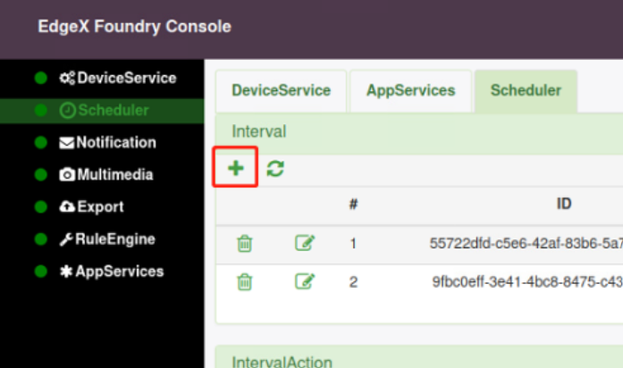 
4. 填写该规则的名称，并指定定时任务的频率（Frequency），例如1秒。 
   
   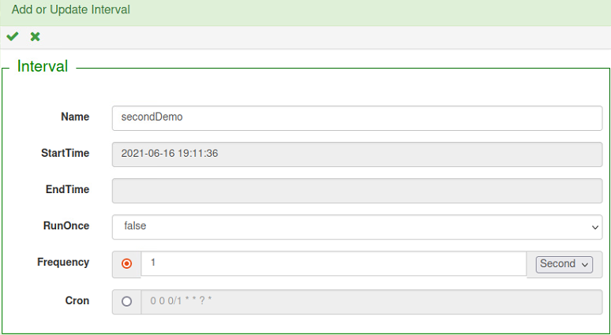 

5. 点击左上角的对勾保存设置。 
   新添加的规则会出现在列表中。 

   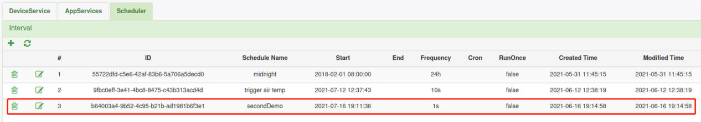 

6. 点击IntervalAction下的+号，增加触发定时任务的规则。 
   
   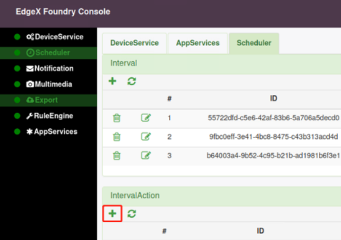 
7. 填写规则的参数。
   - Name：规则的名称
   - Interval：触发定时任务的时间间隔，例如，选择前面创建的时间间隔规则
   - Target：选择core-command
   - TargetAction：选择要触发的动作，例如，查询灯的开关状态：owon switch_{灯的MAC地址}(get) 
   其他参数保持默认即可。 

   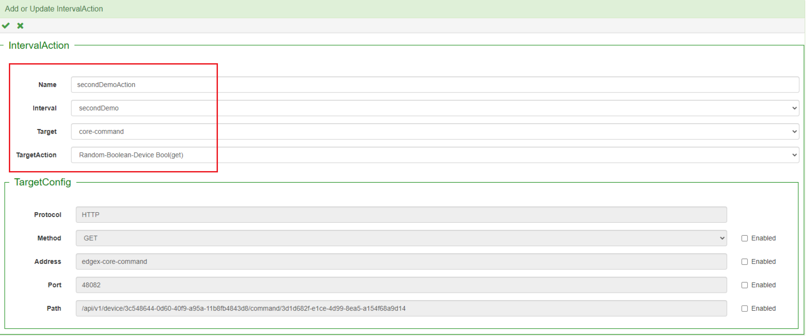 
8. 点击左上角的对勾保存设置。 
   新添加的规则会出现在列表中。 
   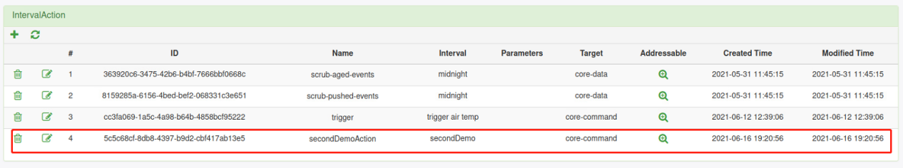 

### 3. 配置导出任务
1. 通过浏览器登录EdgeX Foundry Console，访问地址：http://{EdgeX Foundry服务器IP地址}:4000/。
2. 在左侧导航栏选择AppServices，点击右侧的AppServices页签。
3. 在AppServices下拉框选择AppService-rules-engine。 
   
   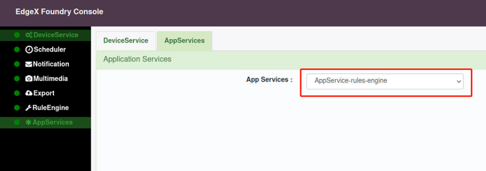 
4. 点击右侧窗格中的Filtering，单击选择FilterByDeviceName。 
   选中后FilterByDeviceName出现在窗口中间位置。 
   
   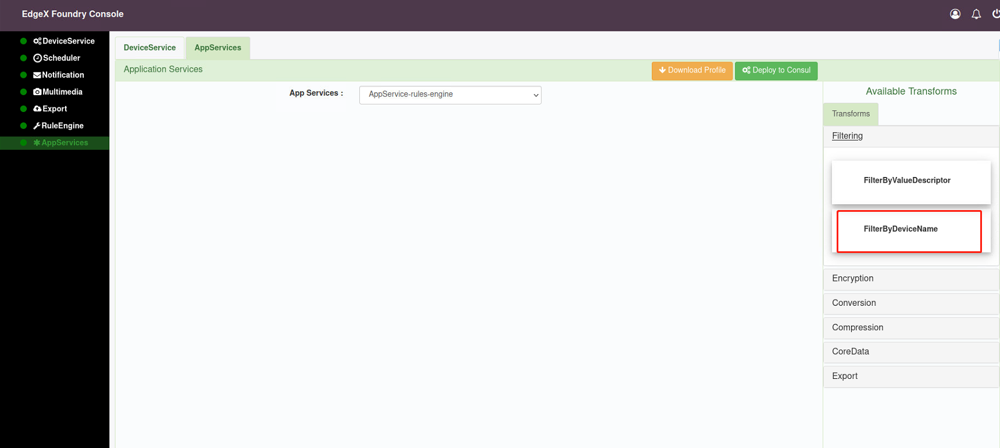 
   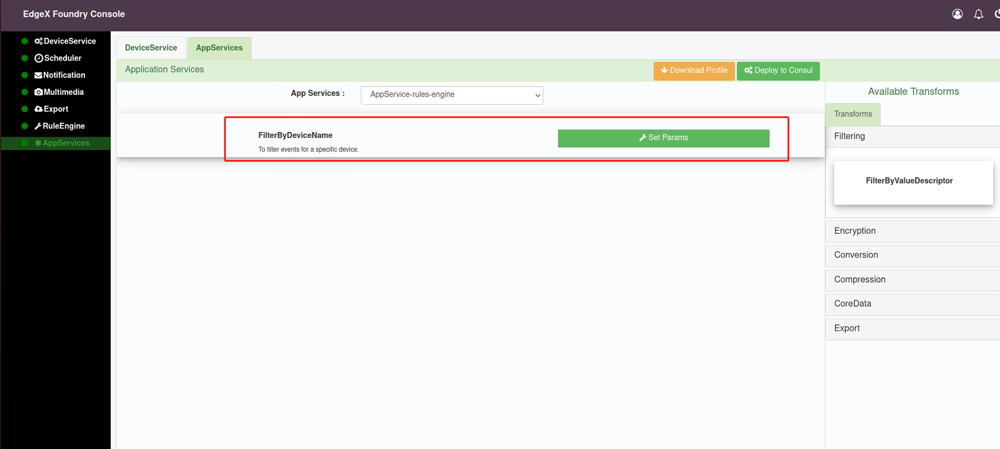 
5. 点击FilterByDeviceName右侧的Set Params按钮。在Parameters对话框中选择要过滤的设备名称，例如owon。 
   
   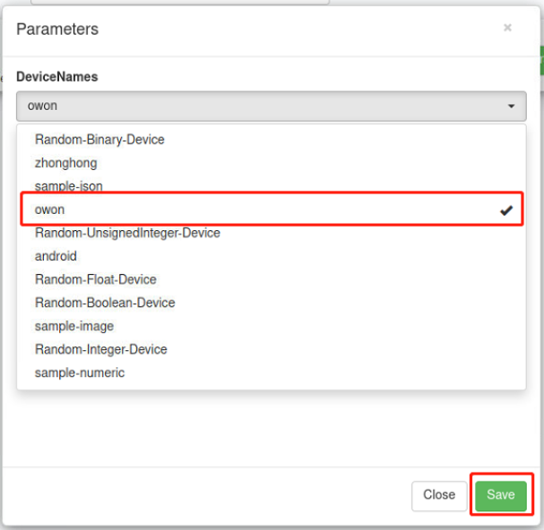 
6. 点击右侧窗格中的Export，单击选择MQTTSend。 
   选中后MQTTSend出现在窗口中间位置。 
   
   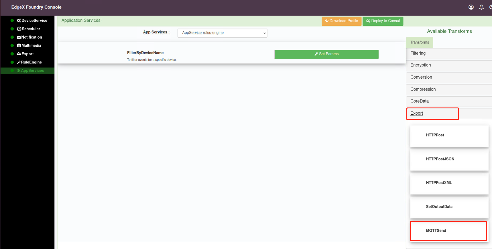 
7. 点击MQTTSend右侧的Set Params按钮。在Parameters对话框中填写要导出数据的MQTT Broker信息。 
   
   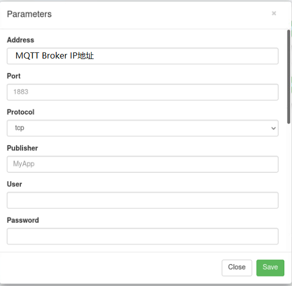 
8. 点击Deploy to Consul，完成配置。 
   配置完成后，owon的所有数据均会主动发送到此MQTT Broker。 

   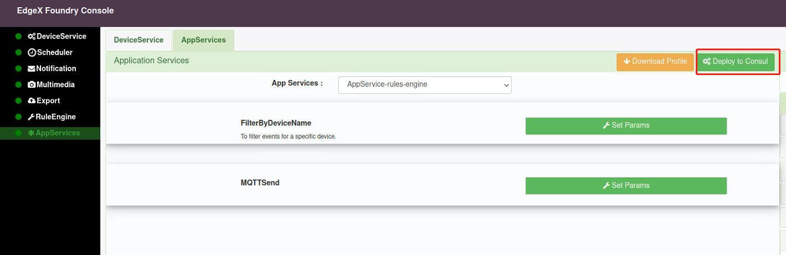
9.  登录Edgex Foundry服务器，执行`~# mosquitto_sub -t exportTopic`命令，接收所配置的导出任务发送的数据。 
   
   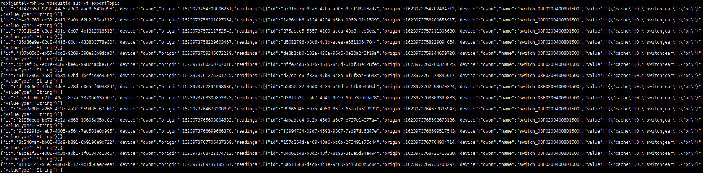

   

   

