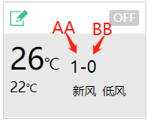

<h1>IoT设备MQTT接口说明</h1>

- [1. 通用接口](#1-通用接口)
  - [1.1 查看所有已注册设备的命令信息列表](#11-查看所有已注册设备的命令信息列表)
- [2. 控制音乐安卓设备](#2-控制音乐安卓设备)
  - [2.1 查询安卓音乐盒子的命令信息列表](#21-查询安卓音乐盒子的命令信息列表)
  - [2.2 更新节目计划](#22-更新节目计划)
  - [2.3 更新节目](#23-更新节目)
  - [2.4 控制安卓音乐盒子](#24-控制安卓音乐盒子)
  - [2.5 安卓音乐盒子截屏并上传](#25-安卓音乐盒子截屏并上传)
  - [2.6 控制音乐](#26-控制音乐)
- [3. 通过中弘网关控制空调](#3-通过中弘网关控制空调)
  - [3.1 查询中弘网关下空调设备的命令信息列表](#31-查询中弘网关下空调设备的命令信息列表)
  - [3.2 查询空调的状态](#32-查询空调的状态)
  - [3.3 设置空调的开关状态](#33-设置空调的开关状态)
  - [3.4 查询空调的温度](#34-查询空调的温度)
  - [3.5 设置空调的温度](#35-设置空调的温度)
  - [3.6 查询空调当前的模式](#36-查询空调当前的模式)
  - [3.7 设置空调的模式](#37-设置空调的模式)
  - [3.8 查询空调的风速](#38-查询空调的风速)
  - [3.9 设置空调的风速](#39-设置空调的风速)
  - [3.10 查询空调当前的回风温度](#310-查询空调当前的回风温度)
  - [3.11 查询空调的故障状态](#311-查询空调的故障状态)
- [4. 通过OWON网关控制灯](#4-通过owon网关控制灯)
  - [4.1 获取OWON网关下灯设备的命令信息列表](#41-获取owon网关下灯设备的命令信息列表)
  - [4.2 查询灯的状态](#42-查询灯的状态)
  - [4.3 设置灯的开关状态](#43-设置灯的开关状态)
  - [4.4 查询灯的亮度](#44-查询灯的亮度)
  - [4.5 设置灯的亮度](#45-设置灯的亮度)
  - [4.6 查找灯的位置](#46-查找灯的位置)
  - [4.7 查看OWON网关连接的所有设备](#47-查看owon网关连接的所有设备)
  - [4.8 查看灯的色温](#48-查看灯的色温)
  - [4.9 设置灯的色温](#49-设置灯的色温)
  - [4.10 查看灯的颜色](#410-查看灯的颜色)
  - [4.11 设置灯的颜色](#411-设置灯的颜色)
- [5. 附录](#5-附录)
  - [5.1 响应公共参数](#51-响应公共参数)
  - [5.2 返回码](#52-返回码)
  - [5.3 颜色代码转换](#53-颜色代码转换)
  - [5.4 空调的状态寄存器和控制寄存器地址计算](#54-空调的状态寄存器和控制寄存器地址计算)

<br>

您可以将安卓设备、中控面板，业务网关等设备注册到EdgeX Foundry服务，通过MQTT服务接口对设备进行控制操作。<br>
使用本文档中的接口之前，您需要为MQTT客户端订阅response_topic/#主题。

## 1. 通用接口
### 1.1 查看所有已注册设备的命令信息列表

**请求主题**

```html
 request_topic/command_get
```

**响应主题**

```html
response_topic/command_get
```

**请求**<br>
请求URL：
```html
http://edgex-core-command:48082/api/v1/device
```

请求消息样例：

```html
{
    "requestUUid":"000cfca0-50d9-4665-92e1-c7be3e4a2e0f",
    "methodUrl":"http://edgex-core-command:48082/api/v1/device",
    "methodParam":null
}
```

**响应**<br>
响应参数：
|     名称          |     参数类型      |     说明                  |     位置                                                                                                                 |   
|-----------------------|-------------------|-------------------------------|--------------------------------------------------------------------------------------------------------------------------|
|     id                |     String        |     设备ID                    |     edgexbody中的数据结构                                                                                              |   
|     name              |     String        |     设备名称                  |     edgexbody中的数据结构                                                                                              |   
|     adminState        |     String        |     设备管理状态              |     edgexbody中的数据结构                                                                                              |   
|     operatingState    |     String        |     设备运行状态              |     edgexbody中的数据结构                                                                                             |   
|     labels            |     String数组    |     设备标签                  |     edgexbody中的数据结构                                                                                              |   
|    commands          |   JSON数组      |     设备命令信息列表          |     edgexbody中的数据结构                                                                                              |   
|     created           |     Long          |     命令创建时间戳            |     commands中的数据结构                                                                                               |   
|     modified          |     Long          |     命令修改时间戳            |     commands中的数据结构                                                                                               |   
|     id                |     String        |     命令ID                    |     commands中的数据结构                                                                                               |   
|     name              |     String        |     命令名称                  |     commands中的数据结构                                                                                               |   
|     get               |     JSON对象      |     命令GET方法               |     commands中的数据结构                                                                                               |   
|     url               |     String        |     命令GET方法的URL          |     get中的数据结构                                                                                                    |   
|     path              |     String        |     命令GET方法的路径     |     get中的数据结构                                                                                                    |   
|     responses         |     JSON数组      |     命令GET方法的响应         |     get中的数据结构                                                                                                   |   
|     code              |     String        |     响应码                    |     responses中的数据结构                                                                                              |   
|     expectedValues    |     String数组    |     期望的数值                |     responses中的数据结构                                                                                             |   
|     description       |     String        |     响应描述                  |     responses中的数据结构                                                                                              |   
|     parameterNames    |     String数组    |     命令GET方法的参数名       |     get中的数据结构                                                                                                    |   
|     put               |     JSON对象      |     命令PUT方法               |     commands中的数据结构                                                                                               |   
|     url               |     String        |     命令PUT方法的URL         |     put中的数据结构                                                                                                    |   
|     path              |     String        |     命令PUT方法的路径     |     put中的数据结构                                                                                                    |   
|     responses         |   JSON数组      |     命令PUT方法的响应         |     put中的数据结构                                                                                                    |   
|     code              |     String        |     响应码                    |     responses中的数据结构                                                                                              |   
|     expectedValues    |     String数组    |     期望的数值                |     responses中的数据结构                                                                                              |   
|     description       |     String        |     响应描述                  |     responses中的数据结构                                                                                              |   
|     parameterNames    |     String数组    |     命令PUT方法的参数名       |     put中的数据结构                                                                                                    |   

其他参数请参考[5.1 响应公共参数](#51-响应公共参数)。<br>

响应消息样例：

```html
{
    "requestUUid": "000cfca0-50d9-4665-92e1-c7be3e4a2e0f",
    "edgexCode": "200",
    "edgexMsg": "Edgex端处理请求成功!",
    "edgexbody": [{
        "id": "09265557-3516-4418-9a0f-ba107a31f8d2",
        "name": "Random-Binary-Device",
        "adminState": "UNLOCKED",
        "operatingState": "ENABLED",
        "labels": [
            "device-virtual-example"
        ],
        "commands": [
            {
                "created": 1617869408629,
                "modified": 1617869408629,
                "id": "0ca06937-4d50-4a1f-8fa2-ecddd6690c9c",
                "name": "Binary",
                "get": {
                    "path": "/api/v1/device/{deviceId}/Binary",
                    "responses": [
                        {
                            "code": "200",
                                "expectedValues": [
                                    "Binary"
                                ]
                        },
                        {
                            "code": "503",
                            "description": "service unavailable"
                        }
                    ],
                        "url": "http://edgex-core-command:48082/api/v1/device/09265557-3516-4418-9a0f-ba107a31f8d2/command/0ca06937-4d50-4a1f-8fa2-ecddd6690c9c"
                },
                "put": {
                        "url": "http://edgex-core-command:48082/api/v1/device/09265557-3516-4418-9a0f-ba107a31f8d2/command/0ca06937-4d50-4a1f-8fa2-ecddd6690c9c"
                }
            }
        ]
    },
    ……
    ]
}
```


## 2. 控制音乐安卓设备
### 2.1 查询安卓音乐盒子的命令信息列表

**请求主题**

```html
request_topic/command_get
```

**响应主题**

```html
response_topic/command_get
```
**请求**<br>
请求URL：
```html
http://edgex-core-command:48082/api/v1/device/name/android
```

请求消息样例：

```html
{
    "requestUUid":"b29cfc80-50d9-4665-92e1-c7be3e4a2e0f",
    "methodUrl":"http://edgex-core-command:48082/api/v1/device/name/android",
    "methodParam":null
}
```

**响应**<br>
响应参数：
|     响应字段          |     字段类型      |     字段描述                  |     说明                                                                                                                 |
|-----------------------|-------------------|-------------------------------|--------------------------------------------------------------------------------------------------------------------------|
|     id                |     String        |     设备ID                    |     edgexbody中的数据结构                                                                                              |
|     name              |     String        |     设备名称                  |     edgexbody中的数据结构                                                                                              |
|     adminState        |     String        |     设备管理状态              |     edgexbody中的数据结构                                                                                              |
|     operatingState    |     String        |     设备运行状态              |     edgexbody中的数据结构                                                                                              |
|     labels            |     String数组    |     设备标签                  |     edgexbody中的数据结构                                                                                              |
|     commands          |     JSON数组      |     设备命令信息列表          |     edgexbody中的数据结构                                                                                              |
|     created           |     Long          |     命令创建时间戳            |     commands中的数据结构                                                                                              |
|     modified          |     Long          |     命令修改时间戳            |     commands中的数据结构                                                                                               |
|     id                |     String        |     命令ID                    |     commands中的数据结构                                                                                               |
|     name              |     String        |     命令名称                  |     commands中的数据结构                                                                                               |
|     get               |     Json对象      |     命令GET方法               |     commands中的数据结构                                                                                              |
|     url               |     String        |     命令GET方法的URL          |     get中的数据结构                                                                                                    |
|     path              |     String        |     命令GET方法的路径     |     get中的数据结构                                                                                                    |
|     responses         |     JSON数组      |     命令GET方法的响应         |     get中的数据结构                                                                                                    |
|     code              |     String        |     响应码                    |     responses中的数据结构                                                                                              |
|     expectedValues    |     String数组    |     期望的数值                |     responses中的数据结构                                                                                              |
|     description       |     String        |     响应描述                  |     responses中的数据结构                                                                                              |
|     parameterNames    |     String数组    |     命令GET方法的参数名       |     get中的数据结构                                                                                                    |
|     put               |     JSON对象      |     命令PUT方法               |     commands中的数据结构                                                                                               |
|     url               |     String        |     命令PUT方法的URL         |     put中的数据结构                                                                                                    |
|     path              |     String        |     命令PUT方法的路径     |     put中的数据结构                                                                                                    |
|     responses         |     Json数组      |     命令PUT方法的响应         |     put中的数据结构                                                                                                   |
|     code              |     String        |     响应码                    |     responses中的数据结构                                                                                             |
|     expectedValues    |     String数组    |     期望的数值                |     responses中的数据结构                                                                                             |
|     description       |     String        |     响应描述                  |     responses中的数据结构                                                                                              |
|     parameterNames    |     String数组    |     命令PUT方法的参数名       |     put中的数据结构                                                                                                    |

其他参数请参考[5.1 响应公共参数](#51-响应公共参数)。<br>

响应消息样例：

```html
{
	"requestUUid": "b29cfc80-50d9-4665-92e1-c7be3e4a2e0f",
	"edgexCode": "200",
	"edgexMsg": "Edgex端处理请求成功!",
	"edgexbody": {
	    "id": "73e5aa47-9cdb-44fe-844c-3faf8598309e",
	    "name": "android",
	    "adminState": "UNLOCKED",
	    "operatingState": "ENABLED",
	    "labels": [
	        ""
	    ],
	    "commands": [
	        {
	            "created": 1622179085504,
	            "modified": 1622179085504,
	            "id": "7ce8e81a-925b-4166-95ef-db992d9117de",
	            "name": "program",
	            "get": {
	                "url": "http://edgex-core-command:48082/api/v1/device/73e5aa47-9cdb-44fe-844c-3faf8598309e/command/7ce8e81a-925b-4166-95ef-db992d9117de"
	            },
	            "put": {
	                "path": "/api/v1/device/{deviceId}/program",
	                "responses": [
	                    {
	                        "code": "200",
	                        "description": "set program success."
	                    },
	                    {
	                        "code": "204",
	                        "description": "set the program."
	                    },
	                    {
	                        "code": "503",
	                        "description": "service unavailable"
	                    }
	                ],
	                "url": "http://edgex-core-command:48082/api/v1/device/73e5aa47-9cdb-44fe-844c-3faf8598309e/command/7ce8e81a-925b-4166-95ef-db992d9117de",
	                "parameterNames": [
	                    "program"
	                ]
	            }
	        },
	        ……
	    ]
	}
}
```


### 2.2 更新节目计划

**请求主题**

```html
request_topic/command_put
```

**响应主题**

```html
response_topic/command_put
```

**请求**<br>
请求URL：
```html
http://edgex-core-command:48082/api/v1/device/73e5aa47-9cdb-44fe-844c-3faf8598309e/command/c56cab3c-6ef8-4a55-a203-03c5f851e425
```
请求参数：
| 名称 | 是否必须 | 参数类型 | 说明 |
| --- | --- | --- | --- |
| schedule | 是 | String | 更新安卓音乐盒子的节目计划<br>mac：安卓音乐盒子的MAC地址 |

请求消息样例：

```html
{
	"requestUUid":"ce123481-42f1-5ce5-12e0-234cgh5a1b1d",
	"methodUrl":"http://edgex-core-command:48082/api/v1/device/73e5aa47-9cdb-44fe-844c-3faf8598309e/command/c56cab3c-6ef8-4a55-a203-03c5f851e425",
	"methodParam":{
	"schedule":"{\"mac\":\"38CA73126BCB\"}"
	}
}
```

**响应**<br>
接口正常的返回码为2xx，例如200或者204。<br>
关于更多返回码和响应参数，请参考[5.1 响应公共参数](#51-响应公共参数)和[5.2 返回码](#52-返回码)。

### 2.3 更新节目

**请求主题**
```html
request_topic/command_put
```

**响应主题**

```html
response_topic/command_put
```
**请求**<br>
请求URL：
```html
http://edgex-core-command:48082/api/v1/device/73e5aa47-9cdb-44fe-844c-3faf8598309e/command/7ce8e81a-925b-4166-95ef-db992d9117de
```

请求参数：
| 名称 | 是否必须 | 参数类型 | 说明 |
| --- | --- | --- | --- |
| program | 是 | String | 更新安卓音乐盒子的节目<br>mac：安卓音乐盒子的MAC地址 |

请求消息样例：

```html
{
	"requestUUid":"12aef4g4-12r0-6a15-01g8-890a920b9v8f",
	"methodUrl":"http://edgex-core-command:48082/api/v1/device/73e5aa47-9cdb-44fe-844c-3faf8598309e/command/7ce8e81a-925b-4166-95ef-db992d9117de",
	"methodParam":{
	"program":"{\"mac\":\"38CA73126BCB\"}"
	}
}
```

**响应**<br>
接口正常的返回码为2xx，例如200或者204。<br>
关于更多返回码和响应参数，请参考[5.1 响应公共参数](#51-响应公共参数)和[5.2 返回码](#52-返回码)。

### 2.4 控制安卓音乐盒子

**请求主题**

```html
request_topic/command_put
```

**响应主题**

```html
response_topic/command_put
```

**请求**<br>
请求URL：
```html
http://edgex-core-command:48082/api/v1/device/73e5aa47-9cdb-44fe-844c-3faf8598309e/command/f2929af5-12dd-497a-a66d-759157ab559b
```
请求参数：
| 名称 | 是否必须 | 参数类型 | 说明 |
| --- | --- | --- | --- |
| device_control | 是 | String | 设备截屏并上传的频率<br>mac：安卓音乐盒子的MAC地址<br>switch：设备开关；1表示开，0表示关<br>backlight：屏幕亮度；取值范围为0-100<br>volume：音量；取值范围为0-100<br>rotation：屏幕旋转角度；取值为0，90，180或270 |

请求消息样例：
```html
{
    "methodUrl":"http://edgex-core-command:48082/api/v1/device/73e5aa47-9cdb-44fe-844c-3faf8598309e/command/f2929af5-12dd-497a-a66d-759157ab559b",
    "device_control":"{\"mac\":\"38CA73126BCB\",\"switch\":0,\"backlight\":100,\"volume\":100,\"rotation\":0}"
}
```

**响应**<br>
接口正常的返回码为2xx，例如200或者204。<br>
关于更多返回码和响应参数，请参考[5.1 响应公共参数](#51-响应公共参数)和[5.2 返回码](#52-返回码)。

### 2.5 安卓音乐盒子截屏并上传

**请求主题**

```html
request_topic/command_put
```

**响应主题**

```html
response_topic/command_put
```
**请求**<br>
请求URL：
```html
http://edgex-core-command:48082/api/v1/device/73e5aa47-9cdb-44fe-844c-3faf8598309e/command/30370719-3b57-4d5f-a5c4-ea301c2a319c
```

请求参数：
| 名称 | 是否必须 | 参数类型 | 说明 |
| --- | --- | --- | --- |
| screenshot | 是 | String | 设备截屏并上传的频率<br>mac：安卓音乐盒子的MAC地址<br>delay：截屏间隔秒数<br>num：截屏上传次数 |

请求消息样例：

```html
{
    "requestUUid":"002vbb1a-210b-cd05-389c-c18390a03ad8",
    "methodUrl":"http://edgex-core-command:48082/api/v1/device/73e5aa47-9cdb-44fe-844c-3faf8598309e/command/30370719-3b57-4d5f-a5c4-ea301c2a319c",
    "methodParam":{
     "screenshot":"{\"mac\":\"38CA73126BCB\",\"delay\":1,\"num\":1}"
    }
}
```

**响应**<br>
接口正常的返回码为2xx，例如200或者204。<br>
关于更多返回码和响应参数，请参考[5.1 响应公共参数](#51-响应公共参数)和[5.2 返回码](#52-返回码)。

### 2.6 控制音乐

**请求主题**

```html
request_topic/command_put
```

**响应主题**

```html
response_topic/command_put
```

**请求**<br>
请求URL：
```html
http://edgex-core-command:48082/api/v1/device/73e5aa47-9cdb-44fe-844c-3faf8598309e/command/1f7a319a-d734-4966-a3d3-529472572e3d
```

请求参数：
| 名称 | 是否必须 | 参数类型 | 说明 |
| --- | --- | --- | --- |
| music_control | 是 | String | 音乐控制操作<br>mac：安卓音乐盒子的MAC地址<br>action：音乐控制命令，取值范围：<br>- play：播放<br>- pre：上一首<br>- next：下一首<br>- pause：暂停<br>- prelist：上一个歌单<br>- nextlist：下一个歌单<br>- jump：切换歌曲<br>audio_id：音乐文件ID<br>当action为jump时该参数设置为音乐文件的ID，当action为其他取值时该参数置0。 |

请求消息样例：

```html
{
    "requestUUid":"64ab903d-dc12-5803-70dc-d7210daf102b",
    "methodUrl":"http://edgex-core-command:48082/api/v1/device/73e5aa47-9cdb-44fe-844c-3faf8598309e/command/1f7a319a-d734-4966-a3d3-529472572e3d",
    "methodParam":{
     "music_control":"{\"mac\":\"38CA73126BCB\",\"action\":\"pause\",\"audio_id\":0}"
    }
}
```

**响应**<br>
接口正常的返回码为2xx，例如200或者204。<br>
关于更多返回码和响应参数，请参考[5.1 响应公共参数](#51-响应公共参数)和[5.2 返回码](#52-返回码)。


## 3. 通过中弘网关控制空调
### 3.1 查询中弘网关下空调设备的命令信息列表

**请求主题**

```html
request_topic/command_get
```

**响应主题**

```html
response_topic/command_get
```

**请求**<br>
请求URL：
```html
http://edgex-core-command:48082/api/v1/device/name/zhonghong
```
请求消息样例：

```html
{
    "requestUUid":"123cfc80-50d9-4665-92e1-c7be3e4a2456",
    "methodUrl":"http://edgex-core-command:48082/api/v1/device/name/zhonghong",
    "methodParam":null
}
```

**响应**<br>
响应参数：
|     名称          |     参数类型      |     说明                  |     位置                                                                                                                 |
|-----------------------|-------------------|-------------------------------|--------------------------------------------------------------------------------------------------------------------------|
|     id                |     String        |     设备ID                    |     edgexbody中的数据结构                                                                                              |
|     name              |     String        |     设备名称                  |     edgexbody中的数据结构                                                                                             |
|     adminState        |     String        |     设备管理状态              |     edgexbody中的数据结构                                                                                              |
|     operatingState    |     String        |     设备运行状态              |     edgexbody中的数据结构                                                                                              |
|     labels            |     String数组    |     设备标签                  |     edgexbody中的数据结构                                                                                              |
|     commands          |     JSON数组      |     设备命令信息列表          |     edgexbody中的数据结构                                                                                              |
|     created           |     Long          |     命令创建时间戳            |     commands中的数据结构                                                                                               |
|     modified          |     Long          |     命令修改时间戳            |     commands中的数据结构                                                                                               |
|     id                |     String        |     命令ID                    |     commands中的数据结构                                                                                               |
|     name              |     String        |     命令名称                  |     commands中的数据结构                                                                                               |
|     get               |     JSON对象      |     命令GET方法               |     commands中的数据结构                                                                                               |
|     url               |     String        |     命令GET方法的URL         |     get中的数据结构                                                                                                    |
|     path              |     String        |     命令GET方法的路径     |     get中的数据结构                                                                                                    |
|     responses         |     JSON数组      |     命令GET方法的响应         |     get中的数据结构                                                                                                    |
|     code              |     String        |     响应码                    |     responses中的数据结构                                                                                              |
|     expectedValues    |     String数组    |     期望的数值                |     responses中的数据结构                                                                                              |
|     description       |     String        |     响应描述                  |     responses中的数据结构                                                                                              |
|     parameterNames    |     String数组    |     命令GET方法的参数名       |     get中的数据结构                                                                                                    |
|     put               |     JSON对象      |     命令PUT方法               |     commands中的数据结构                                                                                               |
|     url               |     String        |     命令PUT方法的URL          |     put中的数据结构                                                                                                    |
|     path              |     String        |     命令PUT方法的路径     |     put中的数据结构                                                                                                    |
|     responses         |     JSON数组      |     命令PUT方法的响应         |     put中的数据结构                                                                                                    |
|     code              |     String        |     响应码                    |     responses中的数据结构                                                                                              |
|     expectedValues    |     String数组    |     期望的数值                |     responses中的数据结构                                                                                             |
|     description       |     String        |     响应描述                  |     responses中的数据结构                                                                                              |
|     parameterNames    |     String数组    |     命令PUT方法的参数名       |     put中的数据结构                                                                                                   |

其他参数请参考[5.1 响应公共参数](#51-响应公共参数)。<br>

响应消息示例：

```html
{
    "requestUUid": "123cfc80-50d9-4665-92e1-c7be3e4a2456",
    "edgexCode": "200",
    "edgexMsg": "Edgex端处理请求成功!",
    "edgexbody": {
        "id": "3605fe85-cbdc-4e87-8db9-2befe6a9c380",
        "name": "zhonghong",
        "adminState": "UNLOCKED",
        "operatingState": "ENABLED",
        "labels": [
            "air"
        ],
        "commands": [
            {
                "created": 1618888660820,
                "modified": 1618888660820,
                "id": "e0f60b31-9b99-4529-b668-59c035e4d461",
                "name": "PowerGet_193",
                "get": {
                    "path": "/api/v1/device/{deviceId}/PowerGet_193",
                    "responses": [
                        {
                            "code": "200",
                            "description": "Get the PowerGet_193",
                                "expectedValues": ["PowerGet_193"]
                        },
                        {
                            "code": "500",
                            "description": "internal server error"
                        }
                    ],
                    "url": "http://edgex-core-command:48082/api/v1/device/3605fe85-cbdc-4e87-8db9-2befe6a9c380/command/e0f60b31-9b99-4529-b668-59c035e4d461"
                },
                "put": {
                    "url": "http://edgex-core-command:48082/api/v1/device/3605fe85-cbdc-4e87-8db9-2befe6a9c380/command/e0f60b31-9b99-4529-b668-59c035e4d461"
                }
            },
            ……
        ]
    }
}
```

### 3.2 查询空调的状态

**请求主题**

```html
request_topic/command_get
```

**响应主题**

```html
response_topic/command_get
```

**请求**<br>
请求URL：
```html
http://edgex-core-command:48082/api/v1/device/3605fe85-cbdc-4e87-8db9-2befe6a9c380/command/e0f60b31-9b99-4529-b668-59c035e4d461
```

请求消息样例：
```html
{
    "requestUUid":"ce123400-42f1-5ce5-12e0-334dfh5a1b1d",
    "methodUrl":"http://edgex-core-command:48082/api/v1/device/3605fe85-cbdc-4e87-8db9-2befe6a9c380/command/e0f60b31-9b99-4529-b668-59c035e4d461",
    "methodParam":null
}
```

**响应**<br>
响应参数：

|     名称        |    参数类型    |     说明                  |     位置                                                                                                                 |
|---------------------|-----------------|-------------------------------|--------------------------------------------------------------------------------------------------------------------------|
|     device          |     String      |     设备对应的网关名称        |     edgexbody中的数据结构                                                                                              |
|     origin          |     Long        |     时间戳，标识唯一性      |     edgexbody中的数据结构                                                                                  |
|     readings        |     JSON数组    |     设备命令对应的数据参数    |     edgexbody中的数据结构                                                                                             |
|     origin          |     Long        |     时间戳，标识唯一性      |     readings中的数据结构                                                                                   |
|     device          |     String      |     设备对应的网关名称        |     readings中的数据结构                                                                                               |
|     name            |     String      |     设备命令名称              |     readings中的数据结构                                                                                             |
|     value           |     String      |     空调的状态<br>1：开机；0：关机            |     readings中的数据结构                                                        |
|     valueType       |     String      |     value字段的类型        |     readings中的数据结构                                                                                               |
|     EncodedEvent    |     null        |     未使用                      |     edgexbody中的数据结构                                                                                     |

其他参数请参考[5.1 响应公共参数](#51-响应公共参数)。<br>

响应消息样例：

```html
{
    "requestUUid": "ce123400-42f1-5ce5-12e0-334dfh5a1b1d",
    "edgexCode": "200",
    "edgexMsg": "Edgex端处理请求成功!",
    "edgexbody": {
    "device": "zhonghong",
    "origin": 1619600246998289461,
    "readings": [
                {
                    "origin": 1619600246998076187,
                    "device": "zhonghong",
                    "name": "PowerGet_193",
                    "value": "0",
                    "valueType": "Uint16"
                }
                ],
    "EncodedEvent": null
    }
}
```

### 3.3 设置空调的开关状态
**请求主题**

```html
request_topic/command_put
```

**响应主题**

```html
response_topic/command_put
```

**请求**<br>
请求URL：
```html
http://edgex-core-command:48082/api/v1/device/3605fe85-cbdc-4e87-8db9-2befe6a9c380/command/6b4ed33b-f3ea-426c-833e-51fe3ab05da3
```

请求参数：
| 名称                            | 是否必须 | 参数类型 | 说明                                     |
| ------------------------------- | -------- | -------- | ---------------------------------------- |
| PowerSet_{空调的控制寄存器地址} | 是       | string   | 空调的开关状态<br>0：关机<br>1：开机 |

关于如何获取空调的控制寄存器地址，请参考[5.4 空调的状态寄存器和控制寄存器地址计算](#54-空调的状态寄存器和控制寄存器地址计算)。

请求消息样例：

```html
{
    "requestUUid":"ce123401-42f1-5ce5-12e0-334dfh5a1b1d",
    "methodUrl":"http://edgex-core-command:48082/api/v1/device/3605fe85-cbdc-4e87-8db9-2befe6a9c380/command/6b4ed33b-f3ea-426c-833e-51fe3ab05da3",
    "methodParam":{
     "PowerSet_4129":"1"
    }
}
```

**响应**<br>
接口正常的返回码为2xx，例如200或者204。<br>
关于更多返回码和响应参数，请参考[5.1 响应公共参数](#51-响应公共参数)和[5.2 返回码](#52-返回码)。

### 3.4 查询空调的温度

**请求主题**

```html
request_topic/command_get
```

**响应主题**

```html
response_topic/command_get
```
**请求**<br>
请求URL：
```html
http://edgex-core-command:48082/api/v1/device/3605fe85-cbdc-4e87-8db9-2befe6a9c380/command/6568d7e1-089f-4db9-91b3-e65024181fec
```

请求消息样例：

```html
{
    "requestUUid":"ce123404-42f1-5ce5-12e0-334dfh5a1b1d",
    "methodUrl":"http://edgex-core-command:48082/api/v1/device/3605fe85-cbdc-4e87-8db9-2befe6a9c380/command/6568d7e1-089f-4db9-91b3-e65024181fec",
    "methodParam":null
}
```

**响应**<br>
响应参数：
|     名称        |     参数类型    |     说明                  |     位置                                           |
|---------------------|-----------------|-------------------------------|--------------------------------------------------------------------------------------------------------------------------|
|     device          |     String      |     设备对应的网关名称        |     edgexbody中的数据结构                                                                                              |
|     origin          |     Long        |     时间戳，标识唯一性                    |     edgexbody中的数据结构                                                                                  |
|     readings        |     JSON数组    |     设备命令对应的数据参数    |     edgexbody中的数据结构                                                                                              |
|     origin          |     Long        |     时间戳，标识唯一性                    |     readings中的数据结构                                                                                   |
|     device          |     String      |     设备对应的网关名称        |     readings中的数据结构                                                                                               |
|     name            |     String      |     设备命令名称              |     readings中的数据结构                                                                                               |
|     value           |     String      |     空调的温度<br>取值范围：16-32      |     readings中的数据结构                                                                      |
|     valueType       |     String      |     value字段的类型        |     readings中的数据结构                                                                                               |
|     EncodedEvent    |     null        |     未使用                      |     edgexbody中的数据结构                                                                                      |

其他参数请参考[5.1 响应公共参数](#51-响应公共参数)。<br>

响应消息样例：

```html
{
        "requestUUid": "ce123404-42f1-5ce5-12e0-334dfh5a1b1d",
        "edgexCode": "200",
        "edgexMsg": "Edgex端处理请求成功!",
        "edgexbody": {
            "device": "zhonghong",
            "origin": 1623136651663160380,
            "readings": [
                {
                    "origin": 1623136651662950614,
                    "device": "zhonghong",
                    "name": "TemperatureGet_194",
                    "value": "26",
                    "valueType": "Uint16"
                }
            ],
        "EncodedEvent": null
        }
}
```

### 3.5 设置空调的温度

**请求主题**

```html
request_topic/command_put
```

**响应主题**

```html
response_topic/command_put
```

**请求**<br>
请求URL：
```html
http://edgex-core-command:48082/api/v1/device/3605fe85-cbdc-4e87-8db9-2befe6a9c380/command/637c33bc-a11c-4e6d-906d-3a7071cbe8e5
```

请求参数：
| 名称                            | 是否必须 | 参数类型 | 说明                                     |
| ------------------------------- | -------- | -------- | ---------------------------------------- |
| TemperatureSet_{空调的控制寄存器地址} | 是       | string   | 空调的温度<br>取值范围：16-32 |

关于如何获取空调的控制寄存器地址，请参考[5.4 空调的状态寄存器和控制寄存器地址计算](#54-空调的状态寄存器和控制寄存器地址计算)。

请求消息样例：
```html
{
    "requestUUid":"ce123405-42f1-5ce5-12e0-334dfh5a1b1d",
    "methodUrl":"http://edgex-core-command:48082/api/v1/device/3605fe85-cbdc-4e87-8db9-2befe6a9c380/command/637c33bc-a11c-4e6d-906d-3a7071cbe8e5",
    "methodParam":{
     "TemperatureSet_4130":"27"
    }
}
```

**响应**<br>
接口正常的返回码为2xx，例如200或者204。<br>
关于更多返回码和响应参数，请参考[5.1 响应公共参数](#51-响应公共参数)和[5.2 返回码](#52-返回码)。

### 3.6 查询空调当前的模式

**请求主题**

```html
request_topic/command_get
```

**响应主题**

```html
response_topic/command_get
```

**请求**<br>
请求URL：
```html
http://edgex-core-command:48082/api/v1/device/3605fe85-cbdc-4e87-8db9-2befe6a9c380/command/2ba1b751-f3b6-4118-a883-165be69f1b73
```

请求消息样例：
```html
{
    "requestUUid":"ce123406-42f1-5ce5-12e0-334dfh5a1b1d",
    "methodUrl":"http://edgex-core-command:48082/api/v1/device/3605fe85-cbdc-4e87-8db9-2befe6a9c380/command/2ba1b751-f3b6-4118-a883-165be69f1b73",
    "methodParam":null
}
```

**响应**<br>
响应参数：
|     名称        |     参数类型    |     说明                  |     位置                                                                                                                 |
|---------------------|-----------------|-------------------------------|--------------------------------------------------------------------------------------------------------------------------|
|     device          |     String      |     设备对应的网关名称        |     edgexbody中的数据结构                                                                                              |
|     origin          |     Long        |     时间戳，标识唯一性        |     edgexbody中的数据结构                                                                                  |
|     readings        |     JSON数组    |     设备命令对应的数据参数    |     edgexbody中的数据结构                                                                                              |
|     origin          |     Long        |     时间戳，标识唯一性        |     readings中的数据结构                                                                                   |
|     device          |     String      |     设备对应的网关名称        |     readings中的数据结构                                                                                               |
|     name            |     String      |     设备命令名称              |     readings中的数据结构                                                                                               |
|     value           |     String      |     空调的模式<br>1：制冷<br>2：除湿<br>4：送风<br>8：制热 |     readings中的数据结构                                     |
|     valueType       |     String      |     value字段的类型        |     readings中的数据结构                                                                                               |
|     EncodedEvent    |     null        |     未使用                      |     edgexbody中的数据结构                                                                                 |

其他参数请参考[5.1 响应公共参数](#51-响应公共参数)。<br>

响应消息样例：

```html
{
        "requestUUid": "ce123406-42f1-5ce5-12e0-334dfh5a1b1d",
        "edgexCode": "200",
        "edgexMsg": "Edgex端处理请求成功!",
        "edgexbody": {
            "device": "zhonghong",
            "origin": 1623137290581586935,
            "readings": [
                {
                    "origin": 1623137290581345897,
                    "device": "zhonghong",
                    "name": "ModelGet_195",
                    "value": "4",
                    "valueType": "Uint16"
                }
            ],
        "EncodedEvent": null
        }
}
```

### 3.7 设置空调的模式

**请求主题**

```html
request_topic/command_put
```

**响应主题**

```html
response_topic/command_put
```

**请求**<br>
请求URL：
```html
http://edgex-core-command:48082/api/v1/device/3605fe85-cbdc-4e87-8db9-2befe6a9c380/command/f5157652-ab38-4126-9c81-a891a2ea4007
```

请求参数：
| 名称                            | 是否必须 | 参数类型 | 说明                                     |
| ------------------------------- | -------- | -------- | ---------------------------------------- |
| ModelSet_{空调的控制寄存器地址} | 是       | string   | 空调的模式<br>1：制冷<br>2：除湿<br>4：送风<br>8：制热 |

关于如何获取空调的控制寄存器地址，请参考[5.4 空调的状态寄存器和控制寄存器地址计算](#54-空调的状态寄存器和控制寄存器地址计算)。

请求消息样例：
```html
{
    "requestUUid":"ce123407-42f1-5ce5-12e0-334dfh5a1b1d",
    "methodUrl":"http://edgex-core-command:48082/api/v1/device/3605fe85-cbdc-4e87-8db9-2befe6a9c380/command/f5157652-ab38-4126-9c81-a891a2ea4007",
    "methodParam":{
    "ModelSet_4131":"1"
    }
}
```
**响应**<br>
接口正常的返回码为2xx，例如200或者204。<br>
关于更多返回码和响应参数，请参考[5.1 响应公共参数](#51-响应公共参数)和[5.2 返回码](#52-返回码)。

### 3.8 查询空调的风速
**请求主题**

```html
request_topic/command_get
```

**响应主题**

```html
response_topic/command_get
```

**请求**<br>
请求URL：
```html
http://edgex-core-command:48082/api/v1/device/3605fe85-cbdc-4e87-8db9-2befe6a9c380/command/a6316c11-5ab0-48a5-bb3e-f165c76e4cb7
```
请求消息样例：
```html
{
    "requestUUid":"ce123408-42f1-5ce5-12e0-334dfh5a1b1d",
    "methodUrl":"http://edgex-core-command:48082/api/v1/device/3605fe85-cbdc-4e87-8db9-2befe6a9c380/command/a6316c11-5ab0-48a5-bb3e-f165c76e4cb7",
    "methodParam":null
}
```

**响应**<br>
响应参数：
|     名称        |     参数类型    |     说明                  |     位置                                                                                                                 |
|---------------------|-----------------|-------------------------------|--------------------------------------------------------------------------------------------------------------------------|
|     device          |     String      |     设备对应的网关名称        |     edgexbody中的数据结构                                                                                              |
|     origin          |     Long        |     时间戳，标识唯一性                    |     edgexbody中的数据结构                                                                                  |
|     readings        |     JSON数组    |     设备命令对应的数据参数    |     edgexbody中的数据结构                                                                                              |
|     origin          |     Long        |     时间戳，标识唯一性                    |     readings中的数据结构                                                                                  |
|     device          |     String      |     设备对应的网关名称        |     readings中的数据结构                                                                                               |
|     name            |     String      |     设备命令名称              |     readings中的数据结构                                                                                               |
|     value           |     String      |     空调的风速<br>1：高速<br>2：中速<br>4：低速    |     readings中的数据结构                                                 |
|     valueType       |     String      |     value字段的类型        |     readings中的数据结构                                                                                               |
|     EncodedEvent    |     null        |     未使用                      |     edgexbody中的数据结构                                                                                      |

其他参数请参考[5.1 响应公共参数](#51-响应公共参数)。<br>

响应消息样例：
```html
{
        "requestUUid": "ce123408-42f1-5ce5-12e0-334dfh5a1b1d",
        "edgexCode": "200",
        "edgexMsg": "Edgex端处理请求成功!",
        "edgexbody": {
            "device": "zhonghong",
            "origin": 1623137865956317153,
            "readings": [
                {
                    "origin": 1623137865956103501,
                    "device": "zhonghong",
                    "name": "WindSpeedGet_196",
                    "value": "4",
                    "valueType": "Uint16"
                }
            ],
        "EncodedEvent": null
        }
}
```

### 3.9 设置空调的风速
**请求主题**

```html
request_topic/command_put
```

**响应主题**

```html
response_topic/command_put
```

**请求**<br>
请求URL： 
```html
http://edgex-core-command:48082/api/v1/device/3605fe85-cbdc-4e87-8db9-2befe6a9c380/command/b8a5887a-816a-4635-8af2-dbe740dfde97
```

请求参数：
| 名称                            | 是否必须 | 参数类型 | 说明                                     |
| ------------------------------- | -------- | -------- | ---------------------------------------- |
| WindSpeedSet_{空调的控制寄存器地址} | 是       | string   | 空调的模式<br>1：高速<br>2：中速<br>4：低速 |

关于如何获取空调的控制寄存器地址，请参考[5.4 空调的状态寄存器和控制寄存器地址计算](#54-空调的状态寄存器和控制寄存器地址计算)。

请求消息样例：
```html
{
    "requestUUid":"ce123409-42f1-5ce5-12e0-334dfh5a1b1d",
    "methodUrl":"http://edgex-core-command:48082/api/v1/device/3605fe85-cbdc-4e87-8db9-2befe6a9c380/command/b8a5887a-816a-4635-8af2-dbe740dfde97",
    "methodParam":{
    "WindSpeedSet_4132":"2"
    }
}
```

**响应**<br>
接口正常的返回码为2xx，例如200或者204。<br>
关于更多返回码和响应参数，请参考[5.1 响应公共参数](#51-响应公共参数)和[5.2 返回码](#52-返回码)。


### 3.10 查询空调当前的回风温度
**请求主题**

```html
request_topic/command_get
```

**响应主题**

```html
response_topic/command_get
```
**请求**<br>
请求URL：
```html
http://edgex-core-command:48082/api/v1/device/3605fe85-cbdc-4e87-8db9-2befe6a9c380/command/d2a15574-e743-4927-bf38-8536b7efdbbf
```

请求消息样例：
```html
{
    "requestUUid":"ce123410-42f1-5ce5-12e0-334dfh5a1b1d",
    "methodUrl":"http://edgex-core-command:48082/api/v1/device/3605fe85-cbdc-4e87-8db9-2befe6a9c380/command/d2a15574-e743-4927-bf38-8536b7efdbbf",
    "methodParam":null
}
```

**响应**<br>
响应参数：
|     名称        |     参数类型    |     说明                  |     位置                                                                                                                 |
|---------------------|-----------------|-------------------------------|--------------------------------------------------------------------------------------------------------------------------|
|     device          |     String      |     设备对应的网关名称        |     edgexbody中的数据结构                                                                                              |
|     origin          |     Long        |     时间戳，标识唯一性                    |     edgexbody中的数据结构                                                                                  |
|     readings        |     JSON数组    |     设备命令对应的数据参数    |     edgexbody中的数据结构                                                                                              |
|     origin          |     Long        |     时间戳，标识唯一性                    |     readings中的数据结构                                                                                   |
|    device          |     String      |     设备对应的网关名称        |     readings中的数据结构                                                                                               |
|     name            |     String      |     设备命令名称              |     readings中的数据结构                                                                                              |
|     value           |     String      |     空调的回风温度            |     readings中的数据结构                                                                                              |
|     valueType       |     String      |     value字段的类型        |     readings中的数据结构                                                                                               |
|     EncodedEvent    |     null        |     未使用                      |     edgexbody中的数据结构                                                                                      |

其他参数请参考[5.1 响应公共参数](#51-响应公共参数)。<br>

响应消息样例：
```html
{
    "requestUUid": "ce123410-42f1-5ce5-12e0-334dfh5a1b1d",
    "edgexCode": "200",
    "edgexMsg": "Edgex端处理请求成功!",
    "edgexbody": {
    "device": "zhonghong",
    "origin": 1623138237104992191,
    "readings": [
                {
                "origin": 1623138237104756178,
                "device": "zhonghong",
                "name": "CurrentTemperatureGet_197",
                "value": "24",
                "valueType": "Uint16"
                }
                ],
    "EncodedEvent": null
    }
}
```

### 3.11 查询空调的故障状态
**请求主题**
```html
request_topic/command_get
```
**响应主题**
```html
response_topic/command_get
```
**请求**<br>
请求URL：
```html
http://edgex-core-command:48082/api/v1/device/3605fe85-cbdc-4e87-8db9-2befe6a9c380/command/8106398a-f648-4348-9102-c208969e8257
```

请求消息样例：
```html
{
    "requestUUid":"ce123411-42f1-5ce5-12e0-334dfh5a1b1d",
    "methodUrl":"http://edgex-core-command:48082/api/v1/device/3605fe85-cbdc-4e87-8db9-2befe6a9c380/command/8106398a-f648-4348-9102-c208969e8257",
    "methodParam":null
}
```

**响应**<br>
响应参数：
|     名称        |     参数类型    |     说明                  |     位置                                                                                                                 |
|---------------------|-----------------|-------------------------------|--------------------------------------------------------------------------------------------------------------------------|
|     device          |     String      |     设备对应的网关名称        |     edgexbody中的数据结构                                                                                             |
|     origin          |     Long        |     时间戳，标识唯一性                    |     edgexbody中的数据结构                                                                                  |
|     readings        |     JSON数组    |     设备命令对应的数据参数    |     edgexbody中的数据结构                                                                                              |
|     origin          |     Long        |     时间戳，标识唯一性                    |     readings中的数据结构                                                                                   |
|     device          |     String      |     设备对应的网关名称        |     readings中的数据结构                                                                                               |
|     name            |     String      |     设备命令名称              |     readings中的数据结构                                                                                              |
|     value           |     String      |     空调的状态码<br>0：无故障。<br>其他值：设备故障，请联系中弘的技术支持。  |     readings中的数据结构                 |
|     valueType       |     String      |     value字段的类型        |     readings中的数据结构                                                                                               |
|     EncodedEvent    |     null        |     未使用                      |     edgexbody中的数据结构                                                                                      |

其他参数请参考[5.1 响应公共参数](#51-响应公共参数)。<br>

响应消息样例：

```html
{
    "requestUUid": "ce123411-42f1-5ce5-12e0-334dfh5a1b1d",
    "edgexCode": "200",
    "edgexMsg": "Edgex端处理请求成功!",
    "edgexbody": {
        "device": "zhonghong",
        "origin": 1623138418528350283,
        "readings": [
                    {
                    "origin": 1623138418528065581,
                    "device": "zhonghong",
                    "name": "ErrorGet_198",
                    "value": "0",
                    "valueType": "Uint16"
                    }
                    ],
    "EncodedEvent": null
    }
}
```

## 4. 通过OWON网关控制灯

### 4.1 获取OWON网关下灯设备的命令信息列表
**请求主题**

```html
request_topic/command_get
```

**响应主题**

```html
response_topic/command_get
```

**请求**<br>
请求URL：
```html
http://edgex-core-command:48082/api/v1/device/name/owon
```
请求消息样例：

```html
{
    "requestUUid":"456cfc00-50d9-4665-92e1-c7be3e4a2456",
    "methodUrl":"http://edgex-core-command:48082/api/v1/device/name/owon",
    "methodParam":null
}
```

**响应**<br>
响应参数：

|     名称          |     参数类型      |     说明                 |     位置                       |
|-----------------------|-------------------|------------------------------|--------------------------------|
|     id                |     String        |     设备ID                   |     edgexbody中的数据结构    |
|     name              |     String        |     设备名称                 |     edgexbody中的数据结构    |
|     adminState        |     String        |     设备管理状态             |     edgexbody中的数据结构    |
|     operatingState    |     String        |     设备运行状态             |     edgexbody中的数据结构    |
|     labels            |     String数组    |     设备标签                 |     edgexbody中的数据结构    |
|     commands          |     JSON数组      |     设备命令信息列表         |     edgexbody中的数据结构    |
|     created           |     Long          |     命令创建时间戳           |     commands中的数据结构     |
|     modified          |     Long          |     命令修改时间戳           |     commands中的数据结构     |
|     id                |     String        |     命令ID                   |     commands中的数据结构     |
|     name              |     String        |     命令名称                 |     commands中的数据结构     |
|     get               |     JSON对象      |     命令GET方法              |     commands中的数据结构     |
|     url               |     String        |     命令GET方法的URL         |     get中的数据结构          |
|     path              |     String        |     命令GET方法的路径    |     get中的数据结构          |
|     responses         |     JSON数组      |     命令GET方法的响应        |     get中的数据结构          |
|     code              |     String        |     响应码                   |     responses中的数据结构    |
|     expectedValues    |     String数组    |     期望的数值               |     responses中的数据结构   |
|     description       |     String        |     响应描述                 |     responses中的数据结构    |
|     parameterNames    |     String数组    |     命令GET方法的参数名      |     get中的数据结构          |
|     put               |     JSON对象      |     命令PUT方法              |     commands中的数据结构     |
|     url               |     String        |     命令PUT方法的URL         |     put中的数据结构         |
|     path              |     String        |     命令PUT方法的路径    |     put中的数据结构          |
|     responses         |     JSON数组      |     命令PUT方法的响应        |     put中的数据结构          |
|     code              |     String        |     响应码                   |     responses中的数据结构    |
|     expectedValues    |     String数组    |     期望的数值               |     responses中的数据结构    |
|     description       |     String        |     响应描述                 |     responses中的数据结构    |
|     parameterNames    |     String数组    |     命令PUT方法的参数名      |     put中的数据结构          |

其他参数请参考[5.1 响应公共参数](#51-响应公共参数)。<br>

响应消息样例：

```html
{
"requestUUid": "456cfc00-50d9-4665-92e1-c7be3e4a2456",
"edgexCode": "200",
"edgexMsg": "Edgex端处理请求成功!",
"edgexbody": {
    "id": "6e3b94a2-5b72-4234-8fdf-89890c08d2f5",
    "name": "owon",
    "adminState": "UNLOCKED",
    "operatingState": "ENABLED",
    "labels": [
        "lamp"
    ],
    "commands": [
        {
            "created": 1622538254933,
            "modified": 1622538254933,
            "id": "d36c1417-0f9a-4666-bea1-dce85c7478fe",
            "name": "switch_08F02004008D1500",
            "get": {
                "path": "/api/v1/device/{deviceId}/switch_08F02004008D1500",
                "responses": [
                    {
                        "code": "200",
                        "description": "get the switch_08F02004008D1500 status",
                        "expectedValues": [
                            "switch_08F02004008D1500"
                        ]
                    },
                    {
                        "code": "503",
                        "description": "service unavailable"
                    }
                ],
                "url": "http://edgex-core-command:48082/api/v1/device/6e3b94a2-5b72-4234-8fdf-89890c08d2f5/command/d36c1417-0f9a-4666-bea1-dce85c7478fe"
            },
            "put": {
                "path": "/api/v1/device/{deviceId}/switch_08F02004008D1500",
                "responses": [
                    {
                        "code": "200",
                        "description": "set switch success."
                    },
                    {
                        "code": "204",
                        "description": "set the switch."
                    },
                    {
                        "code": "503",
                        "description": "service unavailable"
                    }
                ],
                "url": "http://edgex-core-command:48082/api/v1/device/6e3b94a2-5b72-4234-8fdf-89890c08d2f5/command/d36c1417-0f9a-4666-bea1-dce85c7478fe",
                "parameterNames": [
                    "switch_08F02004008D1500"
                ]
            }
        },
        ……
        ]
    }
}
```

### 4.2 查询灯的状态

**请求主题**

```html
request_topic/command_get
```

**响应主题**

```html
response_topic/command_get
```

**请求**<br>
请求URL：
```html
http://edgex-core-command:48082/api/v1/device/6e3b94a2-5b72-4234-8fdf-89890c08d2f5/command/d36c1417-0f9a-4666-bea1-dce85c7478fe
```
请求消息样例：

```html
{
    "requestUUid":"456cfc02-50d9-4665-92e1-c7be3e4a2456",
    "methodUrl":"http://edgex-core-command:48082/api/v1/device/6e3b94a2-5b72-4234-8fdf-89890c08d2f5/command/d36c1417-0f9a-4666-bea1-dce85c7478fe",
    "methodParam":null
}
```

**响应**<br>
响应参数：

|     名称        |     参数类型    |     说明                  |     位置                                                                                                         |
|---------------------|-----------------|-------------------------------|------------------------------------------------------------------------------------------------------------------|
|     device          |     String      |     设备对应的网关名称        |     edgexbody中的数据结构                                                                                    |
|     origin          |     Long        |     时间戳，标识唯一性                    |     edgexbody中的数据结构                                                                         |
|     readings        |     JSON数组    |     设备命令对应的数据参数    |     edgexbody中的数据结构                                                                                     |
|     origin          |     Long        |     时间戳，标识唯一性                    |     readings中的数据结构                                                                           |
|     device          |     String      |     设备对应的网关名称        |     readings中的数据结构                                                                                       |
|     name            |     String      |     设备命令名称              |     readings中的数据结构                                                                                       |
|     value           |     String      |     开关状态<br>cache：缓存值<br>switchgear：开关的状态，off表示关机，on表示开机            |     readings中的数据结构    |
|     valueType       |     String      |     value字段的类型        |     readings中的数据结构                                                                                      |
|     EncodedEvent    |     Null        |     未使用                      |     edgexbody中的数据结构                                                                         |

其他参数请参考[5.1 响应公共参数](#51-响应公共参数)。<br>

响应消息样例：

```html
{
        "requestUUid": "456cfc02-50d9-4665-92e1-c7be3e4a2456",
        "edgexCode": "200",
        "edgexMsg": "Edgex端处理请求成功!",
        "edgexbody": {
            "device": "owon",
            "origin": 1623139346955523173,
            "readings": [
                {
                    "origin": 1623139346953944170,
                    "device": "owon",
                    "name": "switch_08F02004008D1500",
                    "value": "{\"cache\":0,\"switchgear\":\"off\"}",
                    "valueType": "String"
                }
            ],
        "EncodedEvent": null
        }
}
```

### 4.3 设置灯的开关状态
**请求主题**

```html
request_topic/command_put
```

**响应主题**

```html
response_topic/command_put
```

**请求**<br>
请求URL：
```html
http://edgex-core-command:48082/api/v1/device/6e3b94a2-5b72-4234-8fdf-89890c08d2f5/command/d36c1417-0f9a-4666-bea1-dce85c7478fe
```
请求参数：
| 名称                 | 是否必须 | 参数类型 | 说明                                  |
| -------------------- | -------- | -------- | ------------------------------------- |
| switch_{灯的MAC地址} | 是       | string   | 灯的开关状态<br>on：开灯<br>off：关灯 |

请求消息样例：

```html
{
    "requestUUid":"456cfc03-50d9-4665-92e1-c7be3e4a2456",
    "methodUrl":"http://edgex-core-command:48082/api/v1/device/6e3b94a2-5b72-4234-8fdf-89890c08d2f5/command/d36c1417-0f9a-4666-bea1-dce85c7478fe",
    "methodParam":{
    "switch_08F02004008D1500":"on"
    }
}
```

**响应**<br>
接口正常的返回码为2xx，例如200或者204。<br>
关于更多返回码和响应参数，请参考[5.1 响应公共参数](#51-响应公共参数)和[5.2 返回码](#52-返回码)。

### 4.4 查询灯的亮度
**请求主题**
```html
request_topic/command_get
```

**响应主题**
```html
response_topic/command_get
```
**请求**<br>
请求URL：
```html
http://edgex-core-command:48082/api/v1/device/6e3b94a2-5b72-4234-8fdf-89890c08d2f5/command/a2bf7ac0-26b3-4861-8ba5-23fde907f83f
```
请求消息样例：

```html
{
    "requestUUid":"456cfc04-50d9-4665-92e1-c7be3e4a2456",
    "methodUrl":"http://edgex-core-command:48082/api/v1/device/6e3b94a2-5b72-4234-8fdf-89890c08d2f5/command/a2bf7ac0-26b3-4861-8ba5-23fde907f83f",
    "methodParam":null
}
```

**响应**<br>
响应参数：

|     名称        |     参数类型    |     说明                  |     位置                                                                                         |
|---------------------|-----------------|-------------------------------|--------------------------------------------------------------------------------------------------|
|     device          |     String      |     设备对应的网关名称        |     edgexbody中的数据结构                                                                      |
|     origin          |     Long        |     时间戳，标识唯一性                    |     edgexbody中的数据结构                                                        |
|     readings        |     JSON数组    |     设备命令对应的数据参数    |     edgexbody中的数据结构                                                                 |
|     origin          |     Long        |     时间戳，标识唯一性                    |     readings中的数据结构                                                           |
|     device          |     String      |     设备对应的网关名称        |     readings中的数据结构                                                                       |
|     name            |     String      |     设备命令名称              |     readings中的数据结构                                                                       |
|     value           |     String      |     灯的亮度<br>level字段取值范围：0-255<br>值越大，表示亮度越大       |     readings中的数据结构     |
|     valueType       |     String      |     value字段的类型        |     readings中的数据结构                                                                     |
|     EncodedEvent    |     Null        |     未使用                      |     edgexbody中的数据结构                                                              |

其他参数请参考[5.1 响应公共参数](#51-响应公共参数)。<br>

响应消息样例：

```html
{
        "requestUUid": "456cfc04-50d9-4665-92e1-c7be3e4a2456",
        "edgexCode": "200",
        "edgexMsg": "Edgex端处理请求成功!",
        "edgexbody": {
            "device": "owon",
            "origin": 1623139969446399257,
            "readings": [
                {
                    "origin": 1623139969446199680,
                    "device": "owon",
                    "name": "level_08F02004008D1500",
                    "value": "{\"level\":62}",
                    "valueType": "String"
                }
            ],
        "EncodedEvent": null
        }
}
```

### 4.5 设置灯的亮度
**请求主题**
```html
request_topic/command_put
```
**响应主题**
```html
response_topic/command_put
```

**请求**<br>
请求URL：
```html
http://edgex-core-command:48082/api/v1/device/6e3b94a2-5b72-4234-8fdf-89890c08d2f5/command/a2bf7ac0-26b3-4861-8ba5-23fde907f83f
```
请求参数：
| 名称                | 是否必须 | 参数类型 | 说明                                                |
| ------------------- | -------- | -------- | --------------------------------------------------- |
| level_{灯的MAC地址} | 是       | string   | 灯的亮度<br>取值范围：0-255<br>值越大，表示亮度越大 |

请求消息样例：

```html
{
    "requestUUid":"456cfc05-50d9-4665-92e1-c7be3e4a2456",
    "methodUrl":"http://edgex-core-command:48082/api/v1/device/6e3b94a2-5b72-4234-8fdf-89890c08d2f5/command/a2bf7ac0-26b3-4861-8ba5-23fde907f83f",
    "methodParam":{
    "level_08F02004008D1500":"150"
    }
}
```

**响应**<br>
接口正常的返回码为2xx，例如200或者204。<br>
关于更多返回码和响应参数，请参考[5.1 响应公共参数](#51-响应公共参数)和[5.2 返回码](#52-返回码)。


### 4.6 查找灯的位置
**请求主题**
```html
request_topic/command_put
```

**响应主题**
```html
response_topic/command_put
```

**请求**<br>
请求URL：
```html
http://edgex-core-command:48082/api/v1/device/6e3b94a2-5b72-4234-8fdf-89890c08d2f5/command/50a08f1c-b506-4f0c-8dd4-c7899936a5d0
```
请求参数：
| 名称                   | 是否必须 | 参数类型 | 说明                                                                           |
| ---------------------- | -------- | -------- | ------------------------------------------------------------------------------ |
| findNode_{灯的MAC地址} | 是       | string   | 灯闪烁的时间<br>取值范围：1-60（单位为秒）<br>您可以通过闪烁确定灯所在的位置。 |

请求消息样例：
```html
{
    "requestUUid":"456cfc06-50d9-4665-92e1-c7be3e4a2456",
    "methodUrl":"http://edgex-core-command:48082/api/v1/device/6e3b94a2-5b72-4234-8fdf-89890c08d2f5/command/50a08f1c-b506-4f0c-8dd4-c7899936a5d0",
    "methodParam":{
    "findNode_08F02004008D1500":"10"
    }
}
```

**响应**<br>
接口正常的返回码为2xx，例如200或者204。<br>
关于更多返回码和响应参数，请参考[5.1 响应公共参数](#51-响应公共参数)和[5.2 返回码](#52-返回码)。


### 4.7 查看OWON网关连接的所有设备
**请求主题**

```html
request_topic/command_get
```

**响应主题**

```html
response_topic/command_get
```

**请求**<br>
请求URL：
```html
http://edgex-core-command:48082/api/v1/device/6e3b94a2-5b72-4234-8fdf-89890c08d2f5/command/8b7ad566-1016-4de8-8ef1-c4185122cf25
```
请求消息样例：

```html
{
    "requestUUid":"456cfc07-50d9-4665-92e1-c7be3e4a2456",
    "methodUrl":"http://edgex-core-command:48082/api/v1/device/6e3b94a2-5b72-4234-8fdf-89890c08d2f5/command/8b7ad566-1016-4de8-8ef1-c4185122cf25",
    "methodParam":null
}
```

**响应**<br>
响应参数：

|     名称        |     参数类型    |     说明                  |     位置                                   |
|---------------------|-----------------|-------------------------------|--------------------------------------------|
|     device          |     String      |     设备对应的网关名称        |     edgexbody中的数据结构                |
|     origin          |     Long        |     时间戳，标识唯一性                    |     edgexbody中的数据结构    |
|     readings        |     JSON数组    |     设备命令对应的数据参数    |     edgexbody中的数据结构                |
|     origin          |     Long        |     时间戳，标识唯一性       |     readings中的数据结构     |
|     device          |     String      |     设备对应的网关名称        |     readings中的数据结构                 |
|     name            |     String      |     设备命令名称              |     readings中的数据结构                 |
|     value           |     String      |     OWON网关连接的设备信息     |     readings中的数据结构                 |
|     valueType       |     String      |     value字段的类型        |     readings中的数据结构                 |
|     EncodedEvent    |     Null        |     未使用                     |     edgexbody中的数据结构        |

其他参数请参考[5.1 响应公共参数](#51-响应公共参数)。<br>

响应消息样例：

```html
{
         "requestUUid": "456cfc07-50d9-4665-92e1-c7be3e4a2456",
        "edgexCode": "200",
        "edgexMsg": "Edgex端处理请求成功!",
        "edgexbody": {
            "device": "owon",
            "origin": 1623141113832230925,
            "readings": [
                {
                    "origin": 1623141113831804314,
                    "device": "owon",
                    "name": "listAllDev_listAllDev",
                    "value": "{\"count\":2,\"epList\":[{\"IASZoneType\":65535,\"ProfileId\":260,\"clusterFlag\":3,\"devModel\":\"FNB56-ZCW39GD1.1\",\"deviceType\":269,\"ep\":1,\"ieee\":\"08F02004008D1500\",\"linkStatus\":true,\"manuCode\":4478,\"name\":\"Light-20F008\",\"netDeviceType\":1},{\"IASZoneType\":65535,\"ProfileId\":260,\"clusterFlag\":3,\"devModel\":\"FNB56-ZCW39GD1.1\",\"deviceType\":269,\"ep\":1,\"ieee\":\"CA2B2004008D1500\",\"linkStatus\":true,\"manuCode\":4478,\"name\":\"Light-202BCA\",\"netDeviceType\":1}],\"start\":0,\"total\":2}",
                    "valueType": "String"
                }
            ],
        "EncodedEvent": null
        }
}
```

### 4.8 查看灯的色温
**请求主题**

```html
request_topic/command_get
```

**响应主题**

```html
response_topic/command_get
```
**请求**<br>
请求URL：
```html
http://edgex-core-command:48082/api/v1/device/6e3b94a2-5b72-4234-8fdf-89890c08d2f5/command/bba188c2-0d29-40b3-939b-560c6f7d17b5
```
请求消息样例：


```html
{
    "requestUUid":"456cfc08-50d9-4665-92e1-c7be3e4a2456",
    "methodUrl":"http://edgex-core-command:48082/api/v1/device/6e3b94a2-5b72-4234-8fdf-89890c08d2f5/command/bba188c2-0d29-40b3-939b-560c6f7d17b5",
    "methodParam":null
}
```

**响应**<br>
响应参数：

|     名称        |     参数类型    |     说明                  |     位置                                                                                       |
|---------------------|-----------------|-------------------------------|------------------------------------------------------------------------------------------------|
|     device          |     String      |     设备对应的网关名称        |     edgexbody中的数据结构                                                                    |
|     origin          |     Long        |     时间戳，标识唯一性                    |     edgexbody中的数据结构                                                        |
|     readings        |     JSON数组    |     设备命令对应的数据参数    |     edgexbody中的数据结构                                                                    |
|     origin          |     Long        |     时间戳，标识唯一性                    |     readings中的数据结构                                                         |
|     device          |     String      |     设备对应的网关名称        |     readings中的数据结构                                                                     |
|     name            |     String      |     设备命令名称              |     readings中的数据结构                                                                    |
|     value           |     String      |     灯的色温<br>colorTemp取值范围：1-370<br>值越大，色温越偏暖  |     readings中的数据结构    |
|     valueType       |     String      |     value字段的类型        |     readings中的数据结构                                                                     |
|     EncodedEvent    |     Null        |     未使用                      |     edgexbody中的数据结构                                                          |

其他参数请参考[5.1 响应公共参数](#51-响应公共参数)。

响应消息样例：

```html
{
        "requestUUid": "456cfc08-50d9-4665-92e1-c7be3e4a2456",
        "edgexCode": "200",
        "edgexMsg": "Edgex端处理请求成功!",
        "edgexbody": {
            "device": "owon",
            "origin": 1623141399220227411,
            "readings": [
                {
                    "origin": 1623141399219769849,
                    "device": "owon",
                    "name": "color_08F02004008D1500",
                    "value": "{\"colorTemp\":250,\"status\":0}",
                    "valueType": "String"
                }
            ],
        "EncodedEvent": null
        }
}
```

### 4.9 设置灯的色温
**请求主题**

```html
request_topic/command_put
```

**响应主题**

```html
response_topic/command_put
```
**请求**<br>
请求URL：
```html
http://edgex-core-command:48082/api/v1/device/6e3b94a2-5b72-4234-8fdf-89890c08d2f5/command/bba188c2-0d29-40b3-939b-560c6f7d17b5
```
请求参数：
| 名称                | 是否必须 | 参数类型 | 说明                                                  |
| ------------------- | -------- | -------- | ----------------------------------------------------- |
| color_{灯的MAC地址} | 是       | string   | 要设置的色温<br>取值范围：1-370<br>值越大，色温越偏暖 |

请求消息样例：

```html
{
    "requestUUid":"456cfc09-50d9-4665-92e1-c7be3e4a2456",
    "methodUrl":"http://edgex-core-command:48082/api/v1/device/6e3b94a2-5b72-4234-8fdf-89890c08d2f5/command/bba188c2-0d29-40b3-939b-560c6f7d17b5",
    "methodParam":{
    "color_08F02004008D1500":"320"
    }
}
```

**响应**<br>
接口正常的返回码为2xx，例如200或者204。<br>
关于更多返回码和响应参数，请参考[5.1 响应公共参数](#51-响应公共参数)和[5.2 返回码](#52-返回码)。

### 4.10 查看灯的颜色
**请求主题**

```html
request_topic/command_get
```

**响应主题**

```html
response_topic/command_get
```
**请求**<br>
请求URL：
```html
http://edgex-core-command:48082/api/v1/device/6e3b94a2-5b72-4234-8fdf-89890c08d2f5/command/c3b2cda3-fffe-4373-aa65-1f1d9ed46555
```
请求消息样例：

```html
{
    "requestUUid":"456cfc10-50d9-4665-92e1-c7be3e4a2456",
    "methodUrl":"http://edgex-core-command:48082/api/v1/device/6e3b94a2-5b72-4234-8fdf-89890c08d2f5/command/c3b2cda3-fffe-4373-aa65-1f1d9ed46555",
    "methodParam":null
}
```

**响应**<br>
响应参数：

|     名称        |     参数类型    |     说明                  |     位置                                                                                                                                  |
|---------------------|-----------------|-------------------------------|-------------------------------------------------------------------------------------------------------------------------------------------|
|     device          |     String      |     设备对应的网关名称        |     edgexbody中的数据结构                                                                                                               |
|     origin          |     Long        |     时间戳，标识唯一性                    |     edgexbody中的数据结构                                                                                                   |
|     readings        |     JSON数组    |     设备命令对应的数据参数    |     edgexbody中的数据结构                                                                                                               |
|     origin          |     Long        |     时间戳，标识唯一性                    |     readings中的数据结构                                                                                                    |
|     device          |     String      |     设备对应的网关名称        |     readings中的数据结构                                                                                                                |
|     name            |     String      |     设备命令名称              |     readings中的数据结构                                                                                                                |
|     value           |     String      |     灯的颜色<br>其中colorX和colorY是灯的颜色代码。<br>关于此处颜色代码与RGB颜色代码的转换，请参考[5.3 颜色代码转换](#53-颜色代码转换)。            |     readings中的数据结构   |
|     valueType       |     String      |     value字段的类型        |     readings中的数据结构                                                                                                                |
|     EncodedEvent    |     Null        |     未使用                      |     edgexbody中的数据结构                                                                                                 |

其他参数请参考[5.1 响应公共参数](#51-响应公共参数)。<br>

响应消息样例：

```html
{
        "requestUUid": "456cfc10-50d9-4665-92e1-c7be3e4a2456",
        "edgexCode": "200",
        "edgexMsg": "Edgex端处理请求成功!",
        "edgexbody": {
            "device": "owon",
            "origin": 1623141827748055126,
            "readings": [
                {
                    "origin": 1623141827747650763,
                    "device": "owon",
                    "name": "colorXY_08F02004008D1500",
                    "value": "{\"colorX\":28065,\"colorY\":26269}",
                    "valueType": "String"
                }
            ],
        "EncodedEvent": null
        }
}
```

### 4.11 设置灯的颜色
**请求主题**

```html
request_topic/command_put
```

**响应主题**

```html
response_topic/command_put
```

**请求**<br>
请求URL：
```html
http://edgex-core-command:48082/api/v1/device/6e3b94a2-5b72-4234-8fdf-89890c08d2f5/command/c3b2cda3-fffe-4373-aa65-1f1d9ed46555
```
请求参数：
| 名称                  | 是否必须 | 参数类型 | 说明                                                                                                     |
| --------------------- | -------- | -------- | -------------------------------------------------------------------------------------------------------- |
| colorXY_{灯的MAC地址} | 是       | string   | 灯的颜色<br>其中colorX和colorY是灯的颜色代码。<br>关于此处颜色代码与RGB颜色代码的转换，请参考“[5.3 颜色代码转换](#53-颜色代码转换)”。 |

请求消息样例：

```html
{
    "requestUUid":"456cfc11-50d9-4665-92e1-c7be3e4a2456",
    "methodUrl":"http://edgex-core-command:48082/api/v1/device/6e3b94a2-5b72-4234-8fdf-89890c08d2f5/command/c3b2cda3-fffe-4373-aa65-1f1d9ed46555",
    "methodParam":{
    "colorXY_08F02004008D1500":"{\"colorX\":20494, \"colorY\":21561}"
    }
}
```

**响应**<br>
接口正常的返回码为2xx，例如200或者204。<br>
关于更多返回码和响应参数，请参考[5.1 响应公共参数](#51-响应公共参数)和[5.2 返回码](#52-返回码)。


## 5. 附录
### 5.1 响应公共参数
下表列出了MQTT接口响应中的公共参数：
|     名称          |     参数类型      |     说明                                                                                                                 |
|-----------------------|-------------------| -------|
|     requestUUid       |     String        |     返回请求的唯一标识 |
|     edgexCode         |     String        |     EdgeX Foundry的返回码，标识EdgeX Foundry是否成功处理请求。<br>若成功则返回“200”；若失败则返回相对应的返回码。详情请参考[5.2 返回码](#52-返回码)。        |
|     edgexMsg          |     String        |     EdgeX Foundry的响应信息，描述EdgeX Foundry处理请求的结果。<br>若成功则返回“Edgex端处理请求成功!”；若失败则返回相对应的错误描述。    |
|     edgexbody         |     JSON对象      |     EdgeX Foundry处理请求后所返回的数据。<br>在GET请求中，该参数返回所请求的信息；在PUT请求中，该参数为空。                             | 


### 5.2 返回码
**正常时的返回码**
| 返回码 | 说明 |
| --- | --- |
| 200	| 请求成功。|
| 204	| 请求成功，但无返回信息。|

**异常时的返回码**
| 返回码 | 说明 |
| --- | --- |
| 404	| 无法找到所请求的对象。| 
| 500	| 请求未完成，服务器异常。| 
| 503	| 请求失败，服务不可用。| 

###  5.3 颜色代码转换
colorX：int类型，CIE XYZ颜色空间中的x值。<br>
colorY：int类型，CIE XYZ颜色空间中的y值。

colorX与colorY转换成RGB值的公式如下：

```html
//X, Y and Z input refer to a D65/2° standard illuminant.
//sR, sG and sB (standard RGB) output range = 0 ÷ 255

x=colorX / 65536（colorX：范围为0-65279）
y=colorY / 65536（colorY：范围为0-65279）
Y = b*100/255.0 （b为亮度值）
X = x * ( Y / y )
Z = ( 1 - x - y ) * ( Y / y )
var_X = X / 100
var_Y = Y / 100
var_Z = Z / 100
var_R = var_X * 3.2406 + var_Y * -1.5372 + var_Z * -0.4986
var_G = var_X * -0.9689 + var_Y * 1.8758 + var_Z * 0.0415
var_B = var_X * 0.0557 + var_Y * -0.2040 + var_Z * 1.0570
if ( var_R > 0.0031308 )
    var_R = 1.055 * ( var_R ^ ( 1 / 2.4 ) ) - 0.055
else
    var_R = 12.92 * var_R
if ( var_G > 0.0031308 )
    var_G = 1.055 * ( var_G ^ ( 1 / 2.4 ) ) - 0.055
else
    var_G = 12.92 * var_G
if ( var_B > 0.0031308 )
    var_B = 1.055 * ( var_B ^ ( 1 / 2.4 ) ) - 0.055
else
    var_B = 12.92 * var_B
sR = var_R * 255
sG = var_G * 255
sB = var_B * 255
```

### 5.4 空调的状态寄存器和控制寄存器地址计算
GET请求中需要传入空调的状态寄存器地址，SET请求中需要传入空调的控制寄存器地址。<br>

- 状态寄存器的计算方法：(AA×32 + BB) × 6 + 1<br>
- 控制寄存器的计算方法：(AA×32 + BB) × 4 + 4001<br>

其中AA和BB的值可从中弘空调的web管理界面获取，如下图所示。详情请参考中弘官方文档《室外机网关使用手册》。<br>



