<h1>定时任务配置指导 </h1>

- [1. 前提条件](#1-前提条件)
- [2. 配置主机状态上报定时任务](#2-配置主机状态上报定时任务)
- [3. 配置数据导出任务](#3-配置数据导出任务)

本文档指导您通过 EdgeX Foundry Web 管理界面配置定时任务，采集 EdgeX Foundry 服务器的主机状态信息并导出。
您也可以使用同样的方法配置其他定时任务，自动收集IoT设备的信息。

### 1. 前提条件
- 已经部署好 EdgeX Foundry 软件，详情请参考 <a href="https://gitee.com/PubDocumentation/iot-documents/blob/master/1.%20EdgeX%20Foundry%E8%BD%AF%E4%BB%B6%E9%83%A8%E7%BD%B2.md" target="_blank">EdgeX Foundry软件部署</a>。
- 已连接到 EdgeX Foundry 服务器所在的局域网。
- 已经准备好登录 EdgeX Foundry Console 的账号。
### 2. 配置主机状态上报定时任务
1. 使用浏览器进入 http://{EdgeX Foundry 服务器 IP 地址}:4000/ 并登录。
2. 在左侧导航栏选择 Scheduler，点击右侧的 Scheduler 页签。
3. 点击 Interval 下面的 + 号添加时间间隔规则。 
   
   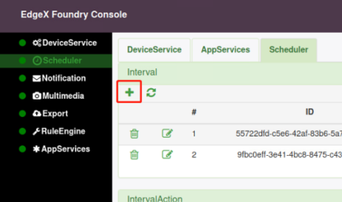 

4. 填写规则的名称，并指定定时任务的频率（Frequency），例如 10 秒，表示每 10 秒触发一次定时任务。 
   
   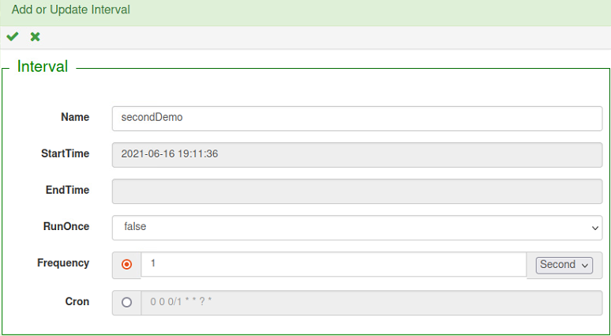 

   点击左上角的对勾保存设置。 
   新添加的时间间隔规则会出现在列表中。 

   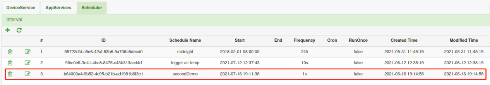 

5. 点击 IntervalAction 下的 + 号，添加定时任务触发规则。 
   
    

6. 填写规则的参数。
   - Name：规则的名称，例如 cpuMetric
   - Interval：触发定时任务的时间间隔，可以选择之前步骤添加的时间间隔规则 metric
   - Target：选择 core-command
   - TargetAction：选择要触发的操作，例如，查询主机 CPU 信息：metric cpuInfo(get) 
   其他参数保持默认即可。 

   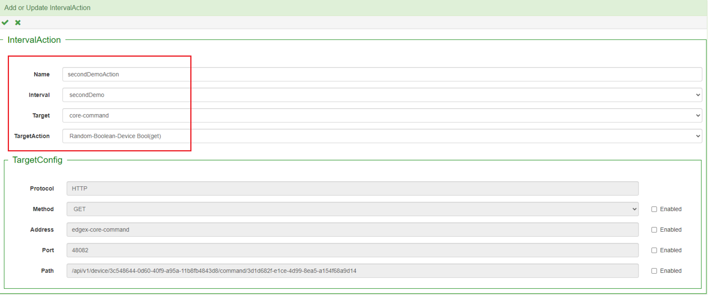 

   点击左上角的对勾保存设置。 
7. 重复步骤 5-6 配置主机、内存、磁盘信息查询的定时任务触发规则。 
   新添加的定时任务触发规则会出现在列表中。 
   
   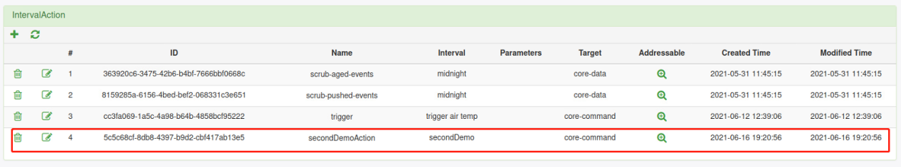 

### 3. 配置数据导出任务
1. 使用浏览器进入 http://{EdgeX Foundry 服务器 IP 地址}:4000/ 并登录。
2. 在左侧导航栏选择 AppServices，点击右侧的 AppServices 页签。
3. 在 AppServices 下拉框选择 AppService-rules-engine。 
   
   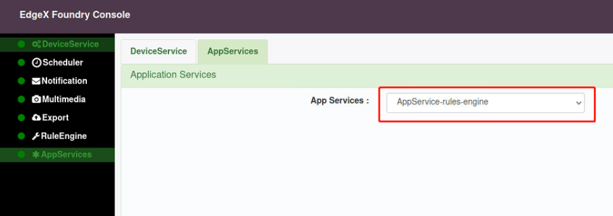 

4. 点击右侧窗格中的 Filtering，单击选择 FilterByDeviceName 按名称过滤设备。 
   
   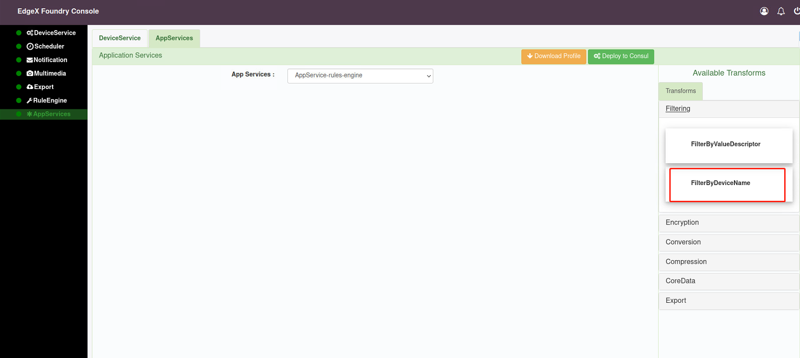 

   选中后 FilterByDeviceName 出现在窗口中间位置。 
     
    

5. 点击 FilterByDeviceName 右侧的 Set Params 按钮。在 Parameters 对话框中选择要过滤的设备名称，本示例中选择 metric（主机设备）。 
   
   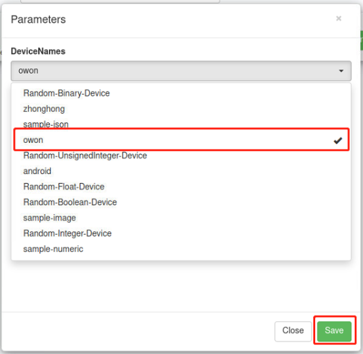 

6. 点击右侧窗格中的 Export，单击选择 MQTTSend。 
   选中后 MQTTSend 出现在窗口中间位置。 
   
    

7. 点击 MQTTSend 右侧的 Set Params 按钮。在 Parameters 对话框中填写要导出数据的 MQTT Broker 信息。 
   将 Topic 参数设置为您想要导出数据的目标主题。 
   
   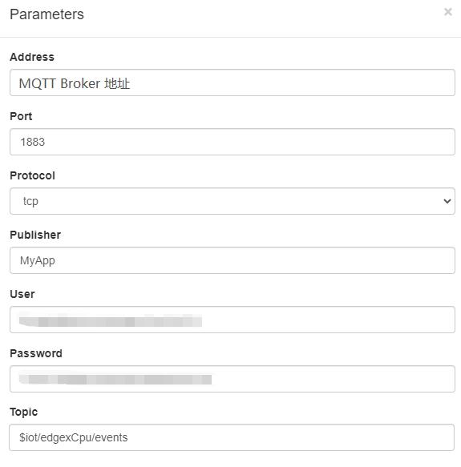 
8. 点击 Deploy to Consul，完成配置。 
   配置完成后，主机设备（metric）的所有数据均会主动发送到指定的主题。 

   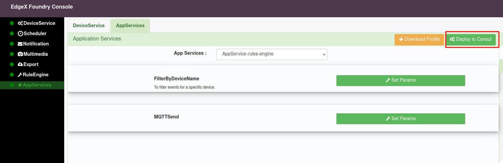
9.  登录 Edgex Foundry 服务器，执行以下命令接收导出任务发送的数据： 
    `mosquitto_sub -h {MQTT Broker 地址} -t {Topic}` 
    请将 {MQTT Broker 地址} 和 {Topic} 替换为第 7 步配置的信息。 
    
    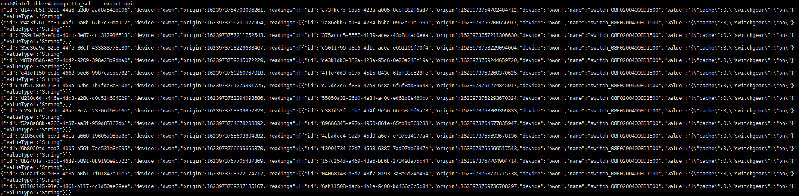

   

   

