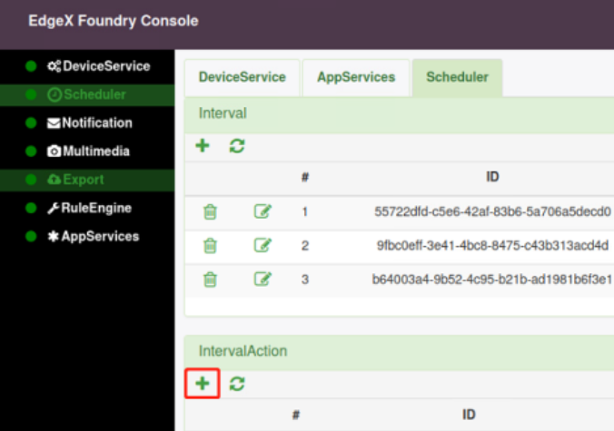
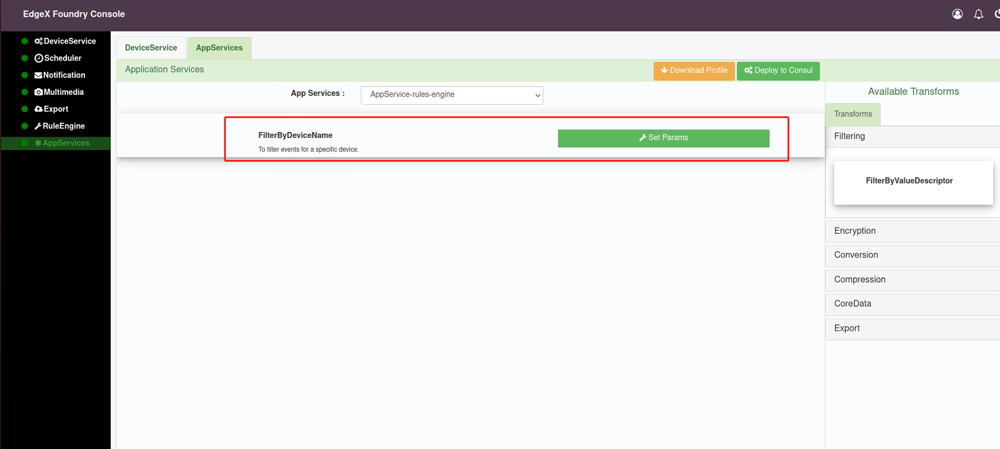
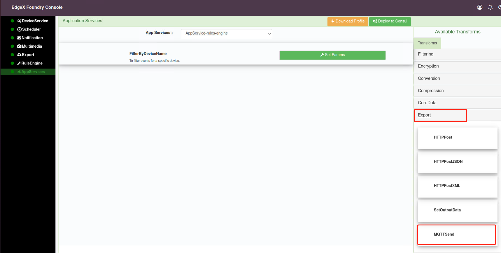
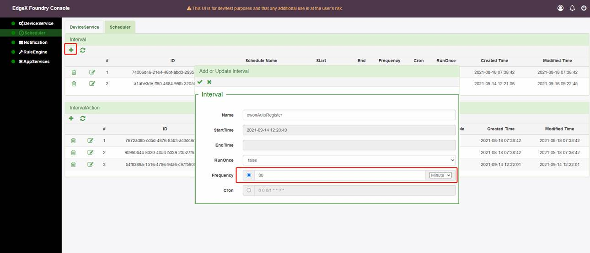
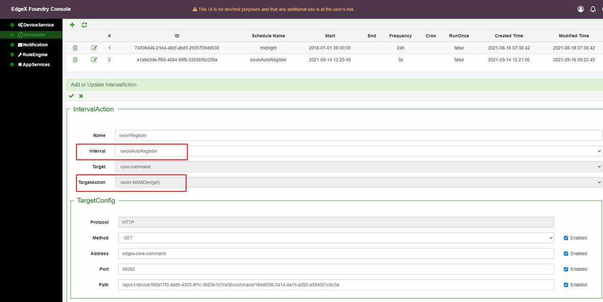
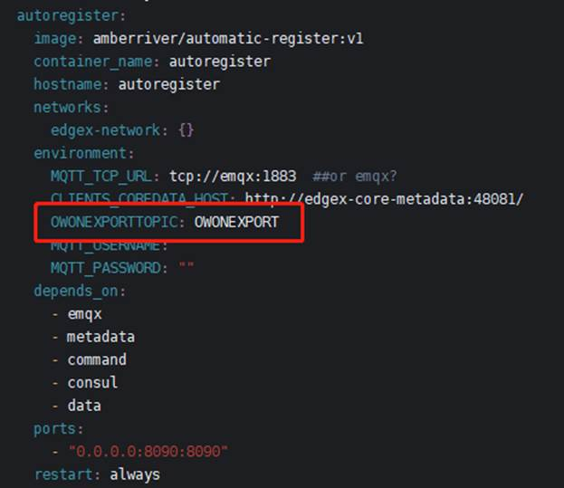
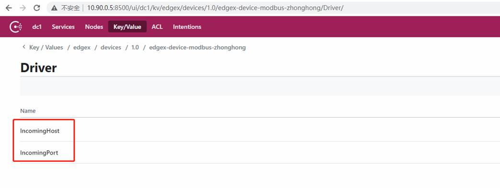
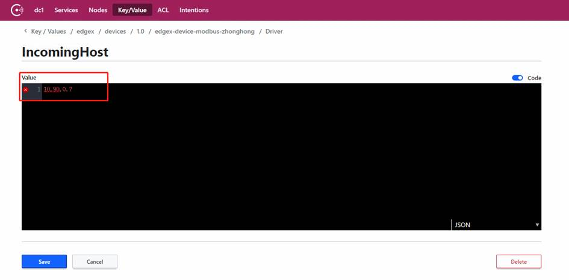
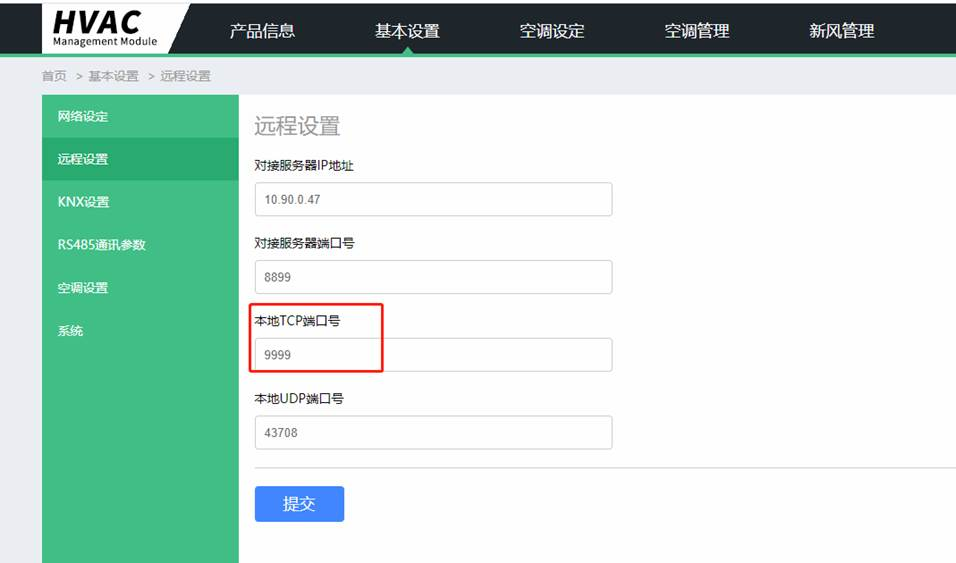

<h1>定时任务配置指导 </h1>

- [1. 前提条件](#1-前提条件)
- [2. 配置主机状态上报定时任务](#2-配置主机状态上报定时任务)
- [3. 配置数据导出任务](#3-配置数据导出任务)

本文档指导您通过 EdgeX Foundry Web 管理界面配置定时任务，采集 EdgeX Foundry 服务器的主机状态信息并导出。 
您也可以使用同样的方法配置其他定时任务，自动收集IoT设备的信息。

### 1. 前提条件
- 已经部署好 EdgeX Foundry 软件，详情请参考 <a href="https://gitee.com/PubDocumentation/iot-documents/blob/master/1.%20EdgeX%20Foundry%E8%BD%AF%E4%BB%B6%E9%83%A8%E7%BD%B2.md" target="_blank">EdgeX Foundry软件部署</a>。
- 已连接到 EdgeX Foundry 服务器所在的局域网。
- 已经准备好登录 EdgeX Foundry Console 的账号。
### 2. 配置主机状态上报定时任务
1. 使用浏览器进入 http://{EdgeX Foundry 服务器 IP 地址}:4000/ 并登录。
2. 在左侧导航栏选择 Scheduler，点击右侧的 Scheduler 页签。
3. 点击 Interval 下面的 + 号添加时间间隔规则。 
   
    

4. 填写规则的名称，并指定定时任务的频率（Frequency），例如 10 秒，表示每 10 秒触发一次定时任务。 
   
    

   点击左上角的对勾保存设置。 
   新添加的时间间隔规则会出现在列表中。 

    

5. 点击 IntervalAction 下的 + 号，添加定时任务触发规则。 
   
    

6. 填写规则的参数。
   - Name：规则的名称，例如 cpuMetric
   - Interval：触发定时任务的时间间隔，可以选择之前步骤添加的时间间隔规则 metric
   - Target：选择 core-command
   - TargetAction：选择要触发的操作，例如，查询主机 CPU 信息：metric cpuInfo(get) 
   其他参数保持默认即可。 

    

   点击左上角的对勾保存设置。 
7. 重复步骤 5-6 配置主机、内存、磁盘信息查询的定时任务触发规则。 
   新添加的定时任务触发规则会出现在列表中。 
   
    

### 3. 配置数据导出任务
1. 使用浏览器进入 http://{EdgeX Foundry 服务器 IP 地址}:4000/ 并登录。
2. 在左侧导航栏选择 AppServices，点击右侧的 AppServices 页签。
3. 在 AppServices 下拉框选择 AppService-rules-engine。 
   
    

4. 点击右侧窗格中的 Filtering，单击选择 FilterByDeviceName 按名称过滤设备。 
   
    

   选中后 FilterByDeviceName 出现在窗口中间位置。 
     
    

5. 点击 FilterByDeviceName 右侧的 Set Params 按钮。在 Parameters 对话框中选择要过滤的设备名称，本示例中选择 metric（主机设备）。 
   
    

6. 点击右侧窗格中的 Export，单击选择 MQTTSend。 
   选中后 MQTTSend 出现在窗口中间位置。 
   
    

7. 点击 MQTTSend 右侧的 Set Params 按钮。在 Parameters 对话框中填写要导出数据的 MQTT Broker 信息。 
   将 Topic 参数设置为您想要导出数据的目标主题。 
   
    
8. 点击 Deploy to Consul，完成配置。 
   配置完成后，主机设备（metric）的所有数据均会主动发送到指定的主题。 

   
9.  登录 Edgex Foundry 服务器，执行以下命令接收导出任务发送的数据： 
    `mosquitto_sub -h {MQTT Broker 地址} -t {Topic}` 
    请将 {MQTT Broker 地址} 和 {Topic} 替换为第 7 步配置的信息。 
    
    

<h1>设备自发现并注册配置指导 </h1>

- [1. 前提条件](#1-前提条件)
- [2. 配置设备自发现并注册](#2-配置设备自发现并注册)
- [3. 配置owon设备消息实时接收](#3-配置owon设备消息实时接收)
- [4. 配置中弘TCP实时消息接收](#4-配置中弘TCP实时消息接收)

本文档指导您通过 EdgeX Foundry Web 管理界面配置设备自发现并注册服务，通过此服务，您可以实时查看各服务器所连接设备情况。  

### 1. 前提条件
- 已经部署好 EdgeX Foundry 软件，详情请参考 <a href="https://gitee.com/PubDocumentation/iot-documents/blob/master/1.%20EdgeX%20Foundry%E8%BD%AF%E4%BB%B6%E9%83%A8%E7%BD%B2.md" target="_blank">EdgeX Foundry软件部署</a>。
- 已连接到 EdgeX Foundry 服务器所在的局域网。
- 已经准备好登录 EdgeX Foundry Console 的账号。
### 2. 配置设备自发现并注册
1. 登录 Edgex Foundry 服务器，查看autoregister服务是否正常运行： 
    `docker-compose ps` 
    
      
2. 配置设备自发现注册任务 
   (1). 登录EdgeX Foundary Console新增定时任务（详情请参考本文档<a href="https://gitee.com/PubDocumentation/iot-documents/blob/master/5.%20%E5%AE%9A%E6%97%B6%E4%BB%BB%E5%8A%A1%E9%85%8D%E7%BD%AE%E6%8C%87%E5%AF%BC.md#2-%E9%85%8D%E7%BD%AE%E4%B8%BB%E6%9C%BA%E7%8A%B6%E6%80%81%E4%B8%8A%E6%8A%A5%E5%AE%9A%E6%97%B6%E4%BB%BB%E5%8A%A1">配置主机状态上报定时任务</a>1-4步骤）。填写任务的名称，并根据实际情况配置设备自发现的时间间隔（Frequency），建议设为 30 分钟，表示每 30 秒触发一次设备自发现任务。 
      
   (2). 点击 IntervalAction 下的 + 号，添加定时任务触发规则。 
      
   (3). 填写规则的参数。 
    - Name：规则的名称，例如 owonRegister
    - Interval：触发定时任务的时间间隔，可以选择之前步骤添加的时间间隔
    - Target：选择 core-command
    - TargetAction：选择要触发的操作owon listAllDev(get)
    - 其他选项保持默认即可。 
      
3. 配置设备自发现数据导出任务 
   (1). 选择AppServices为AppService-rules-engine（详情请参考本文档<a href="https://gitee.com/PubDocumentation/iot-documents/blob/master/5.%20%E5%AE%9A%E6%97%B6%E4%BB%BB%E5%8A%A1%E9%85%8D%E7%BD%AE%E6%8C%87%E5%AF%BC.md#3-%E9%85%8D%E7%BD%AE%E6%95%B0%E6%8D%AE%E5%AF%BC%E5%87%BA%E4%BB%BB%E5%8A%A1">配置数据导出任务</a>1-4步骤） 
   (2). 在AppServices页面中，点击 FilterByDeviceName 右侧的 Set Params 按钮。在 Parameters 对话框中选择要筛选的设备名称，本示例中选择 owon（即owon所连接设备），保存。 
      
   (3).	配置mqtt导出信息。点击MQTTSend 右侧的Set Params 按钮查看或编辑配置信息。在弹出的 Parameters 对话框中，将 Topic 参数设置为您想要导出数据的目标主题,其他参数保持默认即可。 
      
     所有实时消息，将统一通过该topic输出。 

   (4). 点击 Deploy to Consul，完成配置。 
配置完成后，主机设备（metric）的所有数据均会主动发送到指定的主题。 
      
   (5). 打开配置文件docker-compose.yml，找到下图位置，将OWONEXPORTTOPIC的值修改为刚刚配置好的topic值。 
      
   (6)	重启Autoregister服务。 
`docker-compose restart autoregister` 
      
### 3. 配置owon设备消息实时接收
1. 首先配置设备自发现数据导出任务，步骤参考上述<a...>配置设备自发现数据导出任务</a>（1）-（4）步骤 
2. 登录 Edgex Foundry 服务器，执行以下命令接收导出任务发送的数据： 
`mosquitto_sub -h {MQTT Broker 地址} -t {Topic}` 
请将 {MQTT Broker 地址} 和 {Topic} 替换为<a...>配置设备自发现数据导出任务</a>第（3）步骤的信息。 
部分实时消息样例: 
`{"id":"cd7a067b-b8b7-4952-9792-36c0b39c9960","device":"owon","created":1631764745332,"origin":1631764745332365068,"readings":[{"id":"55a85581-c7ef-4839-914f-b1d32c3216b8","origin":1631764745332223143,"device":"owon","name":"realtimeData","value":"{\"argument\":{\"activePower\":0,\"demandFormatting\":0,\"divisor\":1000,\"ep\":1,\"ieee\":\"E9CDD0FEFF2C6A3C\",\"meteringDeviceStatus\":0,\"mutiplier\":1,\"summation\":0,\"summationFormatting\":0,\"unitOfMeasure\":0},\"command\":\"energy\",\"type\":\"update\"}","valueType":"String"}]}`

### 4. 配置中弘TCP消息实时接收
1. 使用浏览器进入http:// {EdgeX Foundry IP 地址}:8500/ui/dc1/kv/edgex/devices/1.0/edgex-device-modbus-zhonghong/Driver/ 
      
2. 修改IncomingHost为中弘网关的IP地址。      
      
3. 登录中弘 Modbus 网关的管理页面，查看中弘网关本地TCP端口号，如下图所示。 
      
4. 将IncomingPort修改为该本地TCP端口号。   
      
5. 重启中弘服务。  
`docker restart edgex-device-modbus-zhonghong`  
6.	在AppServices页面中，将zhonghong添加到FilterByDeviceName中，并配置MQTT导出信息（详细步骤请参考上述<a...>配置设备自发现数据导出任务</a>（1）-（4）步骤）。 
      
      
7. 登录 Edgex Foundry 服务器，执行以下命令接收导出任务发送的数据： 
`mosquitto_sub -h {MQTT Broker 地址} -t {Topic}` 
请将 {MQTT Broker 地址} 和 {Topic} 替换为<a...>配置设备自发现数据导出任务</a>第（3）步骤的信息。 
部分实时消息样例: 
`{"id":"2fcdd038-0601-4483-8502-7a0e993db745","device":"zhonghong","created":1631764525193,"origin":1631764525193401956,"readings":[{"id":"3d5bfb3c-ef16-47ed-a0da-9690d3278c80","origin":1631764525193366385,"device":"zhonghong","name":"realtimeData","value":"{\"connectionInfo\":{\"Address\":\"10.90.0.7\",\"Port\":9999},\"response\":\"015001010103001a04041800000091\"}","valueType":"String"}]}`

    

   

   

