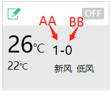

<h1>IoT设备API参考</h1>
[TOC]

EdgeX提供Restful API，您可以通过HTTP调用API管理智能设备。本文档指导您使用Postman来进行接口调用。
## 1. 通用API
### 1.1 查看所有可用的设备API
**URI**
```html
GET /api/v1/device
```

**请求**
样例：
```html
GET http://{EdgeX Foundry IP地址}:48082/api/v1/device
```

**响应**
响应结果会显示所有可用的设备API。

## 2. 通过OWON网关控制灯
调用以下API时，需要在请求地址中指定操作命令，格式为：{指令}_{灯的MAC地址}。

例如：要设置MAC地址为08F02004008D1500的灯的开关，命令为switch_08F02004008D1500。

您可在灯的设备信息中获取MAC地址。
### 2.1 查看灯的开关状态
**URI**

```html
GET /api/v1/device/name/owon/command/switch_{灯的MAC地址}
```

**请求**
样例：
```html
GET http://{EdgeX Foundry IP地址}:48082/api/v1/device/name/owon/command/switch_08F02004008D1500
```

**响应**
响应参数：
| 名称  | 参数类型 | 说明                                                                         |
| ----- | -------- | ------ |
| value | string   | 开关状态<br>cache：缓存值<br>switchgear：开关的状态，off表示关机，on表示开机 |

其他参数请参考“[5. 附录](#5-附录)”。

样例：
```html
{
    "device": "owon",
    "origin": 1620807421916211019,
    "readings": [
        {
            "origin": 1620807421916015171,
            "device": "owon",
            "name": "switch_08F02004008D1500",
            "value": "{\"cache\":0,\"switchgear\":\"off\"}",
            "valueType": "String"
        }
    ],
    "EncodedEvent": null
}
```
返回值：
接口正常的返回值为2xx，例如200或者204。
返回值含义以及更多返回值请参考“[5. 附录](#5-附录)”。

### 2.2 设置灯的开关状态
**URI**
```html
PUT /api/v1/device/name/owon/command/switch_{灯的MAC地址}
```

**请求**
请求参数：
| 名称                 | 是否必须 | 参数类型 | 说明                                  |
| -------------------- | -------- | -------- | ------------------------------------- |
| switch_{灯的MAC地址} | 是       | string   | 灯的开关状态<br>on：开灯<br>off：关灯 |

样例：

```html
PUT http://{EdgeX Foundry IP地址}:48082/api/v1/device/name/owon/command/switch_08F02004008D1500
```
```html
{
    "switch_08F02004008D1500": "off"
}
```

**响应**
返回值：
接口正常的返回值为2xx，例如200或者204。
返回值含义以及更多返回值请参考“[5. 附录](#5-附录)”。
### 2.3 查看灯的亮度
**URI**
```html
GET /api/v1/device/name/owon/command/level_{灯的MAC地址}
```
**请求**
样例：
```html
GET http://{EdgeX Foundry IP地址}:48082/api/v1/device/name/owon/command/level_08F02004008D1500
```

**响应**
响应参数：
| 名称  | 参数类型 | 说明                                                         |
| ----- | -------- | ------------------------------------------------------------ |
| value | string   | 灯的亮度<br>level字段取值范围：0-255<br>值越大，表示亮度越大 |
其他参数请参考“[5. 附录](#5-附录)”。

样例：
```html
{
    "device": "owon",
    "origin": 1620807714963694663,
    "readings": [
        {
            "origin": 1620807714963246695,
            "device": "owon",
            "name": "level_08F02004008D1500",
            "value": "{\"level\":200}",
            "valueType": "String"
        }
    ],
    "EncodedEvent": null
}
```

返回值：
接口正常的返回值为2xx，例如200或者204。
返回值含义以及更多返回值请参考“[5. 附录](#5-附录)”。

### 2.4 设置灯的亮度
**URI**

```html
PUT /api/v1/device/name/owon/command/level_{灯的MAC地址}
```

**请求**
请求参数：
| 名称                | 是否必须 | 参数类型 | 说明                                                |
| ------------------- | -------- | -------- | --------------------------------------------------- |
| level_{灯的MAC地址} | 是       | string   | 灯的亮度<br>取值范围：0-255<br>值越大，表示亮度越大 |

样例：

```html
PUT http://{EdgeX Foundry IP地址}:48082/api/v1/device/name/owon/command/level_08F02004008D1500
```
```html
{
   "level_08F02004008D1500":"30"
}
```

**响应**
返回值：
接口正常的返回值为2xx，例如200或者204。
返回值含义以及更多返回值请参考“[5. 附录](#5-附录)”。

### 2.5 查找灯的位置
**URI**

```html
PUT /api/v1/device/name/owon/command/findNode_{灯的MAC地址}
```

**请求**
请求参数：
| 名称                   | 是否必须 | 参数类型 | 说明                                                                           |
| ---------------------- | -------- | -------- | ------------------------------------------------------------------------------ |
| findNode_{灯的MAC地址} | 是       | string   | 灯闪烁的时间<br>取值范围：1-60（单位为秒）<br>您可以通过闪烁确定灯所在的位置。 |

样例：
```html
PUT http://{EdgeX Foundry IP地址}:48082/api/v1/device/name/owon/command/findNode_08F02004008D1500
```
```html
{
   "findNode_08F02004008D1500":"10"
}
```

**响应**
返回值：
接口正常的返回值为2xx，例如200或者204。
返回值含义以及更多返回值请参考“[5. 附录](#5-附录)”。

### 2.6 查看OWON网关连接的所有设备
**请求**
样例：

```html
GET http://{EdgeX Foundry IP地址}:48082/api/v1/device/name/owon/command/listAllDev_listAllDev
```
**响应**
响应参数：
| 名称  | 参数类型 | 说明                   |
| ----- | -------- | ---------------------- |
| value | string   | OWON网关连接的设备信息 |
其他参数请参考“[5. 附录](#5-附录)”。

样例：
```html
{
    "device": "owon",
    "origin": 1620894127944722947,
    "readings": [
        {
            "origin": 1620894127944241478,
            "device": "owon",
            "name": "listAllDev_listAllDev",
            "value": "{\"count\":2,\"epList\":[{\"IASZoneType\":65535,\"ProfileId\":260,
						\"clusterFlag\":3,\"devModel\":\"FNB56-ZCW39GD1.1\",\"deviceType\":269,
						\"ep\":1,\"ieee\":\"08F02004008D1500\",\"linkStatus\":true,\"manuCode\":4478,
						\"name\":\"Light-20F008\",\"netDeviceType\":1},{\"IASZoneType\":65535,
						\"ProfileId\":260,\"clusterFlag\":3,\"devModel\":\"FNB56-ZCW39GD1.1\",
						\"deviceType\":269,\"ep\":1,\"ieee\":\"CA2B2004008D1500\",\"linkStatus\":true,
						\"manuCode\":4478,\"name\":\"Light-202BCA\",\"netDeviceType\":1}],\"start\":0,\"total\":2}",
            "valueType": "String"
        }
    ],
    "EncodedEvent": null
}
```

返回值：
接口正常的返回值为2xx，例如200或者204。
返回值含义以及更多返回值请参考“[5. 附录](#5-附录)”。

### 2.7 查看灯的色温
**URI**

```html
GET /api/v1/device/name/owon/command/color_{灯的MAC地址}
```

**请求**
样例：

```html
GET http://{EdgeX Foundry IP地址}:48082/api/v1/device/name/owon/command/color_08F02004008D1500
```

**响应**
响应参数：
| 名称  | 参数类型 | 说明                                                       |
| ----- | -------- | ---------------------------------------------------------- |
| value | string   | 灯的色温<br>colorTemp取值范围：1-370<br>值越大，色温越偏暖 |
其他参数请参考“[5. 附录](#5-附录)”。

样例：
```html
{
    "device": "owon",
    "origin": 1620811610720158318,
    "readings": [
        {
            "origin": 1620811610719719006,
            "device": "owon",
            "name": "color_08F02004008D1500",
            "value": "{\"colorTemp\":250,\"status\":0}",
            "valueType": "String"
        }
    ],
    "EncodedEvent": null
}
```

返回值：
接口正常的返回值为2xx，例如200或者204。
返回值含义以及更多返回值请参考“[5. 附录](#5-附录)”。

### 2.8 设置灯的色温
**URI**
```html
PUT /api/v1/device/name/owon/command/color_{灯的MAC地址}
```

**请求**
请求参数：
| 名称                | 是否必须 | 参数类型 | 说明                                                  |
| ------------------- | -------- | -------- | ----------------------------------------------------- |
| color_{灯的MAC地址} | 是       | string   | 要设置的色温<br>取值范围：1-370<br>值越大，色温越偏暖 |

样例：
```html
PUT http://{EdgeX Foundry IP地址}:48082/api/v1/device/name/owon/command/color_08F02004008D1500
```
```html
{
   "color_08F02004008D1500":"320"
}
```

**响应**
返回值：
接口正常的返回值为2xx，例如200或者204。
返回值含义以及更多返回值请参考“[5. 附录](#5-附录)”。

### 2.9 查看灯的颜色

**URI**
```bash
GET /api/v1/device/name/owon/command/colorXY_{灯的MAC地址}
```

**请求**
样例：

```bash
GET http://{EdgeX Foundry IP地址}:48082/api/v1/device/name/owon/command/colorXY_08F02004008D1500
```

**响应**
响应参数：
| 名称  | 参数类型 | 说明                                                                                                     |
| ----- | -------- | -------------------------------------------------------------------------------------------------------- |
| value | string   | 灯的颜色<br>其中colorX和colorY是灯的颜色代码。<br>关于此处颜色代码与RGB颜色代码的转换，请参考“[5. 附录](#5-附录)”。 |
其他参数请参考“[5. 附录](#5-附录)”。

样例：
```html
{
    "device": "owon",
    "origin": 1620811749967455185,
    "readings": [
        {
            "origin": 1620811749967060736,
            "device": "owon",
            "name": "colorXY_08F02004008D1500",
            "value": "{\"colorX\":20545,\"colorY\":21207}",
            "valueType": "String"
        }
    ],
    "EncodedEvent": null
}
```

返回值：
接口正常的返回值为2xx，例如200或者204。
返回值含义以及更多返回值请参考“[5. 附录](#5-附录)”。

### 2.10 设置灯的颜色
**URI**
```html
PUT /api/v1/device/name/owon/command/colorXY_{灯的MAC地址}
```

**请求**
请求参数：
| 名称                  | 是否必须 | 参数类型 | 说明                                                                                                     |
| --------------------- | -------- | -------- | -------------------------------------------------------------------------------------------------------- |
| colorXY_{灯的MAC地址} | 是       | string   | 灯的颜色<br>其中colorX和colorY是灯的颜色代码。<br>关于此处颜色代码与RGB颜色代码的转换，请参考“[5. 附录](#5-附录)”。 |

样例：
```html
PUT http://{EdgeX Foundry IP地址}:48082/api/v1/device/name/owon/command/colorXY_08F02004008D1500
```
```html
{
    "colorXY_08F02004008D1500": 
    "{\"colorX\":20494, \"colorY\":21561}"
}
```

**响应**
返回值：
接口正常的返回值为2xx，例如200或者204。
返回值含义以及更多返回值请参考“[5. 附录](#5-附录)”。


## 3. 通过中弘网关控制空调设备
调用以下API时，需要在请求地址中指定操作命令，格式为：{指令}_{空调的状态或控制寄存器地址}。
其中，GET请求需要获取空调的状态寄存器地址，PUT请求需要获取空调的控制寄存器地址。
关于如何获取寄存器地址，请参考“[5. 附录](#5-附录)”。

### 3.1 查询空调的状态
**URI**
```html
GET /api/v1/device/name/zhonghong/command/PowerGet_{空调的状态寄存器地址}
```
关于如何获取空调的状态寄存器地址，请参考“[5. 附录](#5-附录)”。

**请求**
请求样例：

```html
GET http://{EdgeX Foundry IP地址}:48082/api/v1/device/name/zhonghong/command/PowerGet_193
```

**响应**
响应参数：
| 名称  | 参数类型 | 说明                             |
| ----- | -------- | -------------------------------- |
| value | string   | 空调的状态<br>1：开机<br>0：关机 |
其他参数请参考“[5. 附录](#5-附录)”。

样例：

```html
{
    "device": "zhonghong",
    "origin": 1620811978117765294,
    "readings": [
        {
            "origin": 1620811978117663735,
            "device": "zhonghong",
            "name": "PowerGet_193",
            "value": "1",
            "valueType": "Uint16"
        }
    ],
    "EncodedEvent": null
}
```

返回值：
接口正常的返回值为2xx，例如200或者204。
返回值含义以及更多返回值请参考“[5. 附录](#5-附录)”。

### 3.2 设置空调的开关状态
**URI**

```html
PUT /api/v1/device/name/zhonghong/command/PowerSet_{空调的控制寄存器地址}
```

关于如何获取空调的控制寄存器地址，请参考“[5. 附录](#5-附录)”。

**请求**
请求参数：
| 名称                            | 是否必须 | 参数类型 | 说明                                     |
| ------------------------------- | -------- | -------- | ---------------------------------------- |
| PowerSet_{空调的控制寄存器地址} | 是       | string   | 空调的开关状态<br>0：关机<br>1：开机 |

样例：

```html
PUT http://{EdgeX Foundry IP地址}:48082/api/v1/device/name/zhonghong/command/PowerSet_4129
```
```html
{
   "PowerSet_4129":"0"
}
```

**响应**
返回值：
接口正常的返回值为2xx，例如200或者204。
返回值含义以及更多返回值请参考“[5. 附录](#5-附录)”。

### 3.3 查询空调的温度
**URI**

```html
GET /api/v1/device/name/zhonghong/command/TemperatureGet_{空调的状态寄存器地址}
```
关于如何获取空调的状态寄存器地址，请参考“[5. 附录](#5-附录)”。

**请求**
样例：

```html
GET http://{EdgeX Foundry IP地址}:48082/api/v1/device/name/zhonghong/command/TemperatureGet_194
```

**响应**
响应参数：
| 名称  | 参数类型 | 说明                             |
| ----- | -------- | -------------------------------- |
| value | string   | 空调的温度<br>取值范围：16-32 |
其他参数请参考“[5. 附录](#5-附录)”。

样例：
```html
{
    "device": "zhonghong",
    "origin": 1620812218515922238,
    "readings": [
        {
            "origin": 1620812218515628510,
            "device": "zhonghong",
            "name": "TemperatureGet_194",
            "value": "27",
            "valueType": "Uint16"
        }
    ],
    "EncodedEvent": null
}
```

返回值：
接口正常的返回值为2xx，例如200或者204。
返回值含义以及更多返回值请参考“[5. 附录](#5-附录)”。

### 3.4 设置空调的温度
**URI**

```html
PUT /api/v1/device/name/zhonghong/command/TemperatureSet_{空调的控制寄存器地址}
```

关于如何获取空调的控制寄存器地址，请参考“[5. 附录](#5-附录)”。

**请求**
请求参数：
| 名称                            | 是否必须 | 参数类型 | 说明                                     |
| ------------------------------- | -------- | -------- | ---------------------------------------- |
| TemperatureSet_{空调的控制寄存器地址} | 是       | string   | 空调的温度<br>取值范围：16-32 |
样例：

```html
PUT http://{EdgeX Foundry IP地址}:48082/api/v1/device/name/zhonghong/command/TemperatureSet_4130
```
```html
{
   " TemperatureSet_4130":"30"
}
```

**响应**
返回值：
接口正常的返回值为2xx，例如200或者204。
返回值含义以及更多返回值请参考“[5. 附录](#5-附录)”。

### 3.5 查询空调当前的模式

**URI**
```html
GET /api/v1/device/name/zhonghong/command/ModelGet_{空调的状态寄存器地址}
```

关于如何获取空调的状态寄存器地址，请参考“[5. 附录](#5-附录)”。

**请求**
样例：

```html
GET http://{EdgeX Foundry IP地址}:48082/api/v1/device/name/zhonghong/command/ModelGet_195
```

**响应**
响应参数：
| 名称  | 参数类型 | 说明                             |
| ----- | -------- | -------------------------------- |
| value | string   | 空调的模式<br>1：制冷<br>2：除湿<br>4：送风<br>8：制热 |
其他参数请参考“[5. 附录](#5-附录)”。

样例：
```html
{
    "device": "zhonghong",
    "origin": 1620812462282224482,
    "readings": [
        {
            "origin": 1620812462282026541,
            "device": "zhonghong",
            "name": "ModelGet_195",
            "value": "1",
            "valueType": "Uint16"
        }
    ],
    "EncodedEvent": null
}
```

返回值：
接口正常的返回值为2xx，例如200或者204。
返回值含义以及更多返回值请参考“[5. 附录](#5-附录)”。

### 3.6 设置空调的模式
**URI**
```html
PUT /api/v1/device/name/zhonghong/command/ModelSet_{空调的控制寄存器地址}
```

关于如何获取空调的控制寄存器地址，请参考“[5. 附录](#5-附录)”。

**请求**
请求参数：
| 名称                            | 是否必须 | 参数类型 | 说明                                     |
| ------------------------------- | -------- | -------- | ---------------------------------------- |
| ModelSet_{空调的控制寄存器地址} | 是       | string   | 空调的模式<br>1：制冷<br>2：除湿<br>4：送风<br>8：制热 |

样例：
```html
PUT http://{EdgeX Foundry IP地址}:48082/api/v1/device/name/zhonghong/command/ModelSet_4131
```
```html
{
   " ModelSet_4131":"2"
}
```

**响应**
返回值：
接口正常的返回值为2xx，例如200或者204。
返回值含义以及更多返回值请参考“[5. 附录](#5-附录)”。

### 3.7 查询空调的风速
**URI**

```html
GET /api/v1/device/name/zhonghong/command/WindSpeedGet_{空调的状态寄存器地址}
```

关于如何获取空调的状态寄存器地址，请参考“[5. 附录](#5-附录)”。

**请求**
样例：

```html
GET http://{EdgeX Foundry IP地址}:48082/api/v1/device/name/zhonghong/command/WindSpeedGet_196
```

**响应**
响应参数：
| 名称  | 参数类型 | 说明                             |
| ----- | -------- | -------------------------------- |
| value | string   | 空调的风速<br>1：高速<br>2：中速<br>4：低速 |
其他参数请参考“[5. 附录](#5-附录)”。

样例：
```html
{
    "device": "zhonghong",
    "origin": 1620812636112808729,
    "readings": [
        {
            "origin": 1620812636112576765,
            "device": "zhonghong",
            "name": "WindSpeedGet_196",
            "value": "1",
            "valueType": "Uint16"
        }
    ],
    "EncodedEvent": null
}
```

返回值：
接口正常的返回值为2xx，例如200或者204。
返回值含义以及更多返回值请参考“[5. 附录](#5-附录)”。

### 3.8 设置空调的风速
**URI**

```html
PUT /api/v1/device/name/zhonghong/command/WindSpeedSet_{空调的控制寄存器地址}
```

关于如何获取空调的控制寄存器地址，请参考“[5. 附录](#5-附录)”。

**请求**
请求参数：
| 名称                            | 是否必须 | 参数类型 | 说明                                     |
| ------------------------------- | -------- | -------- | ---------------------------------------- |
| WindSpeedSet_{空调的控制寄存器地址} | 是       | string   | 空调的模式<br>1：高速<br>2：中速<br>4：低速 |

样例：

```html
PUT http://{EdgeX Foundry IP地址}:48082/api/v1/device/name/zhonghong/command/WindSpeedSet_4132
```
```html
{
   "WindSpeedSet_4132":"2"
}
```

**响应**
返回值：
接口正常的返回值为2xx，例如200或者204。
返回值含义以及更多返回值请参考“[5. 附录](#5-附录)”。

### 3.9 查询空调当前的回风温度
**URI**

```html
GET /api/v1/device/name/zhonghong/command/CurrentTemperatureGet_{空调的状态寄存器地址}
```

关于如何获取空调的状态寄存器地址，请参考“[5. 附录](#5-附录)”。

**请求**
样例：

```html
GET http://EdgeX Foundry IP地址:48082/api/v1/device/name/zhonghong/command/CurrentTemperatureGet_197
```

**响应**
响应参数：
| 名称  | 参数类型 | 说明                             |
| ----- | -------- | -------------------------------- |
| value | string   | 空调的回风温度 |
其他参数请参考“5.1 响应公共参数”。

样例：

```html
{
    "device": "zhonghong",
    "origin": 1620812735018473870,
    "readings": [
        {
            "origin": 1620812735018239469,
            "device": "zhonghong",
            "name": "CurrentTemperatureGet_197",
            "value": "23",
            "valueType": "Uint16"
        }
    ],
    "EncodedEvent": null
}
```

返回值：
接口正常的返回值为2xx，例如200或者204。
返回值含义以及更多返回值请参考“[5. 附录](#5-附录)”。

### 3.10 查询空调的故障状态
**URI**

```html
GET /api/v1/device/name/zhonghong/command/ErrorGet_{空调的状态寄存器地址}
```

关于如何获取空调的状态寄存器地址，请参考“[5. 附录](#5-附录)”。

**请求**
样例：

```html
GET http://{EdgeX Foundry IP地址}:48082/api/v1/device/name/zhonghong/command/ErrorGet_198
```

**响应**
响应参数：
| 名称  | 参数类型 | 说明                             |
| ----- | -------- | -------------------------------- |
| value | string   | 空调的状态码<br>0：无故障。<br>其他值：设备故障，请联系中弘的技术支持。 |
其他参数请参考“5.1 响应公共参数”。

样例：
```html
{
    "device": "zhonghong",
    "origin": 1620812804819501364,
    "readings": [
        {
            "origin": 1620812804819315955,
            "device": "zhonghong",
            "name": "ErrorGet_198",
            "value": "0",
            "valueType": "Uint16"
        }
    ],
    "EncodedEvent": null
}
```

返回值：
接口正常的返回值为2xx，例如200或者204。
返回值含义以及更多返回值请参考“[5. 附录](#5-附录)”。

## 4. 控制Android盒子
### 4.1 暂停音乐
**URI**

```html
PUT /api/v1/device/name/android/command/music_control
```

**请求**
请求参数：
| 名称                            | 是否必须 | 参数类型 | 说明                                     |
| ------------------------------- | -------- | -------- | ---------------------------------------- |
| music_control | 是       | string   | 要对Android盒子

样例：

```html
PUT http://{EdgeX Foundry IP地址}:48082/api/v1/device/name/android/command/music_control
```
```html
{"music_control":
                "{\"mac\":\"38CA73126BCB\",\"action\":\"pause\",\"audio_id\":0}"
}
```

**响应**
返回值：
接口正常的返回值为2xx，例如200或者204。
返回值含义以及更多返回值请参考“[5. 附录](#5-附录)”。

## 5. 附录
### 5.1 响应公共参数
下表列出了接口响应中readings字段下的公共参数：
| 名称 | 参数类型 | 说明 |
| --- | --- | --- |
| origin | int	| 请求编号 |
| device | string | 设备名称|
| name	| string | 操作命令| 
| valueType	| string | value字段的类型| 

### 5.2 返回码
**正常时的返回码**
| 返回码 | 说明 |
| --- | --- |
| 200	| 请求成功。|
| 204	| 请求成功，但无返回信息。|
**异常时的返回码**
| 返回码 | 说明 |
| --- | --- |
| 404	| 无法找到所请求的对象。| 
| 500	| 请求未完成，服务器异常。| 
| 503	| 请求失败，服务不可用。| 

###  5.3 颜色代码转换
colorX：int类型，CIE XYZ颜色空间中的x值。
colorY：int类型，CIE XYZ颜色空间中的y值。

colorX与colorY 转换成rgb 值的公式如下：

```html
//X, Y and Z input refer to a D65/2° standard illuminant.
//sR, sG and sB (standard RGB) output range = 0 ÷ 255

x=colorX / 65536（colorX：范围为0-65279）
y=colorY / 65536（colorY：范围为0-65279）
Y = b*100/255.0 （b为亮度值）
X = x * ( Y / y )
Z = ( 1 - x - y ) * ( Y / y )
var_X = X / 100
var_Y = Y / 100
var_Z = Z / 100
var_R = var_X * 3.2406 + var_Y * -1.5372 + var_Z * -0.4986
var_G = var_X * -0.9689 + var_Y * 1.8758 + var_Z * 0.0415
var_B = var_X * 0.0557 + var_Y * -0.2040 + var_Z * 1.0570
if ( var_R > 0.0031308 )
    var_R = 1.055 * ( var_R ^ ( 1 / 2.4 ) ) - 0.055
else
    var_R = 12.92 * var_R
if ( var_G > 0.0031308 )
    var_G = 1.055 * ( var_G ^ ( 1 / 2.4 ) ) - 0.055
else
    var_G = 12.92 * var_G
if ( var_B > 0.0031308 )
    var_B = 1.055 * ( var_B ^ ( 1 / 2.4 ) ) - 0.055
else
    var_B = 12.92 * var_B
sR = var_R * 255
sG = var_G * 255
sB = var_B * 255
```

### 5.4 空调的状态寄存器和控制寄存器地址计算
GET请求中需要传入空调的状态寄存器地址，SET请求中需要传入空调的控制寄存器地址。

- 状态寄存器的计算方法：(AA×32 + BB) ×6 + 1
- 控制寄存器的计算方法：(AA×32 + BB) × 4 + 4001

其中AA和BB的值可从中弘空调的web管理界面获取，如下图所示。详情请参考中弘官方文档《室外机网关使用手册》。



