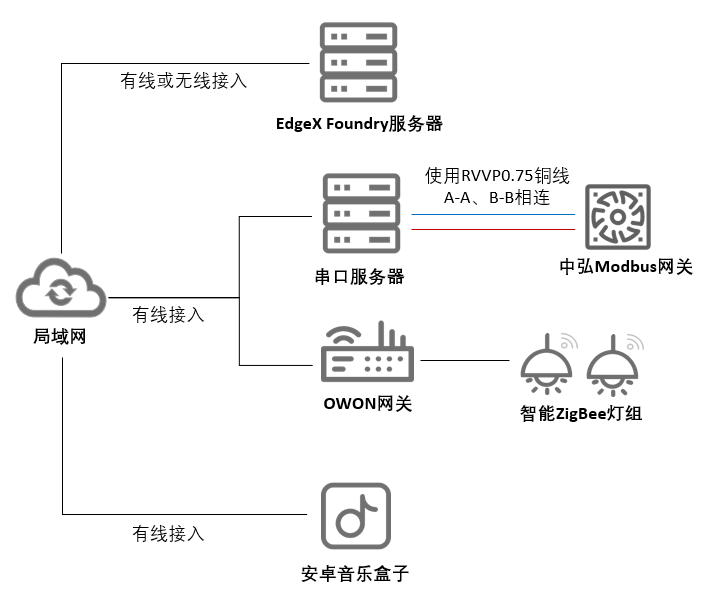
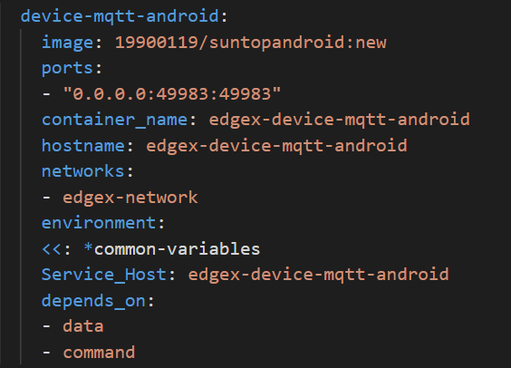
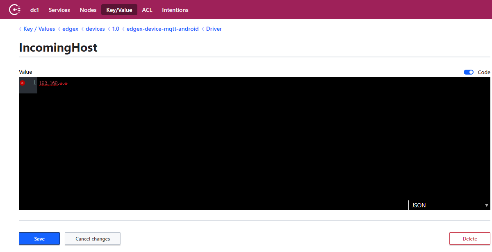
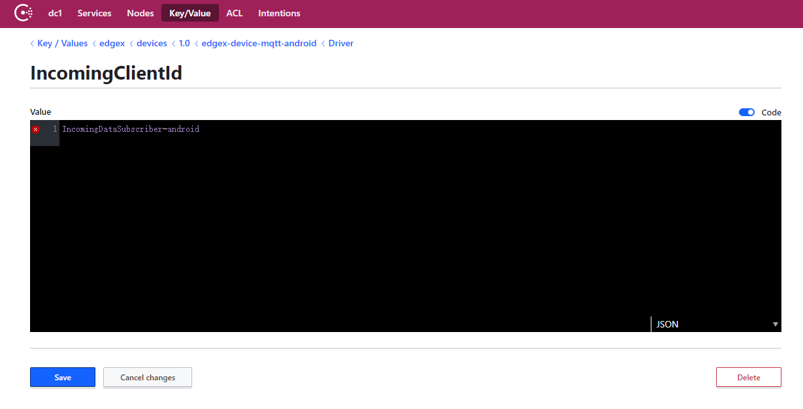
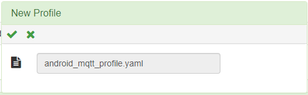

[TOC]

在IoT项目的架构中，EdgeX Foundry为边缘端智能设备提供了一种安全、高效的接入方式。本文档介绍了EdgeX Foundry软件的部署过程，包括所使用的硬件设备、部署前准备、具体操作步骤以及部署后的配置。

## 一、硬件设备
| 设备 | 规格/型号 |
| --- | --- |
| EdgeX Foundry服务器 （Intel边缘设备） | 8G Intel (R) Core (TM) i7-7700HQ CPU @ 2.80GHz   OS：Ubuntu 16.04 |
| 中弘Modbus网关 | B17X2RT |
| RS485串口服务器 | ZX-S508D |
| OWON网关 | SEG-X1 |
| 智能ZigBee灯组 | FNB56-ZCW39GD1.1 |
| 安卓音乐盒子 | audio_2021309_Rk3288 |

## 二、前提条件
开始部署前，请确认满足以下条件：
- 已按照如下示意图安装好相关的硬件设备：
  
   

- 已在EdgeX Foundry服务器上安装下表中的软件：
    | 软件包名称 | 版本要求 |
    | --- | --- |
    | docker | 18.09.7或以上 |
    | docker-compose | 1.29.1或以上 |

- 已获取以下配置文件：

    docker-compose.yml
    owon_mqtt_profile.yaml
    zhonghong_modbus_profile.yaml

遇到问题请联系慧博云通技术支持。

## 三、部署EdgeX Foundry

1. 使用root用户登录EdgeX Foundry服务器。

2. 进入/root目录：

    `cd /root`

3. 使用WinSCP将**docker-compose.yml**文件放入root目录。

4. 启动EdgeX Foundry进程：

    `docker-compose up -d`

5. 查看EdgeX Foundry服务是否启动成功：

    `docker-compose ps`

- 如果命令回显中所有容器的状态均为**up**，则EdgeX Foundry服务启动成功。

    

- 如果存在状态为**exit**的容器，执行**docker start**命令尝试启动。

    

若仍然无法启动，执行**docker logs**命令查看日志，并将日志发送给慧博云通技术支持进行分析定位。

## 四、配置串口服务器

1. 使用浏览器访问http://{串口服务器IP地址}/cgi-bin/luci。

2. 输入用户名密码登录串口服务器web管理界面。

3. 根据下图，配置服务器端口信息，本示例中配置**PORT 8**。

    **本地端口**设置为**4008**。

## 五、适配OWON网关

1. 使用浏览器进入http://{EdgeX Foundry IP地址}:8500/ui/dc1/kv/edgex/devices/1.0/edgex-device-   

    mqtt/Driver。

2. 修改**IncomingHost**为EdgeX Foundry的IP地址。

3. 修改**ResponseHost**为EdgeX Foundry的IP地址。

4. 修改**IncomingTopic**为**device/{deviceId}/report**。

    其中**{deviceId}**是OWON网关的MAC地址。

5. 修改**ResponseTopic**为**reply/device/{deviceId}/{appclientId}**。

    **{deviceId}**是OWON网关的MAC地址，**{appclientId}**是自定义的标识符。

6. 上传OWON网关信息配置文件。

    (1). 使用浏览器进入http://{EdgeX Foundry IP地址}:4000/并登录。

**注意：**
如果是首次登录，系统会要求您设置用于登录的用户名密码。本示例中用户名和密码均为admin。

    

(2). 修改**owon_mqtt_profile.yaml**配置文件，把设备的MAC地址全部替换为当前环境灯的MAC地址。
例如：**switch_08F02004008D1500**，需要将**08F02004008D1500**替换为实际的MAC地址。
您可以从灯的设备信息中获取该MAC地址。
(3). 点击**Device Profile**下面的**+**号，上传OWON网关信息的配置文件。

(4). 点击**Devices**下面的**+**号，添加OWON网关设备信息。

**Schema**：**tcp**
**Host**：EdgeX Foundry服务器的IP地址
**Port**：MQTT服务的端口号，此处为**1883**
**Clientid**：**clientid**
**Topic**：**api/device/{deviceId}/{appclientId}**

其中**{deviceId}**是OWON网关的MAC地址，**{appclientId}**是自定义的标识符。

(5). 重启edgex-device-mqtt容器使配置生效：

`docker restart edgex-device-mqtt`

## 六、适配中弘Modbus网关

1. 使用浏览器进入http://{EdgeX Foundry IP地址}:4000/。

2. 编辑**zhonghong_modbus_profile.yaml**配置文件，将空调地址全部修改为当前环境的实际地址。

    Get命令的地址需要替换为空调**状态**寄存器的地址，Set命令的地址需要替换为**控制**寄存器的地址。

    例如，在PowerGet_193，需要将193替换成实际的状态寄存器地址；在TemperatureSet_4130中，                                                                                 

    需要将4130替换成实际的控制寄存器地址。   

    **状态**寄存器计算方法：(AA×32 + BB) ×6 + 1

    **控制**寄存器计算方法：(AA×32 + BB) × 4 + 4001

    其中AA和BB的值可从中弘空调的web管理界面获取，如下图所示。详情请参考中弘官方文档《室外

    机网关使用手册》。

3. 点击**Device Profile**下面的+号，上传中弘Modbus网关信息的配置文件。

4. 点击**Devices**下面的**+**号，添加中弘Modbus网关设备的信息。

    **Address**：串口服务器的IP地址

    **Port**：串口服务器的端口号，此处设置为**4008**
此端口号需要与串口服务器中的配置保持一致，详情参考“配置串口服务器”中的步骤3。

    **UnitID**：中弘Modbus网关管理页面中配置的设备地址，本示例中设置为1

    

下图是中弘Modbus网关的管理页面，可从该页面获取设备地址，详情请参考中弘官方文档《室外  

 机网关使用手册》。

## 七、适配安卓盒子

1. 将安卓盒子连接到EdgeX Foundry服务器的MQTT Broker上。
2. 使用root用户登录EdgeX Foundry服务器。
3. 进入/root目录：
    `cd /root`

4. 检查**docker-compose.yml**文件，确保文件包含安卓盒子的配置，如下图所示：

 
5. 启动安卓服务的容器：
   `docker-compose up -d device-mqtt-android`

6. 使用浏览器进入http://{EdgeX Foundry IP地址}:8500/ui/dc1/kv/edgex/devices/1.0/edgex-device-mqtt-android/Driver/。

7. 修改**IncomingHost**为EdgeX Foundry的IP地址。

 
8. 修改**ResponseHost**为EdgeX Foundry的IP地址。
   
 

9. 修改**IncomingTopic**和**ResponseTopic**为**api/android/{type}/{brand_id}/{mac}**。
- **brand_id**：品牌ID
- **mac**：安卓盒子的MAC地址
- **type**：设备类型，取值如下：
    **VIDEO**：广告屏
    **SVIDEO**：同步屏
    **AI**：互动屏
    **AUDIO**：音乐盒子

10. 修改**IncomingClientId**为**IncomingDataSubscriber-android**。

11. 修改**ResponseClientId**为**CommandResponseSubscriber-android**。
12. 上传安卓盒子信息配置文件。
    (1) 使用浏览器进入http://{EdgeX Foundry IP地址}:4000/。
    (2) 点击**Device Profile**下面的**+**号，上传Android盒子的配置文件。
    
 
    (3) 点击**Devices**下面的**+**号，添加Android盒子信息。
        - **Schema**：**tcp**
        - **Host**：EdgeX Foundry服务器的IP地址
        - **Port**：MQTT服务的端口号，此处为**1883**
        - **Clientid**：**clientid**
        - **Topic**：**api/android/{type}/{brand_id}/{mac}**
            其中，**brand_id**是品牌ID，**mac**是安卓盒子的MAC地址，**type**是设备类型
            **type**取值：
            **VIDEO**：广告屏
            **SVIDEO**：同步屏
            **AI**：互动屏
            **AUDIO**：音乐盒子
13. 重启**edgex-device-mqtt-android**容器使配置生效：

     `docker restart edgex-device-mqtt-android`