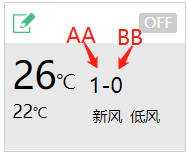

## 5. 附录
### 5.1 响应公共参数
下表列出了API响应中readings字段下的公共参数：
| 名称 | 参数类型 | 说明 |
| --- | --- | --- |
| origin | int	| 请求编号 |
| device | string | 设备名称|
| name	| string | 操作命令| 
| valueType	| string | value字段的类型| 

### 响应公共参数
下表列出了MQTT接口响应中的公共参数：
|     名称          |     参数类型      |     说明                                                                                                                 |
|-----------------------|-------------------| -------|
|     requestUUid       |     String        |     返回请求的唯一标识 |
|     edgexCode         |     String        |     EdgeXFoundry的返回码，标识EdgexFoundry是否成功处理请求。<br>若成功则返回“200”；若失败则返回相对应的返回码。详情请参考[5.2 返回码](#52-返回码)。        |
|     edgexMsg          |     String        |     EdgeXFoundry的响应信息，描述EdgexFoundry处理请求的结果。<br>若成功则返回“Edgex端处理请求成功!”；若失败则返回相对应的错误描述。    |
|     edgexbody         |     JSON对象      |     EdgexFoundry处理请求后所返回的数据。在GET请求中，该参数返回所请求的信息。在PUT请求中，该参数为空。                             | 


### 5.2 返回码
**正常时的返回码**
| 返回码 | 说明 |
| --- | --- |
| 200	| 请求成功。|
| 204	| 请求成功，但无返回信息。|
**异常时的返回码**
| 返回码 | 说明 |
| --- | --- |
| 404	| 无法找到所请求的对象。| 
| 500	| 请求未完成，服务器异常。| 
| 503	| 请求失败，服务不可用。| 

###  5.3 颜色代码转换
colorX：int类型，CIE XYZ颜色空间中的x值。
colorY：int类型，CIE XYZ颜色空间中的y值。

colorX与colorY 转换成rgb 值的公式如下：

```html
//X, Y and Z input refer to a D65/2° standard illuminant.
//sR, sG and sB (standard RGB) output range = 0 ÷ 255

x=colorX / 65536（colorX：范围为0-65279）
y=colorY / 65536（colorY：范围为0-65279）
Y = b*100/255.0 （b为亮度值）
X = x * ( Y / y )
Z = ( 1 - x - y ) * ( Y / y )
var_X = X / 100
var_Y = Y / 100
var_Z = Z / 100
var_R = var_X * 3.2406 + var_Y * -1.5372 + var_Z * -0.4986
var_G = var_X * -0.9689 + var_Y * 1.8758 + var_Z * 0.0415
var_B = var_X * 0.0557 + var_Y * -0.2040 + var_Z * 1.0570
if ( var_R > 0.0031308 )
    var_R = 1.055 * ( var_R ^ ( 1 / 2.4 ) ) - 0.055
else
    var_R = 12.92 * var_R
if ( var_G > 0.0031308 )
    var_G = 1.055 * ( var_G ^ ( 1 / 2.4 ) ) - 0.055
else
    var_G = 12.92 * var_G
if ( var_B > 0.0031308 )
    var_B = 1.055 * ( var_B ^ ( 1 / 2.4 ) ) - 0.055
else
    var_B = 12.92 * var_B
sR = var_R * 255
sG = var_G * 255
sB = var_B * 255
```

### 5.4 空调的状态寄存器和控制寄存器地址计算
GET请求中需要传入空调的状态寄存器地址，SET请求中需要传入空调的控制寄存器地址。

- 状态寄存器的计算方法：(AA×32 + BB) ×6 + 1
- 控制寄存器的计算方法：(AA×32 + BB) × 4 + 4001

其中AA和BB的值可从中弘空调的web管理界面获取，如下图所示。详情请参考中弘官方文档《室外机网关使用手册》。

